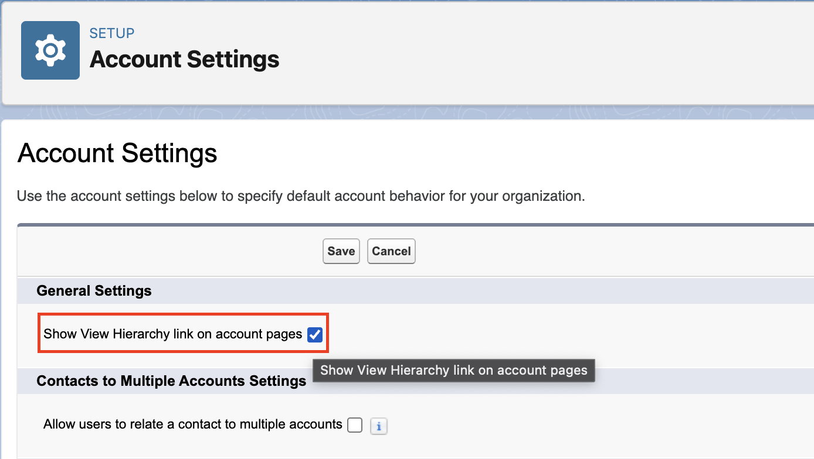
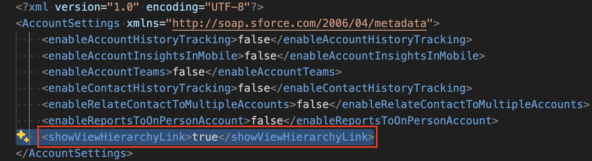
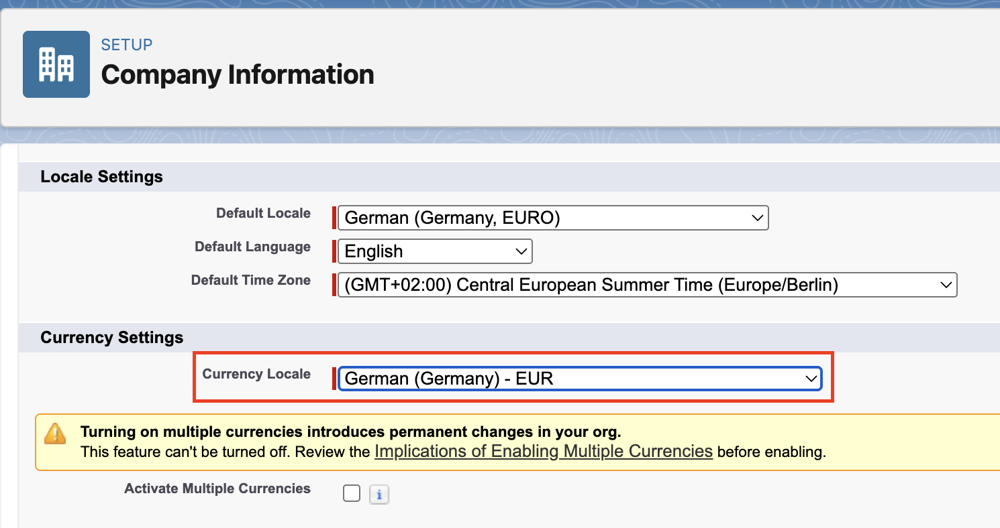

# sfdx-browserforce-plugin

> sf plugin to apply settings in the Salesforce Setup Menu using browser automation

[](https://www.npmjs.com/package/sfdx-browserforce-plugin)
[](https://www.npmjs.com/package/sfdx-browserforce-plugin)
[](https://www.npmjs.com/package/sfdx-browserforce-plugin)
[](https://github.com/amtrack/sfdx-browserforce-plugin/actions?query=branch:main)
[](https://amtrack.github.io/sfdx-browserforce-plugin/)
[](https://github.com/amtrack/sfdx-browserforce-plugin/stargazers)
[](https://github.com/amtrack/sfdx-browserforce-plugin/graphs/contributors)
[](https://github.com/amtrack/sfdx-browserforce-plugin/blob/main/LICENSE)
[](https://github.com/amtrack/sfdx-browserforce-plugin/blob/main/CONTRIBUTING.md)

📖 **Documentation: [amtrack.github.io/sfdx-browserforce-plugin](https://amtrack.github.io/sfdx-browserforce-plugin/)**

> **Note:** Since v6 we're using Playwright instead of Puppeteer. Please see the [release notes](https://github.com/amtrack/sfdx-browserforce-plugin/releases) for migration instructions.

✅ Most settings in the Salesforce Setup Menu are represented as [Settings](https://developer.salesforce.com/docs/atlas.en-us.api_meta.meta/api_meta/meta_settings.htm) in the Metadata API.

For example, the highlighted checkbox "Show View Hierarchy link on account pages" in Account Settings is indeed represented in the Metadata `AccountSettings` as `showViewHierarchyLink`.

|                                                                                   |                                                                   |
| --------------------------------------------------------------------------------- | ----------------------------------------------------------------- |
|  |  |

⚡ **BUT**

> Not all feature settings are available in the Metadata API. See [Unsupported Metadata Types](https://developer.salesforce.com/docs/atlas.en-us.api_meta.meta/api_meta/meta_unsupported_types.htm) for information on which feature settings are not available.
>
> Source: [Metadata API Developer Guide | Settings](https://developer.salesforce.com/docs/atlas.en-us.api_meta.meta/api_meta/meta_settings.htm)

For example, the Currency Locale in `Setup -> Company Settings -> Company Information` is not represented in any Metadata.



👉 This is where Browserforce (sfdx-browserforce-plugin) comes to the rescue. It fills this gap by applying these unsupported settings through browser automation!

## Example

To change the Currency Locale, the Browserforce config file (here: `./config/currency.json`) looks like this:

```json
{
  "$schema": "https://raw.githubusercontent.com/amtrack/sfdx-browserforce-plugin/main/src/plugins/schema.json",
  "settings": {
    "companyInformation": {
      "defaultCurrencyIsoCode": "English (South Africa) - ZAR"
    }
  }
}
```

Apply the config:

```console
$ sf browserforce apply -f ./config/currency.json --target-org myOrg@example.com
  logging in... done
  Applying config file ./config/currency.json to org myOrg@example.com
  [CompanyInformation] retrieving state... done
  [CompanyInformation] changing 'defaultCurrencyIsoCode' to '"English (South Africa) - ZAR"'... done
  logging out... done
```

Apply the config again: 👉 No action necessary

```console
$ sf browserforce apply -f ./config/currency.json --target-org myOrg@example.com
  logging in... done
  Applying config file ./config/currency.json to org myOrg@example.com
  [CompanyInformation] retrieving state... done
  [CompanyInformation] no action necessary
  logging out... done
```

## Environment variables in config files

A value written exactly as `"${VARIABLE_NAME}"` is read from the environment variable `VARIABLE_NAME` when running `sf browserforce apply`. Use it to keep secrets out of config files, for example in a CI pipeline:

```json
{
  "settings": {
    "authProviders": {
      "MyAuthProvider": {
        "consumerKey": "my-consumer-key",
        "consumerSecret": "${MY_AUTH_PROVIDER_SECRET}"
      }
    }
  }
}
```

- The value is converted to the type the setting expects: `true`/`false` for a checkbox, a number, or JSON for a list or an object.
- A variable that is not set, or empty, stops the command before logging in, naming the setting and the variable.
- Values coming from environment variables are shown as `****` in the output.
- Only a value that is exactly `${NAME}` is replaced: `"prefix-${NAME}"` stays as written.
- To keep the literal text `${NAME}` as a value, write `$${NAME}`.

## Describe and validate settings without an org

- `sf browserforce plugins list --json` describes every setting: its documentation page (`docUrl`), its JSON Schema, its fields, examples, and warnings (irreversible changes, Classic-only features, org prerequisites). Tools building Browserforce configurations, like [sfdx-hardis](https://sfdx-hardis.cloudity.com/) deployment actions, read it.
- `sf browserforce plugins validate -f ./config/currency.json` checks a config file and reports each error with its path and the documentation page of the setting. Environment variable references are accepted and listed.
- `sf browserforce apply --json` returns the planned changes of each setting (applied, or only planned with `--dry-run`), with secrets and values from environment variables masked.

## Key Concepts

- 🔧 configuration using JSON Schema (similar to the [Scratch Org Definition Configuration](https://developer.salesforce.com/docs/atlas.en-us.sfdx_dev.meta/sfdx_dev/sfdx_dev_scratch_orgs_def_file.htm))
- 🧠 idempotency of the `apply` command only applies what's necessary and allows re-execution (concept similar to [terraform](https://www.terraform.io/docs/commands/apply.html))
- 🏎️ browser automation powered by Playwright, [learn more about Playwright and Browserforce](https://amtrack.github.io/sfdx-browserforce-plugin/troubleshooting/)

## Supported Browserforce Settings

Top settings:

- Change Currency Locale
- Delete inactive record types
- Replace (and delete) picklist values
- Manage (create/modify/delete) Field Dependencies on CustomFields
- Set Email Deliverability Access Level to "No access", "System email only" and "All email"
- Enable the 'Sales Cloud for Slack' Slack App
- Change active Lightning Theme
- Import certificates from a keystore in Java Keystore (JKS) format

But there's more:

- Please see the [Settings](https://amtrack.github.io/sfdx-browserforce-plugin/settings/) reference of the documentation, with screenshots and examples for each setting.
- Explore the JSON schema powered configuration using a [full-blown example](https://github.dev/amtrack/sfdx-browserforce-plugin/blob/main/examples/full.json) or start with an [empty configuration](https://github.dev/amtrack/sfdx-browserforce-plugin/blob/main/examples/empty.json).

## Installation

```shell
sf plugins install sfdx-browserforce-plugin
```

> **Important:** Playwright does not come with a browser automatically

You might need to install a browser explicitly or configure Browserforce to use an existing browser.

> **Tip:** If you're using Browserforce on GitHub Actions with the `ubuntu-latest` (v24) Docker image, we can use the preinstalled Google Chrome automatically.
> No further configuration and installation needed, because the `CHROME_BIN` environment variable is already set.

### Option 1: Install a browser using our Playwright wrapper command

```shell
sf browserforce playwright -- install chromium
```

> **Important:** The two hyphens `--` are intentional and separate the sf command from the arguments to be passed to the playwright executable.

### Option 2: Configure Browserforce to use an existing browser

You can use any of the following environment variables:

```shell
BROWSERFORCE_BROWSER_CHANNEL="chrome"
BROWSERFORCE_BROWSER_CHANNEL="chromium"
BROWSERFORCE_BROWSER_EXECUTABLE_PATH="/usr/bin/google-chrome"
CHROME_BIN="/usr/bin/google-chrome"
```

## Commands

<!-- commands -->
* [`sf browserforce apply`](#sf-browserforce-apply)
* [`sf browserforce playwright`](#sf-browserforce-playwright)
* [`sf browserforce plugins list`](#sf-browserforce-plugins-list)
* [`sf browserforce plugins validate`](#sf-browserforce-plugins-validate)

## `sf browserforce apply`

apply a plan from a config file

```
USAGE
  $ sf browserforce apply -o <value> [--json] [--flags-dir <value>] [-f <value>] [-d] [--headless] [--slow-mo <value>]
    [--timeout <value>] [--trace] [--browser-executable-path <value>] [--browser-channel <value>] [--max-retries
    <value>] [--retry-timeout <value>]

FLAGS
  -d, --dry-run                 [env: BROWSERFORCE_DRY_RUN] dry run
  -f, --definitionfile=<value>  path to a browserforce config file
  -o, --target-org=<value>      (required) Username or alias of the target org. Not required if the `target-org`
                                configuration variable is already set.

BROWSER CONFIGURATION FLAGS
  --browser-channel=<value>          [env: BROWSERFORCE_BROWSER_CHANNEL] the channel (e.g. chromium or chrome) to use
  --browser-executable-path=<value>  [env: BROWSERFORCE_BROWSER_EXECUTABLE_PATH] the path to a browser executable
  --[no-]headless                    [env: BROWSERFORCE_HEADLESS] run in headless mode (default: true)
  --slow-mo=<value>                  [env: BROWSERFORCE_SLOWMO] slow motion in milliseconds (default: 0)
  --timeout=<value>                  [default: 90000, env: BROWSERFORCE_NAVIGATION_TIMEOUT_MS] the default navigation
                                     timeout in milliseconds
  --trace                            [env: BROWSERFORCE_TRACE] create a Playwright trace file

GLOBAL FLAGS
  --flags-dir=<value>  Import flag values from a directory.
  --json               Format output as json.

RETRY CONFIGURATION FLAGS
  --max-retries=<value>    [default: 6, env: BROWSERFORCE_RETRY_MAX_RETRIES] the maximum number of retries for retryable
                           actions
  --retry-timeout=<value>  [default: 4000, env: BROWSERFORCE_RETRY_TIMEOUT_MS] the inital timeout in milliseconds for
                           retryable actions (exponentially increased)

DESCRIPTION
  apply a plan from a config file

  With --json, the result lists each setting in the order applied, with its planned changes (secrets and values from
  environment variables shown as ****, null when no action is necessary) and whether they were applied.

EXAMPLES
  $ sf browserforce apply -f ./config/currency.json --target-org myOrg@example.com
    logging in... done
    Applying config file ./config/currency.json to org myOrg@example.com
    [CompanyInformation] retrieving state... done
    [CompanyInformation] changing 'defaultCurrencyIsoCode' to '"English (South Africa) - ZAR"'... done
    logging out... done
  

FLAG DESCRIPTIONS
  -d, --dry-run  dry run

    Retrieve the config and show the diff, but don't apply it.

  --browser-channel=<value>  the channel (e.g. chromium or chrome) to use

    Playwright will try to figure out the path to the browser executable automatically.

  --browser-executable-path=<value>  the path to a browser executable

    Note: The environment variable CHROME_BIN can also be used. On GitHub Actions with ubuntu-latest, CHROME_BIN is set
    to /usr/bin/google-chrome.

  --trace  create a Playwright trace file

    The trace file can be viewed with "sf browserforce playwright -- show-trace trace-<date>.zip".
```

_See code: [src/commands/browserforce/apply.ts](https://github.com/amtrack/sfdx-browserforce-plugin/blob/main/src/commands/browserforce/apply.ts)_

## `sf browserforce playwright`

access the Playwright CLI

```
USAGE
  $ sf browserforce playwright

DESCRIPTION
  access the Playwright CLI

EXAMPLES
  $ sf browserforce playwright -- --help

  $ sf browserforce playwright -- --version

  $ sf browserforce playwright -- install --list

  $ sf browserforce playwright -- install chromium
```

_See code: [src/commands/browserforce/playwright.ts](https://github.com/amtrack/sfdx-browserforce-plugin/blob/main/src/commands/browserforce/playwright.ts)_

## `sf browserforce plugins list`

list the settings Browserforce can apply

```
USAGE
  $ sf browserforce plugins list [--json] [--flags-dir <value>]

GLOBAL FLAGS
  --flags-dir=<value>  Import flag values from a directory.
  --json               Format output as json.

DESCRIPTION
  list the settings Browserforce can apply

  Describe every setting (plugin) that can be used under "settings" in a Browserforce config file, without connecting to
  an org.

  With --json, each setting comes with its documentation page (docUrl), its JSON Schema, a flat list of its fields ready
  to be prompted, examples, and warnings (irreversible changes, Classic-only features, org prerequisites). The settings
  that have been removed are listed with their migration instructions.

  This output is meant for tools building Browserforce configurations, like sfdx-hardis deployment actions. Its
  "formatVersion" only changes when a field is removed or renamed.

EXAMPLES
  $ sf browserforce plugins list

  $ sf browserforce plugins list --json
```

_See code: [src/commands/browserforce/plugins/list.ts](https://github.com/amtrack/sfdx-browserforce-plugin/blob/main/src/commands/browserforce/plugins/list.ts)_

## `sf browserforce plugins validate`

validate a Browserforce config without connecting to an org

```
USAGE
  $ sf browserforce plugins validate [--json] [--flags-dir <value>] [-f <value>] [--config <value>]

FLAGS
  -f, --definitionfile=<value>  path to a browserforce config file
      --config=<value>          browserforce config as a JSON string

GLOBAL FLAGS
  --flags-dir=<value>  Import flag values from a directory.
  --json               Format output as json.

DESCRIPTION
  validate a Browserforce config without connecting to an org

  Check a config file, or inline JSON, against the schemas of all settings and report every error with its path and the
  documentation page of the setting. Removed settings are reported with their migration instructions.

  Values written as "${VAR}" are accepted in place of any value: they are environment variable references that
  "browserforce apply" resolves and checks before logging in. They are listed in the result. Write "${VAR}" to keep the
  literal text "${VAR}".

  The command exits with code 1 when the config is invalid; with --json, the result still lists the errors.

EXAMPLES
  $ sf browserforce plugins validate -f ./config/currency.json

  $ sf browserforce plugins validate --config '{"settings":{"densitySettings":{"density":"Compact"}}}' --json
```

_See code: [src/commands/browserforce/plugins/validate.ts](https://github.com/amtrack/sfdx-browserforce-plugin/blob/main/src/commands/browserforce/plugins/validate.ts)_
<!-- commandsstop -->

## Playwright

We use [Playwright](https://playwright.dev/) for browser automation.

For more information on browser automation best practices, see the [Playwright documentation](https://github.com/amtrack/sfdx-browserforce-plugin/blob/main/docs/PLAYWRIGHT.md).

## Alternative Installation

You can also install the `sfdx-browserforce-plugin` NPM package without `sf`. The package exports a `sfdx-browserforce-plugin` executable:

Example:

```shell
npm install --save-dev sfdx-browserforce-plugin
npx sfdx-browserforce-plugin browserforce -h
```

## Troubleshooting

More in [Troubleshooting](https://amtrack.github.io/sfdx-browserforce-plugin/troubleshooting/), including how to watch or record what the browser does.

If no browser is installed or launching fails, you'll get an error message from Playwright with a suggestion.

Typically this will guide you to install a browser.
If you've installed sfdx-browserforce-plugin using `sf`, you can replace the following:

```diff
- npx playwright install chromium
+ sf browserforce playwright -- install chromium
```

## Contributing

Please see [CONTRIBUTING.md](CONTRIBUTING.md) for getting started.

## Sponsors

- [PARX](https://www.parx.com)
- [IPfolio](https://www.ipfolio.com)

## License

MIT © [Matthias Rolke](mailto:mr.amtrack@gmail.com)
