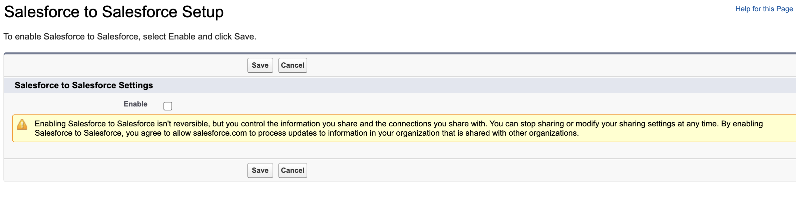
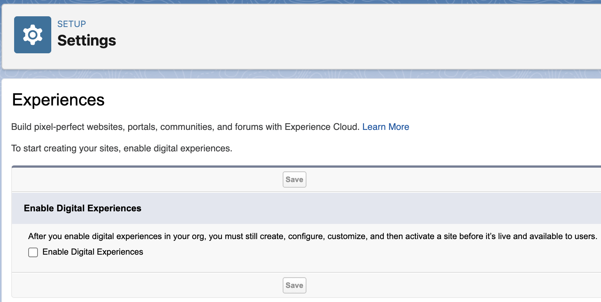
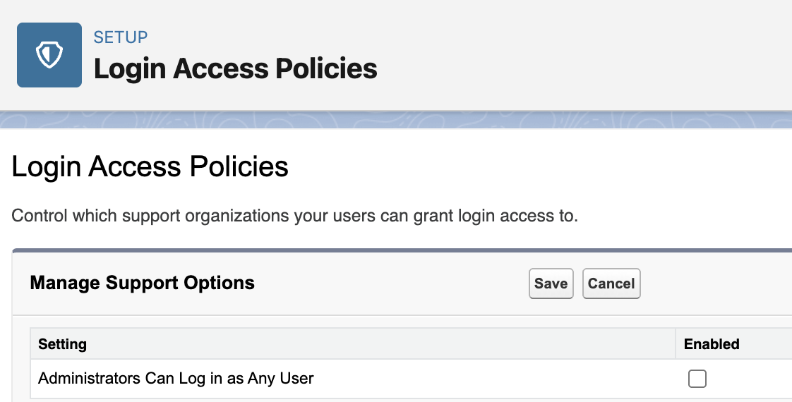
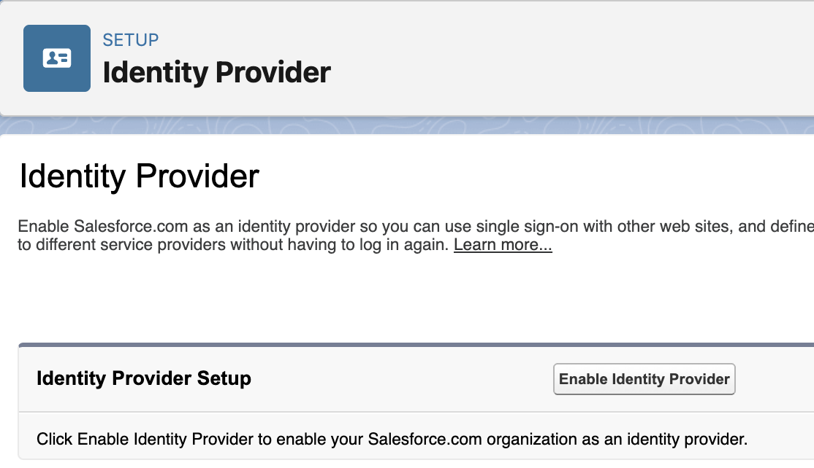
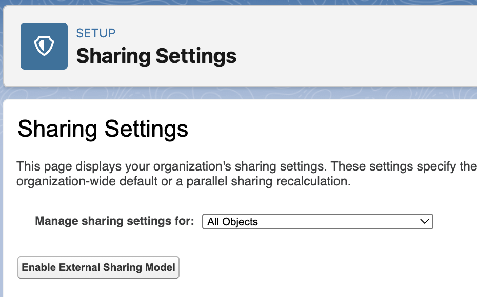
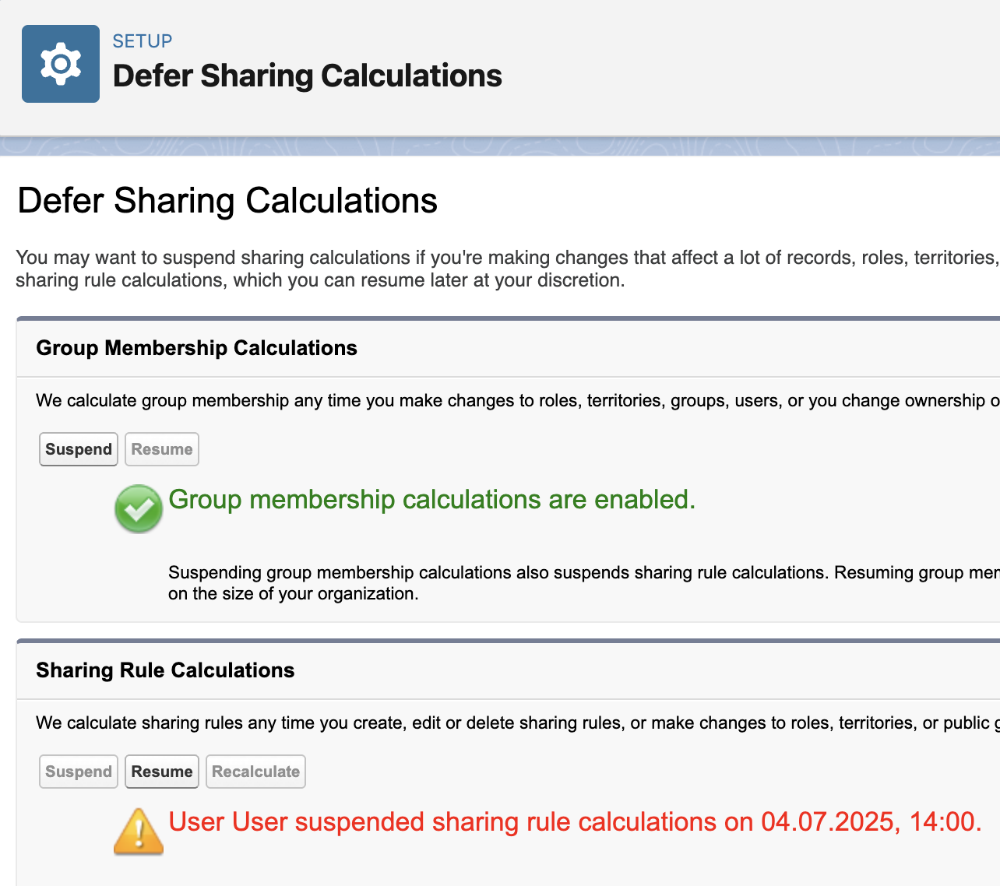

# Hall of Fame

!!! success "Gaps closed in the Metadata API"

    Fortunately Salesforce has closed some gaps in the Metadata API. 🎉

    Where previously browser automation was needed, you can now apply the setting using your Scratch Org Definition File or a deployment. ✅

Here's a list of settings that have been removed from sfdx-browserforce-plugin, most of them in favor of the Metadata API.
When a config file still uses one of them, `sf browserforce apply` and `sf browserforce plugins validate` stop with a link to its section below.

## SalesforceToSalesforce { #salesforcetosalesforce }

!!! warning "Retired by Salesforce"

    Unlike the other entries, this setting was not replaced by the Metadata API.
    Salesforce is retiring Salesforce to Salesforce entirely (full retirement in Spring '27).

- 🔗 Salesforce Setup Menu: Salesforce to Salesforce Settings (`/_ui/s2s/ui/PartnerNetworkEnable/e`)
- 👉 Checkbox "Enable"
- 🚀 implemented in [sfdx-browserforce-plugin@0.2.0](https://github.com/amtrack/sfdx-browserforce-plugin/releases/tag/v0.2.0) January 2018
- ⚰️ retired by Salesforce: [Salesforce-to-Salesforce Retirement](https://help.salesforce.com/s/articleView?id=005103355&type=1) (can no longer be enabled in new orgs, full retirement in Spring '27)
- ❌ removed in [sfdx-browserforce-plugin@7.0.0](https://github.com/amtrack/sfdx-browserforce-plugin/releases/tag/v7.0.0) November 2026



Deprecated `browserforce-config.json`:

```json
{
  "$schema": "https://github.com/amtrack/sfdx-browserforce-plugin/blob/v6.5.0/src/plugins/schema.json",
  "settings": {
    "salesforceToSalesforce": {
      "enabled": true
    }
  }
}
```

There is no direct replacement. Salesforce recommends these alternatives, depending on the use case:

- **Partner Cloud**: sharing and collaboration with sales partners
- **Data Cloud One**: unifying data across your company's Salesforce orgs
- **MuleSoft Anypoint**: complex integrations across Salesforce and other systems
- **MuleSoft for Flow**: low-code integrations built in Flow Builder (requires an add-on)

Remove the `salesforceToSalesforce` entry from your `browserforce-config.json`.

## Communities { #communities }

- 🔗 Salesforce Setup Menu: Feature Settings > Digital Experiences > Settings (`/lightning/setup/NetworkSettings/home`)
- 👉 Checkbox "Enable Digital Experiences"
- 🚀 implemented in [sfdx-browserforce-plugin@1.2.0](https://github.com/amtrack/sfdx-browserforce-plugin/releases/tag/v1.2.0) March 2019
- ✅ supported in Metadata [CommunitiesSettings](https://developer.salesforce.com/docs/atlas.en-us.api_meta.meta/api_meta/meta_communitiessettings.htm) `enableNetworksEnabled` since Salesforce API v47.0 (Winter '20)
- ❌ removed in [sfdx-browserforce-plugin@5.0.0](https://github.com/amtrack/sfdx-browserforce-plugin/releases/tag/v5.0.0) July 2025



Deprecated `browserforce-config.json`:

```json
{
  "$schema": "https://github.com/amtrack/sfdx-browserforce-plugin/blob/v4.8.2/src/plugins/schema.json",
  "settings": {
    "communities": {
      "enabled": true
    }
  }
}
```

For Scratch Orgs, please use a `config/project-scratch-def.json` like this:

```json
{
  "orgName": "Browserforce",
  "edition": "Developer",
  "language": "en_US",
  "features": ["Communities"],
  "settings": {
    "communitiesSettings": {
      "enableNetworksEnabled": true
    }
  }
}
```

For Sandbox and Production orgs, enable the setting using an explicit deployment:

```shell
sf project deploy start --source-dir unpackaged
```

`unpackaged/settings/Communities.settings-meta.xml`:

```xml
<?xml version="1.0" encoding="UTF-8"?>
<CommunitiesSettings xmlns="http://soap.sforce.com/2006/04/metadata">
    <enableNetworksEnabled>true</enableNetworksEnabled>
</CommunitiesSettings>
```

## Security LoginAccessPolicies administratorsCanLogInAsAnyUser { #security-loginaccesspolicies-administratorscanloginasanyuser }

- 🔗 Salesforce Setup Menu: Security > Login Access Policies (`/partnerbt/loginAccessPolicies.apexp`)
- 👉 Checkbox "Administrators Can Log in as Any User"
- 🚀 implemented in [sfdx-browserforce-plugin@0.3.0](https://github.com/amtrack/sfdx-browserforce-plugin/releases/tag/v0.3.0) February 2018
- ✅ supported in Metadata [SecuritySettings](https://developer.salesforce.com/docs/atlas.en-us.api_meta.meta/api_meta/meta_securitysettings.htm) `enableAdminLoginAsAnyUser` since Salesforce API v47.0 (Winter '20)
- ❌ removed in [sfdx-browserforce-plugin@5.0.0](https://github.com/amtrack/sfdx-browserforce-plugin/releases/tag/v5.0.0) July 2025



Deprecated `browserforce-config.json`:

```json
{
  "$schema": "https://github.com/amtrack/sfdx-browserforce-plugin/blob/v4.8.2/src/plugins/schema.json",
  "settings": {
    "security": {
      "loginAccessPolicies": {
        "administratorsCanLogInAsAnyUser": true
      }
    }
  }
}
```

For Scratch Orgs, please use a `config/project-scratch-def.json` like this:

```json
{
  "orgName": "Browserforce",
  "edition": "Developer",
  "language": "en_US",
  "features": [],
  "settings": {
    "securitySettings": {
      "enableAdminLoginAsAnyUser": true
    }
  }
}
```

For Sandbox and Production orgs, enable the setting using an explicit deployment:

```shell
sf project deploy start --source-dir unpackaged
```

`unpackaged/settings/Security.settings-meta.xml`:

```xml
<?xml version="1.0" encoding="UTF-8"?>
<SecuritySettings xmlns="http://soap.sforce.com/2006/04/metadata">
    <enableAdminLoginAsAnyUser>true</enableAdminLoginAsAnyUser>
</SecuritySettings>
```

## Security IdentityProvider { #security-identityprovider }

- 🔗 Salesforce Setup Menu: Identity > Identity Provider (`/lightning/setup/IdpPage/home`)
- 👉 Enable/Disable Identity Provider
- 🚀 implemented in [sfdx-browserforce-plugin@1.0.0](https://github.com/amtrack/sfdx-browserforce-plugin/releases/tag/v1.0.0) November 2018
- ✅ supported in Metadata [IdentityProviderSettings](https://developer.salesforce.com/docs/atlas.en-us.api_meta.meta/api_meta/meta_identityprovidersettings.htm) `enableIdentityProvider` since Salesforce API v57.0 (Spring '23)
- ❌ removed in [sfdx-browserforce-plugin@5.0.0](https://github.com/amtrack/sfdx-browserforce-plugin/releases/tag/v5.0.0) July 2025



Deprecated `browserforce-config.json`:

```json
{
  "$schema": "https://github.com/amtrack/sfdx-browserforce-plugin/blob/v4.8.2/src/plugins/schema.json",
  "settings": {
    "security": {
      "identityProvider": {
        "enabled": true,
        "certificate": "SelfSignedCert"
      }
    }
  }
}
```

Deploy a Certificate and the IdentityProviderSettings:

```console
$ tree unpackaged
unpackaged
├── certs
│   ├── identity_provider.crt
│   └── identity_provider.crt-meta.xml
└── settings
    └── IdentityProvider.settings-meta.xml

3 directories, 3 files
```

```shell
sf project deploy start --source-dir unpackaged
```

`unpackaged/settings/IdentityProvider.settings-meta.xml`:

```xml
<?xml version="1.0" encoding="UTF-8"?>
<IdentityProviderSettings xmlns="http://soap.sforce.com/2006/04/metadata">
    <certificateName>identity_provider</certificateName>
    <enableIdentityProvider>true</enableIdentityProvider>
</IdentityProviderSettings>
```

`unpackaged/certs/identity_provider.crt-meta.xml`:

```xml
<?xml version="1.0" encoding="UTF-8"?>
<Certificate xmlns="http://soap.sforce.com/2006/04/metadata">
    <caSigned>false</caSigned>
    <encryptedWithPlatformEncryption>false</encryptedWithPlatformEncryption>
    <keySize>2048</keySize>
    <masterLabel>identity_provider</masterLabel>
    <privateKeyExportable>true</privateKeyExportable>
</Certificate>
```

## Security Sharing { #security-sharing }

- 🔗 Salesforce Setup Menu: Security > Sharing Settings (`/lightning/setup/SecuritySharing/home`)
- 👉 Button "Enable External Sharing Model" / "Disable External Sharing Model"
- 🚀 implemented in [sfdx-browserforce-plugin@0.1.0](https://github.com/amtrack/sfdx-browserforce-plugin/releases/tag/v0.1.0) February 2018
- ✅ supported in Metadata [SharingSettings](https://developer.salesforce.com/docs/atlas.en-us.api_meta.meta/api_meta/meta_sharingsettings.htm) `enableExternalSharingModel` since Salesforce API v47.0 (Winter '20)
- ❌ removed in [sfdx-browserforce-plugin@5.0.0](https://github.com/amtrack/sfdx-browserforce-plugin/releases/tag/v5.0.0) July 2025



Deprecated `browserforce-config.json`:

```json
{
  "$schema": "https://github.com/amtrack/sfdx-browserforce-plugin/blob/v4.8.2/src/plugins/schema.json",
  "settings": {
    "security": {
      "sharing": {
        "enableExternalSharingModel": true
      }
    }
  }
}
```

For Scratch Orgs, please use a `config/project-scratch-def.json` like this:

```json
{
  "orgName": "Browserforce",
  "edition": "Developer",
  "language": "en_US",
  "features": [],
  "settings": {
    "sharingSettings": {
      "enableExternalSharingModel": true
    }
  }
}
```

For Sandbox and Production orgs, enable the setting using an explicit deployment:

```shell
sf project deploy start --source-dir unpackaged
```

`unpackaged/settings/Sharing.settings-meta.xml`:

```xml
<?xml version="1.0" encoding="UTF-8"?>
<SharingSettings xmlns="http://soap.sforce.com/2006/04/metadata">
    <enableExternalSharingModel>true</enableExternalSharingModel>
</SharingSettings>
```

## DeferSharingCalculation { #defersharingcalculation }

- 🔗 Salesforce Setup Menu: Security > Defer Sharing Calculations (`/lightning/setup/DeferSharingCalculations/home`)
- 👉 Button "Suspend" / "Resume"
- 🚀 implemented in [sfdx-browserforce-plugin@1.7.0](https://github.com/amtrack/sfdx-browserforce-plugin/releases/tag/v1.7.0) June 2020
- ✅ supported in Metadata [SharingSettings](https://developer.salesforce.com/docs/atlas.en-us.api_meta.meta/api_meta/meta_sharingsettings.htm) `deferSharingRules` since Salesforce API v49.0 (Summer '20)
- ❌ removed in [sfdx-browserforce-plugin@5.0.0](https://github.com/amtrack/sfdx-browserforce-plugin/releases/tag/v5.0.0) July 2025



Deprecated `browserforce-config.json`:

```json
{
  "$schema": "https://github.com/amtrack/sfdx-browserforce-plugin/blob/v4.8.2/src/plugins/schema.json",
  "settings": {
    "deferSharingCalculation": {
      "suspend": true
    }
  }
}
```

For Scratch Orgs, please use a `config/project-scratch-def.json` like this:

```json
{
  "orgName": "Browserforce",
  "edition": "Developer",
  "language": "en_US",
  "features": ["DeferSharingCalc"],
  "settings": {
    "sharingSettings": {
      "deferSharingRules": true
    }
  }
}
```

For Sandbox and Production orgs, enable the setting using an explicit deployment:

```shell
sf project deploy start --source-dir unpackaged/permissionsets
sf org assign permset -n Defer_Sharing
sf project deploy start --source-dir unpackaged/settings
```

`unpackaged/permissionsets/Defer_Sharing.permissionset-meta.xml`:

```xml
<?xml version="1.0" encoding="UTF-8"?>
<PermissionSet xmlns="http://soap.sforce.com/2006/04/metadata">
    <hasActivationRequired>false</hasActivationRequired>
    <label>Defer Sharing</label>
    <userPermissions>
        <enabled>true</enabled>
        <name>AssignPermissionSets</name>
    </userPermissions>
    <userPermissions>
        <enabled>true</enabled>
        <name>DeferSharingCalculations</name>
    </userPermissions>
    <userPermissions>
        <enabled>true</enabled>
        <name>DelegatedTwoFactor</name>
    </userPermissions>
    <userPermissions>
        <enabled>true</enabled>
        <name>FreezeUsers</name>
    </userPermissions>
    <userPermissions>
        <enabled>true</enabled>
        <name>ManageInternalUsers</name>
    </userPermissions>
    <userPermissions>
        <enabled>true</enabled>
        <name>ManageIpAddresses</name>
    </userPermissions>
    <userPermissions>
        <enabled>true</enabled>
        <name>ManageLoginAccessPolicies</name>
    </userPermissions>
    <userPermissions>
        <enabled>true</enabled>
        <name>ManagePasswordPolicies</name>
    </userPermissions>
    <userPermissions>
        <enabled>true</enabled>
        <name>ManageProfilesPermissionsets</name>
    </userPermissions>
    <userPermissions>
        <enabled>true</enabled>
        <name>ManageRoles</name>
    </userPermissions>
    <userPermissions>
        <enabled>true</enabled>
        <name>ManageSharing</name>
    </userPermissions>
    <userPermissions>
        <enabled>true</enabled>
        <name>ManageUsers</name>
    </userPermissions>
    <userPermissions>
        <enabled>true</enabled>
        <name>MonitorLoginHistory</name>
    </userPermissions>
    <userPermissions>
        <enabled>true</enabled>
        <name>ResetPasswords</name>
    </userPermissions>
    <userPermissions>
        <enabled>true</enabled>
        <name>ViewAllUsers</name>
    </userPermissions>
    <userPermissions>
        <enabled>true</enabled>
        <name>ViewRoles</name>
    </userPermissions>
    <userPermissions>
        <enabled>true</enabled>
        <name>ViewSetup</name>
    </userPermissions>
</PermissionSet>
```

`unpackaged/settings/Sharing.settings-meta.xml`:

```xml
<?xml version="1.0" encoding="UTF-8"?>
<SharingSettings xmlns="http://soap.sforce.com/2006/04/metadata">
    <deferSharingRules>true</deferSharingRules>
</SharingSettings>
```
