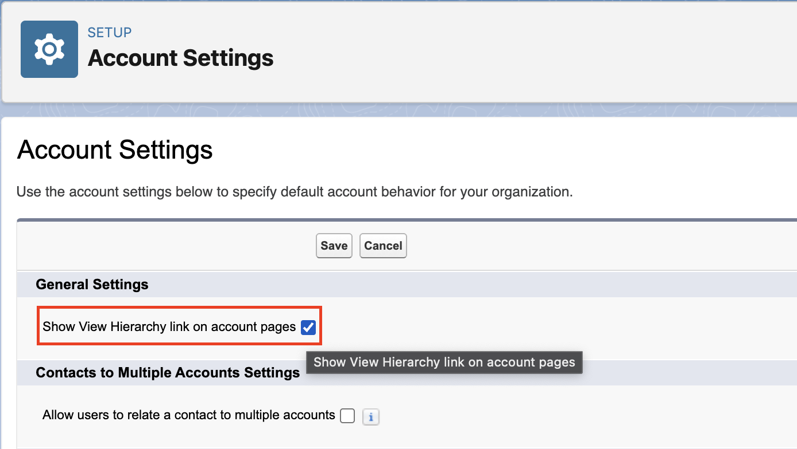
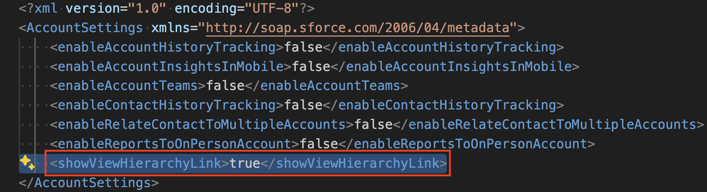
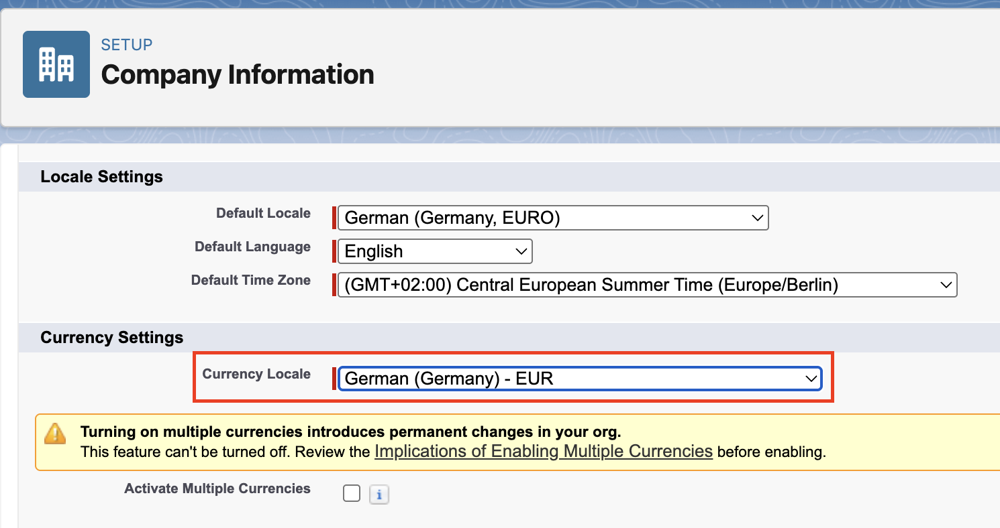

<!-- This file has been generated with command 'sf hardis:doc:plugin:generate'. Please do not update it manually or it may be overwritten -->
# sfdx-browserforce-plugin

> sf plugin to apply settings in the Salesforce Setup Menu using browser automation

[](https://www.npmjs.com/package/sfdx-browserforce-plugin)
[](https://www.npmjs.com/package/sfdx-browserforce-plugin)
[](https://www.npmjs.com/package/sfdx-browserforce-plugin)
[](https://github.com/amtrack/sfdx-browserforce-plugin/actions?query=branch:main)
[](https://amtrack.github.io/sfdx-browserforce-plugin/)
[](https://github.com/amtrack/sfdx-browserforce-plugin/stargazers)
[](https://github.com/amtrack/sfdx-browserforce-plugin/graphs/contributors)
[](https://github.com/amtrack/sfdx-browserforce-plugin/blob/main/LICENSE)
[](https://github.com/amtrack/sfdx-browserforce-plugin/blob/main/CONTRIBUTING.md)

> **Note:** Since v6 we're using Playwright instead of Puppeteer. Please see the [release notes](https://github.com/amtrack/sfdx-browserforce-plugin/releases) for migration instructions.

✅ Most settings in the Salesforce Setup Menu are represented as [Settings](https://developer.salesforce.com/docs/atlas.en-us.api_meta.meta/api_meta/meta_settings.htm) in the Metadata API.

For example, the highlighted checkbox "Show View Hierarchy link on account pages" in Account Settings is indeed represented in the Metadata `AccountSettings` as `showViewHierarchyLink`.

|                                                                                                                                                                   |                                                                                                                                                   |
|-------------------------------------------------------------------------------------------------------------------------------------------------------------------|---------------------------------------------------------------------------------------------------------------------------------------------------|
|  |  |

⚡ **BUT**

> Not all feature settings are available in the Metadata API. See [Unsupported Metadata Types](https://developer.salesforce.com/docs/atlas.en-us.api_meta.meta/api_meta/meta_unsupported_types.htm) for information on which feature settings are not available.
>
> Source: [Metadata API Developer Guide | Settings](https://developer.salesforce.com/docs/atlas.en-us.api_meta.meta/api_meta/meta_settings.htm)

For example, the Currency Locale in `Setup -> Company Settings -> Company Information` is not represented in any Metadata.



👉 This is where Browserforce (sfdx-browserforce-plugin) comes to the rescue. It fills this gap by applying these unsupported settings through browser automation!

## Example

To change the Currency Locale, the Browserforce config file (here: `./config/currency.json`) looks like this:

```json
{
  "$schema": "https://raw.githubusercontent.com/amtrack/sfdx-browserforce-plugin/main/src/plugins/schema.json",
  "settings": {
    "companyInformation": {
      "defaultCurrencyIsoCode": "English (South Africa) - ZAR"
    }
  }
}
```

Apply the config:

```console
$ sf browserforce apply -f ./config/currency.json --target-org myOrg@example.com
  logging in... done
  Applying config file ./config/currency.json to org myOrg@example.com
  [CompanyInformation] retrieving state... done
  [CompanyInformation] changing 'defaultCurrencyIsoCode' to '"English (South Africa) - ZAR"'... done
  logging out... done
```

Apply the config again: 👉 No action necessary

```console
$ sf browserforce apply -f ./config/currency.json --target-org myOrg@example.com
  logging in... done
  Applying config file ./config/currency.json to org myOrg@example.com
  [CompanyInformation] retrieving state... done
  [CompanyInformation] no action necessary
  logging out... done
```

## Supported Browserforce Settings

Top settings:

- Change Currency Locale
- Delete inactive record types
- Replace (and delete) picklist values
- Manage (create/modify/delete) Field Dependencies on CustomFields
- Set Email Deliverability Access Level to "No access", "System email only" and "All email"
- Enable the 'Sales Cloud for Slack' Slack App
- Change active Lightning Theme
- Import certificates from a keystore in Java Keystore (JKS) format

But there's more:

- Please see the [Settings](https://amtrack.github.io/sfdx-browserforce-plugin/settings/) reference of the documentation, with screenshots and examples for each setting.
- Explore the JSON schema powered configuration using a [full-blown example](https://github.dev/amtrack/sfdx-browserforce-plugin/blob/main/examples/full.json) or start with an [empty configuration](https://github.dev/amtrack/sfdx-browserforce-plugin/blob/main/examples/empty.json).

## Learn more

- [Installation](installation.md): install the plugin and a browser.
- [Configuration](configuration.md): config files, environment variables, validation without an org.
- [Settings](settings/index.md): every setting Browserforce can apply, with examples.
- [Commands](commands.md): the flags of each command.
- [Troubleshooting](troubleshooting.md): watch or record what the browser does.
- [llms.txt](llms.txt): every page of this documentation with a one-line description, for a coding agent to read.
