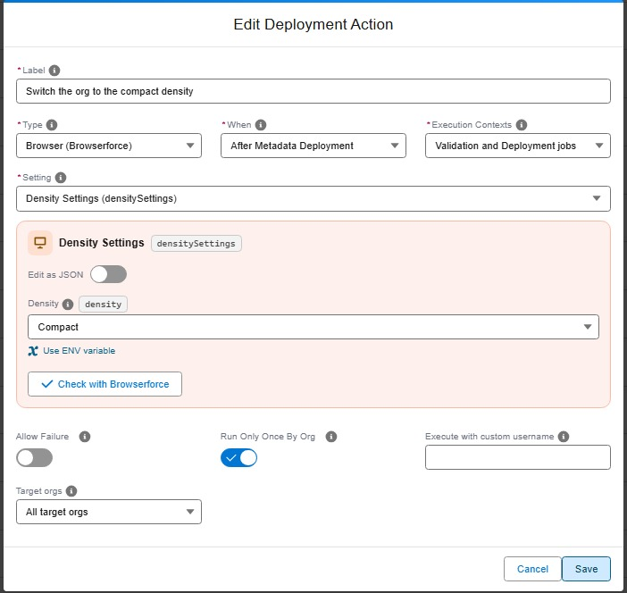

# Installation

```shell
sf plugins install sfdx-browserforce-plugin
```

!!! important "Playwright does not come with a browser automatically"

    You might need to install a browser explicitly or configure Browserforce to use an existing browser.

!!! tip "GitHub Actions"

    If you're using Browserforce on GitHub Actions with the `ubuntu-latest` (v24) image, the preinstalled Google Chrome is used automatically.
    No further configuration and installation needed, because the `CHROME_BIN` environment variable is already set.

## Option 1: Install a browser using our Playwright wrapper command

```shell
sf browserforce playwright -- install chromium
```

!!! important

    The two hyphens `--` are intentional and separate the sf command from the arguments to be passed to the playwright executable.

## Option 2: Configure Browserforce to use an existing browser

You can use any of the following environment variables:

```shell
BROWSERFORCE_BROWSER_CHANNEL="chrome"
BROWSERFORCE_BROWSER_CHANNEL="chromium"
BROWSERFORCE_BROWSER_EXECUTABLE_PATH="/usr/bin/google-chrome"
CHROME_BIN="/usr/bin/google-chrome"
```

## Alternative installation without `sf`

You can also install the `sfdx-browserforce-plugin` npm package without `sf`. The package exports a `sfdx-browserforce-plugin` executable:

```shell
npm install --save-dev sfdx-browserforce-plugin
npx sfdx-browserforce-plugin browserforce -h
```

## Using sfdx-hardis deployment actions

In a Salesforce CI/CD pipeline run by [sfdx-hardis](https://sfdx-hardis.cloudity.com/), a **Browser** deployment action applies a Browserforce setting to each org a Pull Request is deployed to, before or after the deployment. There is nothing to install: sfdx-hardis installs Browserforce when it is missing, and its Docker images include Browserforce and its browser.

In the sfdx-hardis VS Code extension, pick the setting in the list: its fields show as a form, filled with the example of the setting, with its warnings. **Check with Browserforce** validates the value before saving. During a deployment check, nothing is changed: the Pull Request comment shows what the deployment will change.



```yaml
commandsPostDeploy:
  - id: 2f0c4d1e-7a3b-4c5d-9e8f-0a1b2c3d4e5f
    label: Switch the org to the compact density
    type: browser
    context: all
    parameters:
      setting: densitySettings
      config:
        density: Compact
```

Values written as `"${VARIABLE}"` are read from CI/CD variables, so secrets stay out of git. See [Apply a Setup setting in a browser](https://sfdx-hardis.cloudity.com/salesforce-devops-work-on-user-story-deployment-actions-browser/) in the sfdx-hardis documentation.

The same Browserforce setting can also be an [org initialization step](https://sfdx-hardis.cloudity.com/salesforce-devops-org-initialization/), so that each new scratch org or sandbox is set up the same way:

```yaml
orgInitSteps:
  - id: compact-density
    label: Compact density for all users
    type: browser
    parameters:
      setting: densitySettings
      config:
        density: Compact
```
