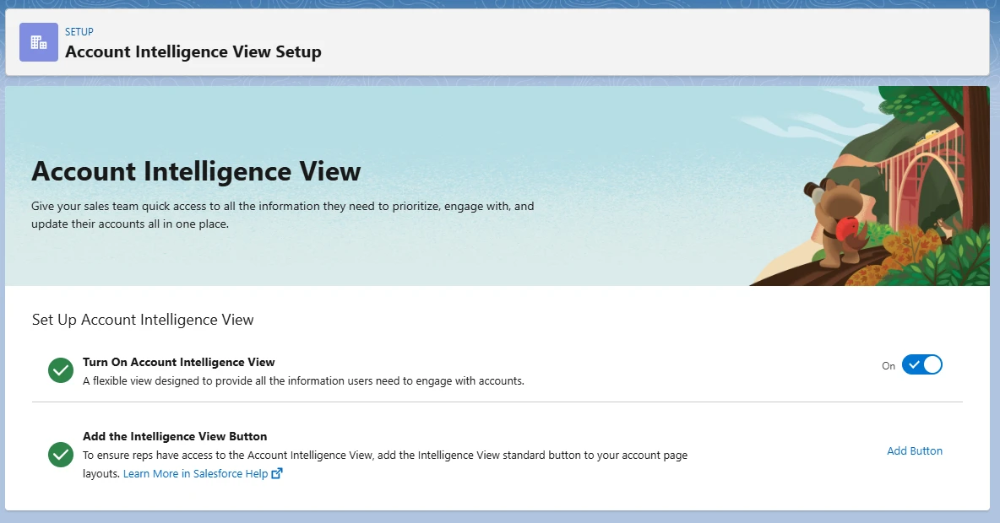
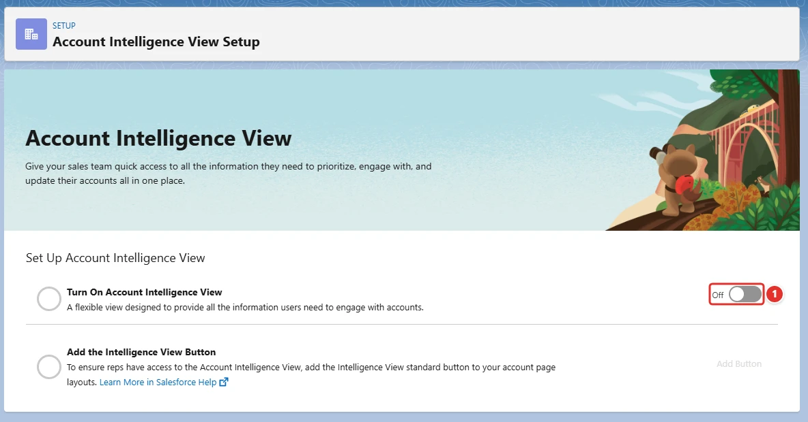
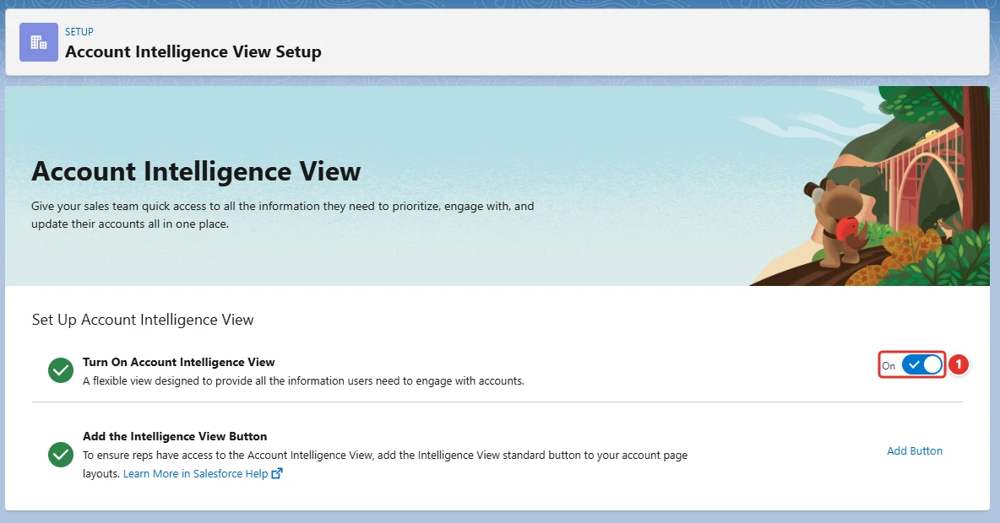

<!-- This file is generated by `npm run generate:docs` from the zod schemas in src/plugins. Do not edit it. -->

# Account Intelligence View

Config key: `settings.accountIntelligenceView`

!!! info "Prerequisites"
    - Account Intelligence available in the org (scratch org feature AccountInspection)

Setup: **Feature Settings → Sales → Account Intelligence** (`/lightning/setup/AccountInspectionSettings/home`)

Turns the Account Intelligence view on or off.



## Use case

### Account managers review their whole portfolio in one view

Northwind Traders runs quarterly account reviews: each account manager walks through the activity, open opportunities and cases of the accounts they own. Opening the accounts one by one takes hours, so the sales operations team wants the Account Intelligence view, a list of accounts with their key metrics and recent changes side by side.

The view is switched on by the **Account Intelligence toggle <span class="bf-pill bf-pill-c1">1</span>** in Setup. The Metadata API cannot do it: `AccountIntelligenceSettings` only holds the logos, news and automated fields of the accounts, not this toggle. With this config, every new sandbox and scratch org of the sales team gets the view, so the reviews can be rehearsed and the related customizations tested before they reach production.

=== "Config"

    ```json
    {
      "$schema": "https://raw.githubusercontent.com/amtrack/sfdx-browserforce-plugin/main/src/plugins/schema.json",
      "settings": {
        "accountIntelligenceView": {
          "enable": true
        }
      }
    }
    ```

=== "Before"

    

=== "After"

    

| Pill | Field | Before | After |
| ---- | ----- | ------ | ----- |
| <span class="bf-pill bf-pill-c1">1</span> | <code>enable</code> | `false` | `true` |

## Examples

=== "Example 1"

    ```json
    {
      "$schema": "https://raw.githubusercontent.com/amtrack/sfdx-browserforce-plugin/main/src/plugins/schema.json",
      "settings": {
        "accountIntelligenceView": {
          "enable": true
        }
      }
    }
    ```

=== "Example 2"

    ```json
    {
      "$schema": "https://raw.githubusercontent.com/amtrack/sfdx-browserforce-plugin/main/src/plugins/schema.json",
      "settings": {
        "accountIntelligenceView": {
          "enable": false
        }
      }
    }
    ```

## Fields

| Field | Type | Description |
| ----- | ---- | ----------- |
| <code>enable</code> | boolean | Enable Account Intelligence View |

??? note "JSON Schema"

    ```json
    {
      "type": "object",
      "properties": {
        "enable": {
          "type": "boolean",
          "title": "Enable Account Intelligence View"
        }
      },
      "title": "Account Intelligence View",
      "description": "Setup: **Feature Settings → Sales → Account Intelligence** (`/lightning/setup/AccountInspectionSettings/home`)\n\nTurns the Account Intelligence view on or off.\n\n",
      "examples": [
        {
          "enable": true
        },
        {
          "enable": false
        }
      ],
      "x-prerequisites": [
        "Account Intelligence available in the org (scratch org feature AccountInspection)"
      ]
    }
    ```

[Source code of this setting](https://github.com/amtrack/sfdx-browserforce-plugin/tree/main/src/plugins/account-intelligence-view)
