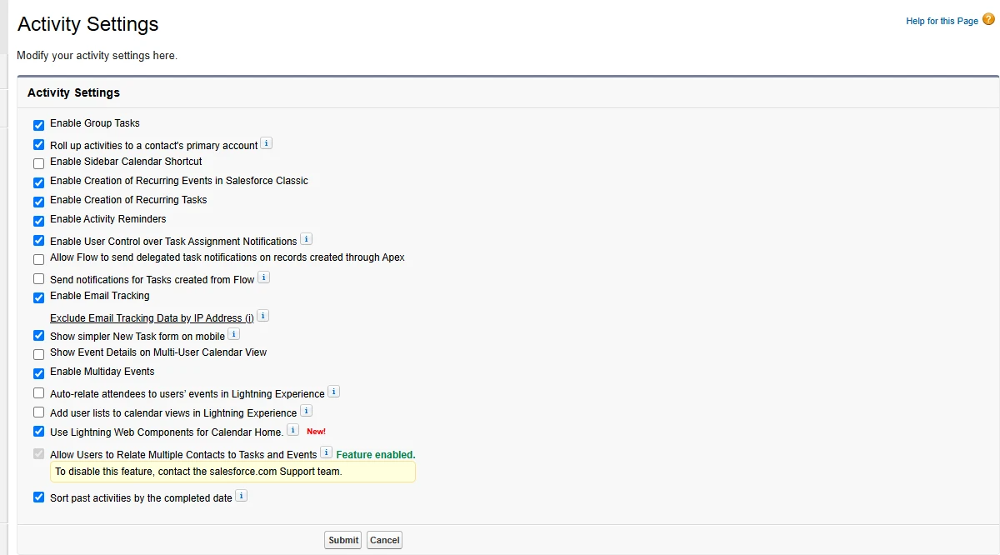
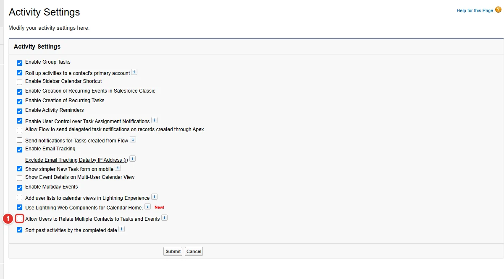
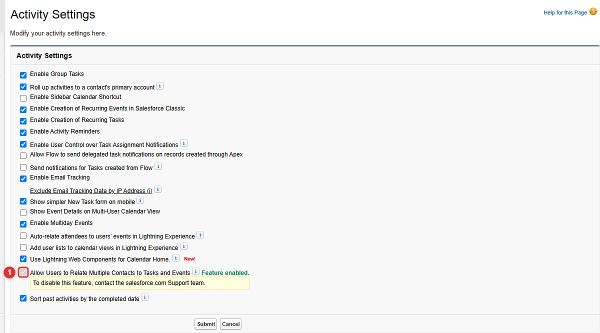

<!-- This file is generated by `npm run generate:docs` from the zod schemas in src/plugins. Do not edit it. -->

# Activity Settings

Config key: `settings.activitySettings`

!!! danger "Irreversible"
    Once applied, `allowUsersToRelateMultipleContactsToTasksAndEvents` cannot be changed back.

Setup: **Feature Settings → Sales → Activity Settings** (`/lightning/setup/HomeActivitiesSetupPage/home`)

Although the Metadata API has an `ActivitiesSettings.allowUsersToRelateMultipleContactsToTasksAndEvents` field, it is read-only since API v36.0: the setting cannot be enabled through an API.



## Use case

### Meetings are logged once for every contact who attended

The account managers of Proseware meet buying committees of four or five people. An event can only be related to one contact, so they either log the meeting once and the other attendees show no activity, or log it five times and the activity reports count five meetings.

**Allow Users to Relate Multiple Contacts to Tasks and Events <span class="bf-pill bf-pill-c1">1</span>** turns on Shared Activities: a task or an event can name up to 50 contacts. The `ActivitiesSettings` field of the Metadata API is read-only, so the setting can only be turned on in Setup, and only Salesforce Support can turn it off again: try it in a sandbox before applying this config to production.

=== "Config"

    ```json
    {
      "$schema": "https://raw.githubusercontent.com/amtrack/sfdx-browserforce-plugin/main/src/plugins/schema.json",
      "settings": {
        "activitySettings": {
          "allowUsersToRelateMultipleContactsToTasksAndEvents": true
        }
      }
    }
    ```

=== "Before"

    

=== "After"

    

| Pill | Field | Before | After |
| ---- | ----- | ------ | ----- |
| <span class="bf-pill bf-pill-c1">1</span> | <code>allowUsersToRelateMultipleContactsToTasksAndEvents</code> |  | `true` |

## Example

```json
{
  "$schema": "https://raw.githubusercontent.com/amtrack/sfdx-browserforce-plugin/main/src/plugins/schema.json",
  "settings": {
    "activitySettings": {
      "allowUsersToRelateMultipleContactsToTasksAndEvents": true
    }
  }
}
```

## Fields

| Field | Type | Description |
| ----- | ---- | ----------- |
| <code>allowUsersToRelateMultipleContactsToTasksAndEvents</code> | boolean | Allow Users to Relate Multiple Contacts to Tasks and Events<br>Although the Metadata API has a ActivitiesSettings.allowUsersToRelateMultipleContactsToTasksAndEvents field, it is not possible to enable this setting using an API. Warning: can only be disabled with help of the salesforce.com Support team. https://developer.salesforce.com/docs/atlas.en-us.api_meta.meta/api_meta/meta_activitiessettings.htm<br>**Irreversible:** cannot be changed back once applied. |

??? note "JSON Schema"

    ```json
    {
      "type": "object",
      "properties": {
        "allowUsersToRelateMultipleContactsToTasksAndEvents": {
          "type": "boolean",
          "title": "Allow Users to Relate Multiple Contacts to Tasks and Events",
          "x-irreversible": true,
          "description": "Although the Metadata API has a ActivitiesSettings.allowUsersToRelateMultipleContactsToTasksAndEvents field, it is not possible to enable this setting using an API. Warning: can only be disabled with help of the salesforce.com Support team. https://developer.salesforce.com/docs/atlas.en-us.api_meta.meta/api_meta/meta_activitiessettings.htm"
        }
      },
      "title": "Activity Settings",
      "description": "Setup: **Feature Settings → Sales → Activity Settings** (`/lightning/setup/HomeActivitiesSetupPage/home`)\n\nAlthough the Metadata API has an `ActivitiesSettings.allowUsersToRelateMultipleContactsToTasksAndEvents` field, it is read-only since API v36.0: the setting cannot be enabled through an API.\n\n",
      "examples": [
        {
          "allowUsersToRelateMultipleContactsToTasksAndEvents": true
        }
      ]
    }
    ```

[Source code of this setting](https://github.com/amtrack/sfdx-browserforce-plugin/tree/main/src/plugins/activity-settings)
