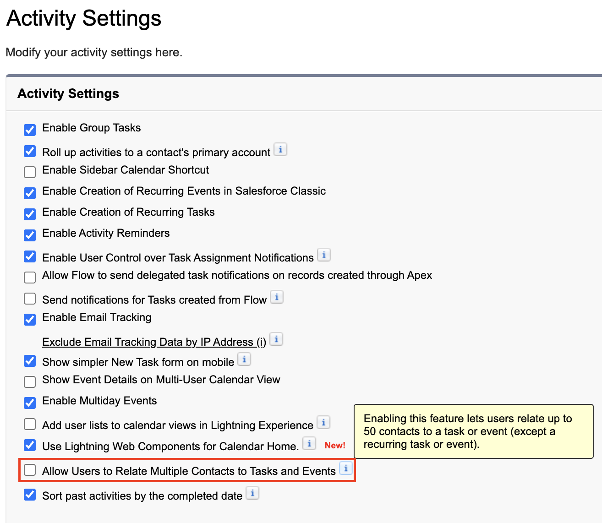

<!-- This file is generated by `npm run generate:docs` from the zod schemas in src/plugins. Do not edit it. -->

# Activity Settings

Config key: `settings.activitySettings`

!!! danger "Irreversible"
    Once applied, `allowUsersToRelateMultipleContactsToTasksAndEvents` cannot be changed back.

Setup: **Feature Settings → Sales → Activity Settings** (`/lightning/setup/HomeActivitiesSetupPage/home`)

Although the Metadata API has an `ActivitiesSettings.allowUsersToRelateMultipleContactsToTasksAndEvents` field, it is read-only since API v36.0: the setting cannot be enabled through an API.



## Example

```json
{
  "$schema": "https://raw.githubusercontent.com/amtrack/sfdx-browserforce-plugin/main/src/plugins/schema.json",
  "settings": {
    "activitySettings": {
      "allowUsersToRelateMultipleContactsToTasksAndEvents": true
    }
  }
}
```

## Fields

| Field | Type | Description |
| ----- | ---- | ----------- |
| <code>allowUsersToRelateMultipleContactsToTasksAndEvents</code> | boolean | Allow Users to Relate Multiple Contacts to Tasks and Events<br>Although the Metadata API has a ActivitiesSettings.allowUsersToRelateMultipleContactsToTasksAndEvents field, it is not possible to enable this setting using an API. Warning: can only be disabled with help of the salesforce.com Support team. https://developer.salesforce.com/docs/atlas.en-us.api_meta.meta/api_meta/meta_activitiessettings.htm<br>**Irreversible:** cannot be changed back once applied. |

??? note "JSON Schema"

    ```json
    {
      "type": "object",
      "properties": {
        "allowUsersToRelateMultipleContactsToTasksAndEvents": {
          "type": "boolean",
          "title": "Allow Users to Relate Multiple Contacts to Tasks and Events",
          "x-irreversible": true,
          "description": "Although the Metadata API has a ActivitiesSettings.allowUsersToRelateMultipleContactsToTasksAndEvents field, it is not possible to enable this setting using an API. Warning: can only be disabled with help of the salesforce.com Support team. https://developer.salesforce.com/docs/atlas.en-us.api_meta.meta/api_meta/meta_activitiessettings.htm"
        }
      },
      "title": "Activity Settings",
      "description": "Setup: **Feature Settings → Sales → Activity Settings** (`/lightning/setup/HomeActivitiesSetupPage/home`)\n\nAlthough the Metadata API has an `ActivitiesSettings.allowUsersToRelateMultipleContactsToTasksAndEvents` field, it is read-only since API v36.0: the setting cannot be enabled through an API.\n\n",
      "examples": [
        {
          "allowUsersToRelateMultipleContactsToTasksAndEvents": true
        }
      ]
    }
    ```

[Source code of this setting](https://github.com/amtrack/sfdx-browserforce-plugin/tree/main/src/plugins/activity-settings)
