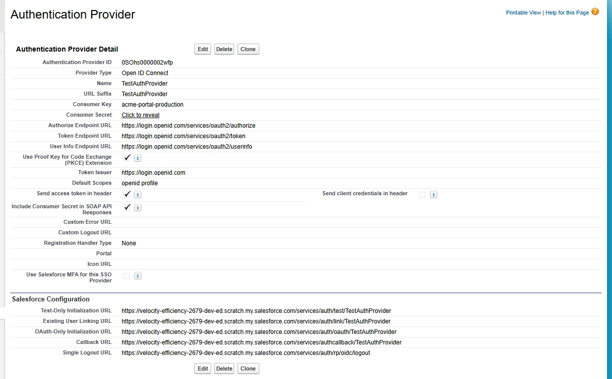
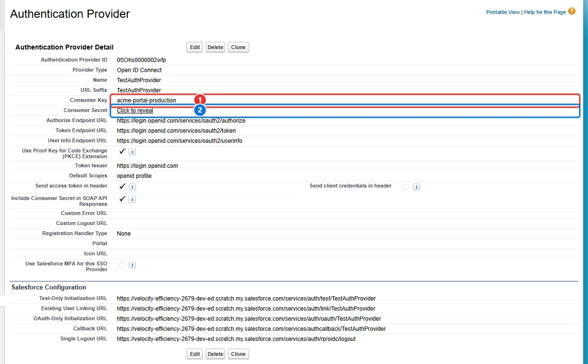

<!-- This file is generated by `npm run generate:docs` from the zod schemas in src/plugins. Do not edit it. -->

# Auth Providers

Config key: `settings.authProviders`

Setup: **Identity → Auth. Providers** (`/lightning/setup/AuthProviders/home`)

Updates the Consumer Key and the Consumer Secret of existing Auth Providers, keyed by their API name. Reference the secret with an environment variable (`"${MY_SECRET}"`) rather than writing it in the config file: it is masked in the output of `apply`.



## Use case

### Set the credentials of a single sign-on provider in each environment

Acme's partners log in to its community with their own OpenID Connect identity provider. The Auth. Provider is deployed with the Metadata API, but each environment talks to a different client of the identity provider, and the Metadata API only exports the consumer secret as a placeholder and only deploys a value encrypted by the org itself: the real secret has to be typed in Setup in each environment.

This config sets the **Consumer Key <span class="bf-pill bf-pill-c1">1</span>** and the **Consumer Secret <span class="bf-pill bf-pill-c2">2</span>** of the Auth. Provider named `TestAuthProvider` (its API name, the key of the entry). The secret comes from the environment variable `PARTNER_SSO_SECRET` of the pipeline, never from the file, and `apply` masks it in its output. Setup never shows a secret back, so Browserforce cannot compare it: every `apply` writes both values again.

=== "Config"

    ```json
    {
      "$schema": "https://raw.githubusercontent.com/amtrack/sfdx-browserforce-plugin/main/src/plugins/schema.json",
      "settings": {
        "authProviders": {
          "TestAuthProvider": {
            "consumerKey": "acme-portal-production",
            "consumerSecret": "${PARTNER_SSO_SECRET}"
          }
        }
      }
    }
    ```

=== "Before"

    

=== "After"

    

| Pill | Field | Before | After |
| ---- | ----- | ------ | ----- |
| <span class="bf-pill bf-pill-c1">1</span> | <code>TestAuthProvider.<wbr>consumerKey</code> | `acme-portal-uat` | `acme-portal-production` |
| <span class="bf-pill bf-pill-c2">2</span> | <code>TestAuthProvider.<wbr>consumerSecret</code> | `uat-secret` | `${PARTNER_SSO_SECRET}` |

## Example

```json
{
  "$schema": "https://raw.githubusercontent.com/amtrack/sfdx-browserforce-plugin/main/src/plugins/schema.json",
  "settings": {
    "authProviders": {
      "MyAuthProvider": {
        "consumerKey": "my-consumer-key",
        "consumerSecret": "${MY_AUTH_PROVIDER_SECRET}"
      }
    }
  }
}
```

## Fields

In the field paths, `[]` stands for the items of a list and `*` for the entries of an object keyed by name.

| Field | Type | Description |
| ----- | ---- | ----------- |
| <code>*.<wbr>consumerSecret</code> | string | Consumer Secret<br>The Consumer Secret value for the Auth Provider<br>**Secret:** masked in the output of `apply`. |
| <code>*.<wbr>consumerKey</code> | string | Consumer Key<br>The Consumer Key value for the Auth Provider |

??? note "JSON Schema"

    ```json
    {
      "type": "object",
      "propertyNames": {
        "type": "string",
        "pattern": "^[a-zA-Z0-9_]+$"
      },
      "additionalProperties": {
        "type": "object",
        "properties": {
          "consumerSecret": {
            "type": "string",
            "title": "Consumer Secret",
            "description": "The Consumer Secret value for the Auth Provider",
            "x-password": true
          },
          "consumerKey": {
            "type": "string",
            "title": "Consumer Key",
            "description": "The Consumer Key value for the Auth Provider"
          }
        }
      },
      "description": "Setup: **Identity → Auth. Providers** (`/lightning/setup/AuthProviders/home`)\n\nUpdates the Consumer Key and the Consumer Secret of existing Auth Providers, keyed by their API name. Reference the secret with an environment variable (`\"${MY_SECRET}\"`) rather than writing it in the config file: it is masked in the output of `apply`.\n\n",
      "title": "Auth Providers",
      "examples": [
        {
          "MyAuthProvider": {
            "consumerKey": "my-consumer-key",
            "consumerSecret": "${MY_AUTH_PROVIDER_SECRET}"
          }
        }
      ]
    }
    ```

[Source code of this setting](https://github.com/amtrack/sfdx-browserforce-plugin/tree/main/src/plugins/auth-providers)
