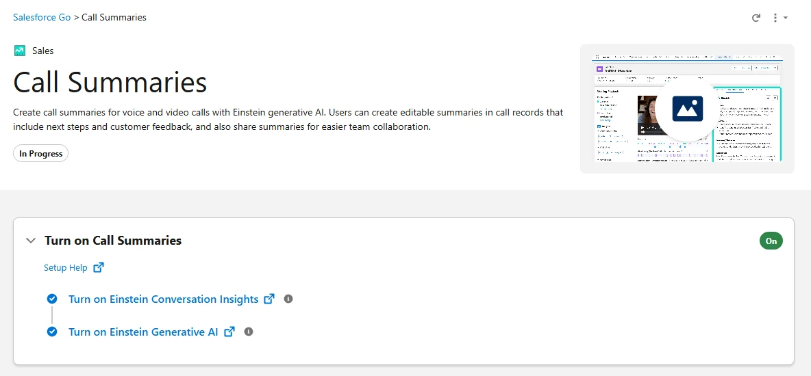
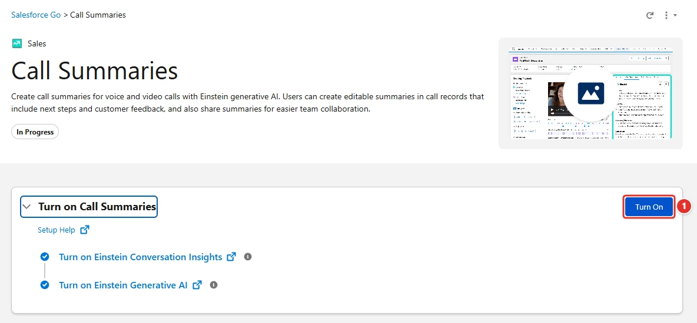
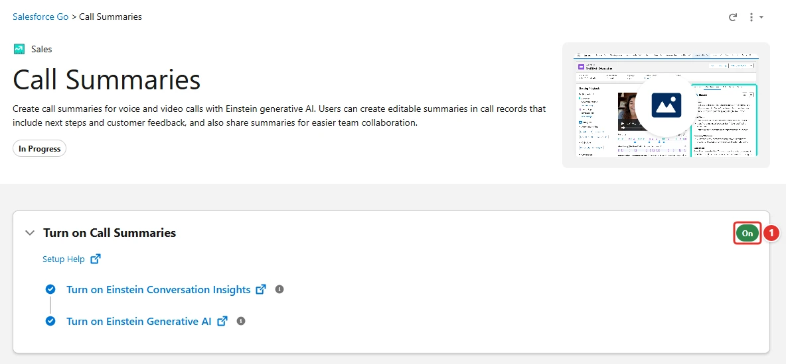

<!-- This file is generated by `npm run generate:docs` from the zod schemas in src/plugins. Do not edit it. -->

# Call Summaries

Config key: `settings.callSummaries`

!!! info "Prerequisites"
    - Einstein Conversation Insights turned on (scratch org feature CallCoaching and ConversationalIntelligenceSettings.enableCallCoaching)
    - Einstein Generative AI turned on (scratch org feature Einstein1AIPlatform and EinsteinGptSettings.enableEinsteinGptPlatform)

Setup: **Salesforce Go → Call Summaries** (`/lightning/setup/page/feature/sales-cloud-call-summaries/home`)

Turns on Call Summaries, the summaries of voice and video calls written by Einstein generative AI, and waits until Salesforce has created the object that stores them. Deploying `ConversationalIntelligenceSettings` with `enableCallSummarization` often fails with `OrgPreferences.GenECI`, and the setting can read `true` before that object exists. Turning it off uses the Metadata API.



## Use case

### Summarize the sales calls with generative AI

The managers of Tailspin Toys no longer have time to listen to the recorded calls of their reps: they want Einstein to write a summary of each call, with its next steps and the feedback of the customer. Deploying `ConversationalIntelligenceSettings` with `enableCallSummarization` often fails with `OrgPreferences.GenECI`, and even when the setting reads `true`, the object that stores the summaries may not exist yet.

With `enabled: true`, Browserforce clicks **Turn On <span class="bf-pill bf-pill-c1">1</span>** in Setup > Salesforce Go > Call Summaries and waits until Salesforce has created that object. Einstein Conversation Insights must be on first, which the `einsteinConversationInsights` setting does. `enabled: false` turns the setting off through the Metadata API.

=== "Config"

    ```json
    {
      "$schema": "https://raw.githubusercontent.com/amtrack/sfdx-browserforce-plugin/main/src/plugins/schema.json",
      "settings": {
        "callSummaries": {
          "enabled": true
        }
      }
    }
    ```

=== "Before"

    

=== "After"

    

| Pill | Field | Before | After |
| ---- | ----- | ------ | ----- |
| <span class="bf-pill bf-pill-c1">1</span> | <code>enabled</code> | `false` | `true` |

## Examples

=== "Example 1"

    ```json
    {
      "$schema": "https://raw.githubusercontent.com/amtrack/sfdx-browserforce-plugin/main/src/plugins/schema.json",
      "settings": {
        "callSummaries": {
          "enabled": true
        }
      }
    }
    ```

=== "Example 2"

    ```json
    {
      "$schema": "https://raw.githubusercontent.com/amtrack/sfdx-browserforce-plugin/main/src/plugins/schema.json",
      "settings": {
        "callSummaries": {
          "enabled": false
        }
      }
    }
    ```

## Fields

| Field | Type | Description |
| ----- | ---- | ----------- |
| <code>enabled</code> | boolean | Enable Call Summaries<br>Turning on Call Summaries using ConversationalIntelligenceSettings Metadata (enableCallSummarization) often fails with OrgPreferences.GenECI, so it is turned on in Setup > Salesforce Go > Call Summaries instead.<br>It is turned off using Metadata https://developer.salesforce.com/docs/atlas.en-us.api_meta.meta/api_meta/meta_conversationalintelligencesettings.htm |

??? note "JSON Schema"

    ```json
    {
      "type": "object",
      "properties": {
        "enabled": {
          "type": "boolean",
          "title": "Enable Call Summaries",
          "description": "Turning on Call Summaries using ConversationalIntelligenceSettings Metadata (enableCallSummarization) often fails with OrgPreferences.GenECI, so it is turned on in Setup > Salesforce Go > Call Summaries instead.\nIt is turned off using Metadata https://developer.salesforce.com/docs/atlas.en-us.api_meta.meta/api_meta/meta_conversationalintelligencesettings.htm"
        }
      },
      "title": "Call Summaries",
      "description": "Setup: **Salesforce Go → Call Summaries** (`/lightning/setup/page/feature/sales-cloud-call-summaries/home`)\n\nTurns on Call Summaries, the summaries of voice and video calls written by Einstein generative AI, and waits until Salesforce has created the object that stores them. Deploying `ConversationalIntelligenceSettings` with `enableCallSummarization` often fails with `OrgPreferences.GenECI`, and the setting can read `true` before that object exists. Turning it off uses the Metadata API.\n\n",
      "examples": [
        {
          "enabled": true
        },
        {
          "enabled": false
        }
      ],
      "x-prerequisites": [
        "Einstein Conversation Insights turned on (scratch org feature CallCoaching and ConversationalIntelligenceSettings.enableCallCoaching)",
        "Einstein Generative AI turned on (scratch org feature Einstein1AIPlatform and EinsteinGptSettings.enableEinsteinGptPlatform)"
      ]
    }
    ```

[Source code of this setting](https://github.com/amtrack/sfdx-browserforce-plugin/tree/main/src/plugins/call-summaries)
