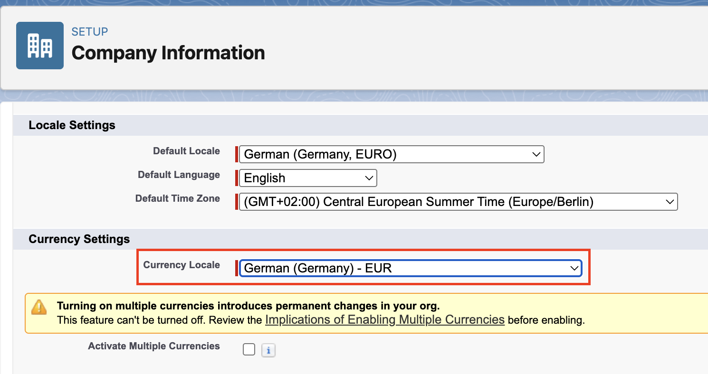

<!-- This file is generated by `npm run generate:docs` from the zod schemas in src/plugins. Do not edit it. -->

# Company Information

Config key: `settings.companyInformation`

Setup: **Company Settings → Company Information** (`/lightning/setup/CompanyProfileInfo/home`)

Sets the Currency Locale of the org, which no Metadata API type represents.



## Example

```json
{
  "$schema": "https://raw.githubusercontent.com/amtrack/sfdx-browserforce-plugin/main/src/plugins/schema.json",
  "settings": {
    "companyInformation": {
      "defaultCurrencyIsoCode": "English (South Africa) - ZAR"
    }
  }
}
```

## Fields

| Field | Type | Description | Values | Default |
| ----- | ---- | ----------- | ------ | ------- |
| `defaultCurrencyIsoCode` | string | Default Currency |  |  |

??? note "JSON Schema"

    ```json
    {
      "type": "object",
      "properties": {
        "defaultCurrencyIsoCode": {
          "type": "string",
          "title": "Default Currency"
        }
      },
      "title": "Company Information",
      "description": "Setup: **Company Settings → Company Information** (`/lightning/setup/CompanyProfileInfo/home`)\n\nSets the Currency Locale of the org, which no Metadata API type represents.\n\n",
      "examples": [
        {
          "defaultCurrencyIsoCode": "English (South Africa) - ZAR"
        }
      ]
    }
    ```

[Source code of this setting](https://github.com/amtrack/sfdx-browserforce-plugin/tree/main/src/plugins/company-information)
