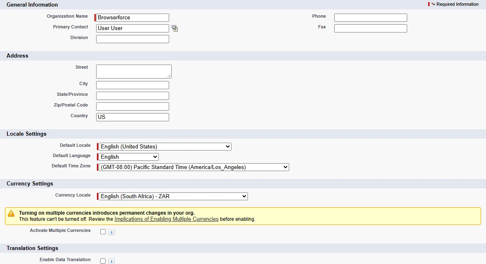
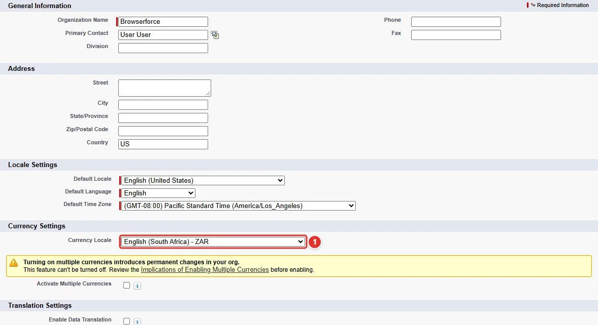

<!-- This file is generated by `npm run generate:docs` from the zod schemas in src/plugins. Do not edit it. -->

# Company Information

Config key: `settings.companyInformation`

Setup: **Company Settings → Company Information** (`/lightning/setup/CompanyProfileInfo/home`)

Sets the Currency Locale of the org, which no Metadata API type represents.



## Use case

### A South African subsidiary invoices in rand

Acme opens a sales office in Johannesburg with its own Salesforce org. The org was created with the defaults of the US admin who signed it up, so every opportunity, quote and report shows amounts in US dollars.

The currency of an org without multiple currencies is its **Currency Locale <span class="bf-pill bf-pill-c1">1</span>**, a field of the Company Information page that no Metadata API type holds. Applying this config in every new environment of the subsidiary, from the scratch orgs of the developers to production, switches it to `English (South Africa) - ZAR` without anyone clicking in Setup.

=== "Config"

    ```json
    {
      "$schema": "https://raw.githubusercontent.com/amtrack/sfdx-browserforce-plugin/main/src/plugins/schema.json",
      "settings": {
        "companyInformation": {
          "defaultCurrencyIsoCode": "English (South Africa) - ZAR"
        }
      }
    }
    ```

=== "Before"

    

=== "After"

    

| Pill | Field | Before | After |
| ---- | ----- | ------ | ----- |
| <span class="bf-pill bf-pill-c1">1</span> | <code>defaultCurrencyIsoCode</code> | `English (United States) - USD` | `English (South Africa) - ZAR` |

## Example

```json
{
  "$schema": "https://raw.githubusercontent.com/amtrack/sfdx-browserforce-plugin/main/src/plugins/schema.json",
  "settings": {
    "companyInformation": {
      "defaultCurrencyIsoCode": "English (South Africa) - ZAR"
    }
  }
}
```

## Fields

| Field | Type | Description |
| ----- | ---- | ----------- |
| <code>defaultCurrencyIsoCode</code> | string | Default Currency |

??? note "JSON Schema"

    ```json
    {
      "type": "object",
      "properties": {
        "defaultCurrencyIsoCode": {
          "type": "string",
          "title": "Default Currency"
        }
      },
      "title": "Company Information",
      "description": "Setup: **Company Settings → Company Information** (`/lightning/setup/CompanyProfileInfo/home`)\n\nSets the Currency Locale of the org, which no Metadata API type represents.\n\n",
      "examples": [
        {
          "defaultCurrencyIsoCode": "English (South Africa) - ZAR"
        }
      ]
    }
    ```

[Source code of this setting](https://github.com/amtrack/sfdx-browserforce-plugin/tree/main/src/plugins/company-information)
