<!-- This file is generated by `npm run generate:docs` from the zod schemas in src/plugins. Do not edit it. -->

# Customer Portal Settings

Config key: `settings.customerPortal`

!!! warning "Salesforce Classic only"
    This feature only exists in Salesforce Classic.

!!! danger "Irreversible"
    Once applied, `enabled` cannot be changed back.

Salesforce Classic Setup: **Customize → Customer Portal → Customer Portal Settings** (`/_ui/core/portal/CustomerSuccessPortalSetup/e`)

Enables the Customer Portal, configures its portals (self-registration, profiles) and the custom objects available in it.

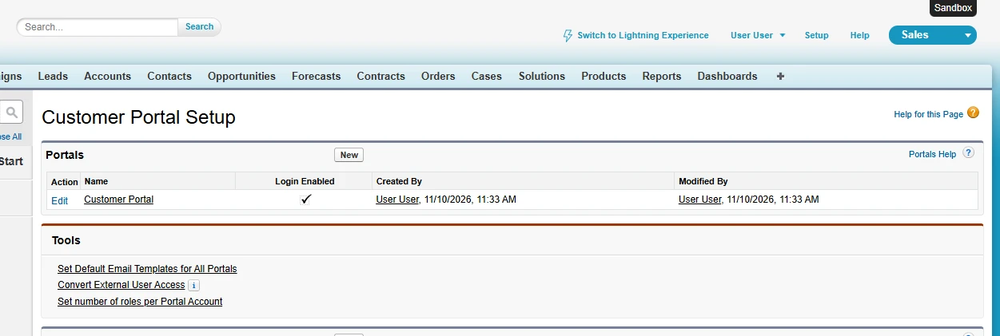


## Use cases

### 1. Enable the Customer Portal with its default portal

Acme still serves its older customers through a Salesforce Classic Customer Portal, and every new sandbox or scratch org of its developers needs it. The Metadata API can turn on `OrgSettings.enableCustomerSuccessPortal`, but only Setup also creates the portal named **Customer Portal**, with the current user as its administrator and email sender, which the next use cases configure.

This config ticks **Enable Customer Portal <span class="bf-pill bf-pill-c1">1</span>**. It cannot be turned off afterwards, so Browserforce only ever enables it.

=== "Config"

    ```json
    {
      "$schema": "https://raw.githubusercontent.com/amtrack/sfdx-browserforce-plugin/main/src/plugins/schema.json",
      "settings": {
        "customerPortal": {
          "enabled": true
        }
      }
    }
    ```

=== "Before"

    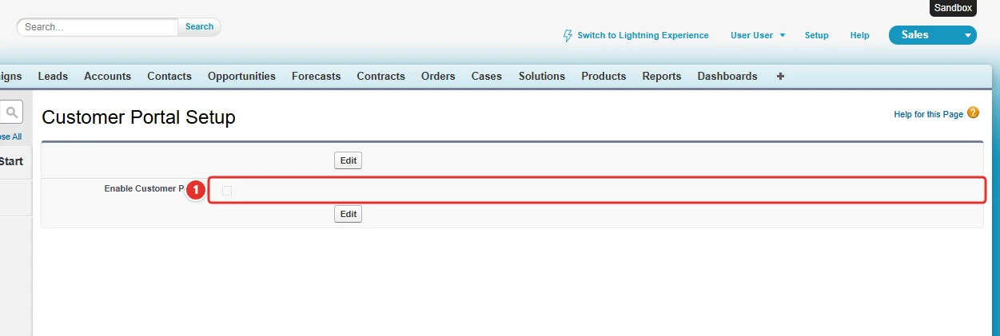

=== "After"

    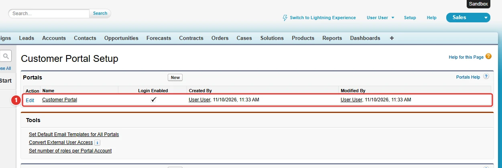

| Pill | Field | Before | After |
| ---- | ----- | ------ | ----- |
| <span class="bf-pill bf-pill-c1">1</span> | <code>enabled</code> |  | `true` |

### 2. Choose the profiles of the portal and its self-registration

Acme's distributors log in to the Customer Portal with their own profile, `Dummy` in this org, and must be able to register themselves. Which profiles may use a portal is set on the **Customer Portal Profiles** page of the portal: the `Profile` and `Portal` types of the Metadata API have no field for it.

This config makes the profile `Dummy` **<span class="bf-pill bf-pill-c1">1</span>** one of the assigned profiles of the portal named **Customer Portal**, and sets its self-registration defaults. Profiles that `portalProfileMemberships` does not list keep their setting.

=== "Config"

    ```json
    {
      "$schema": "https://raw.githubusercontent.com/amtrack/sfdx-browserforce-plugin/main/src/plugins/schema.json",
      "settings": {
        "customerPortal": {
          "enabled": true,
          "portals": [
            {
              "name": "Customer Portal",
              "adminUser": "User User",
              "description": "Customer Portal",
              "isSelfRegistrationActivated": true,
              "selfRegUserDefaultLicense": "Customer Portal Manager Custom",
              "selfRegUserDefaultRole": "User",
              "selfRegUserDefaultProfile": "Customer Portal Manager Custom",
              "portalProfileMemberships": [
                {
                  "name": "Dummy",
                  "active": true
                }
              ]
            }
          ]
        }
      }
    }
    ```

=== "Before"

    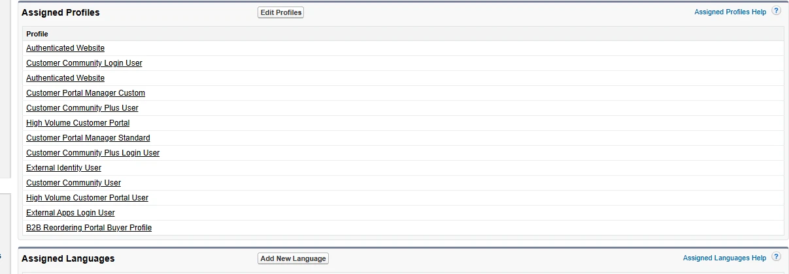

=== "After"

    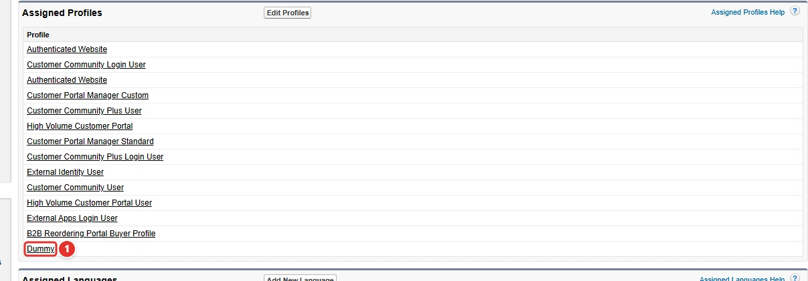

| Pill | Field | Before | After |
| ---- | ----- | ------ | ----- |
| <span class="bf-pill bf-pill-c1">1</span> | <code>portals[0].<wbr>portalProfileMemberships</code> | `[{"name":"Dummy","active":false}]` | `[{"name":"Dummy","active":true}]` |
|  | <code>enabled</code><br>the Customer Portal must be enabled first (use case 1) | `true` | `true` |
|  | <code>portals[0].<wbr>name</code><br>the portal whose profiles change | `Customer Portal` | `Customer Portal` |
|  | <code>portals[0].<wbr>adminUser</code><br>also deployable with the Portal type of the Metadata API (admin) |  | `User User` |
|  | <code>portals[0].<wbr>description</code><br>also deployable with the Portal type of the Metadata API |  | `Customer Portal` |
|  | <code>portals[0].<wbr>isSelfRegistrationActivated</code><br>also deployable with the Portal type of the Metadata API | `false` | `true` |
|  | <code>portals[0].<wbr>selfRegUserDefaultLicense</code><br>the license of the users who register themselves |  | `Customer Portal Manager Custom` |
|  | <code>portals[0].<wbr>selfRegUserDefaultRole</code><br>also deployable with the Portal type of the Metadata API |  | `User` |
|  | <code>portals[0].<wbr>selfRegUserDefaultProfile</code><br>also deployable with the Portal type of the Metadata API |  | `Customer Portal Manager Custom` |

### 3. Rename the portal

The portal created by Setup is named Customer Portal, and Acme wants its customers to see **Acme Support** in the emails and pages of the portal. The `Portal` type of the Metadata API identifies a portal by its name, so a deployment cannot rename it: it would look for a portal of the new name.

`oldName` **<span class="bf-pill bf-pill-c1">1</span>** finds the portal, and `name` **<span class="bf-pill bf-pill-c2">2</span>** is its new name. Once renamed, a second `apply` finds no portal named Customer Portal but one named Acme Support, and does nothing.

=== "Config"

    ```json
    {
      "$schema": "https://raw.githubusercontent.com/amtrack/sfdx-browserforce-plugin/main/src/plugins/schema.json",
      "settings": {
        "customerPortal": {
          "enabled": true,
          "portals": [
            {
              "name": "Acme Support",
              "oldName": "Customer Portal"
            }
          ]
        }
      }
    }
    ```

=== "Before"

    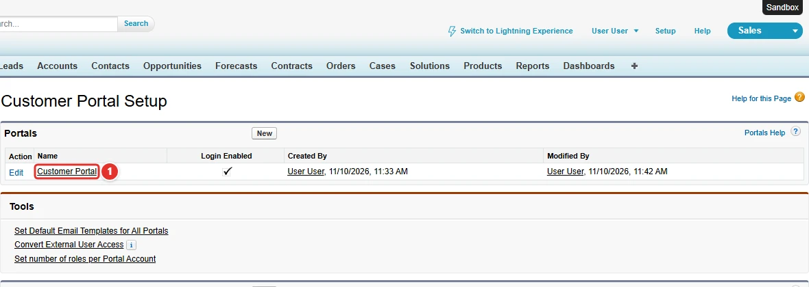

=== "After"

    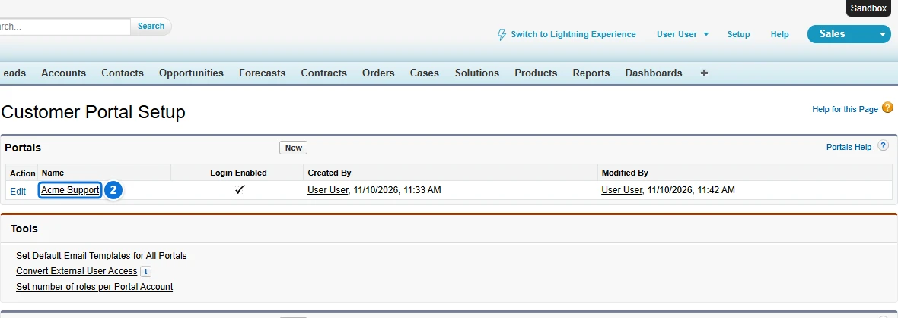

| Pill | Field | Before | After |
| ---- | ----- | ------ | ----- |
| <span class="bf-pill bf-pill-c1">1</span> | <code>portals[0].<wbr>oldName</code> | `Acme Support` | `Customer Portal` |
| <span class="bf-pill bf-pill-c2">2</span> | <code>portals[0].<wbr>name</code> | `Customer Portal` | `Acme Support` |
|  | <code>enabled</code><br>the Customer Portal must be enabled first (use case 1) | `true` | `true` |

### 4. Make custom objects available in the portal

Acme's customers must see their Dummy records and their Salesforce CPQ quotes in the portal. A custom object only appears in a Customer Portal once **Available for Customer Portal** is ticked in the definition of the object, an option of its Setup page.

This config ticks it for `Dummy__c` **<span class="bf-pill bf-pill-c1">1</span>** and for the `SBQQ__Quote__c` object of Salesforce CPQ **<span class="bf-pill bf-pill-c2">2</span>**: an object is named by its API name without suffix, with its `namespacePrefix` when it comes from a managed package. `available: false` removes an object from the portal.

=== "Config"

    ```json
    {
      "$schema": "https://raw.githubusercontent.com/amtrack/sfdx-browserforce-plugin/main/src/plugins/schema.json",
      "settings": {
        "customerPortal": {
          "enabled": true,
          "availableCustomObjects": [
            {
              "name": "Dummy",
              "available": true
            },
            {
              "name": "Quote",
              "namespacePrefix": "SBQQ",
              "available": true
            }
          ]
        }
      }
    }
    ```

=== "Before"

    *The custom object Dummy__c*

    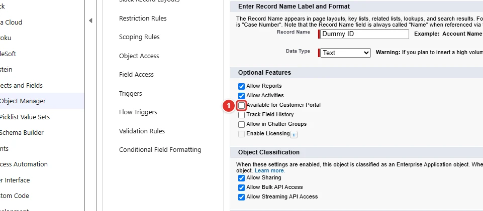

    *The Quote object of Salesforce CPQ (SBQQ__Quote__c)*

    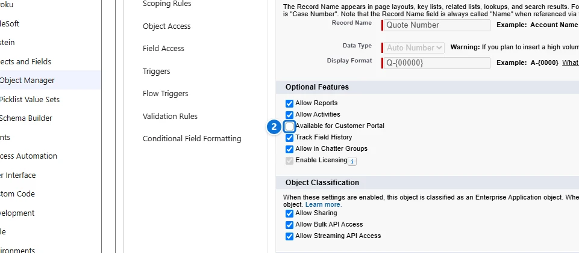

=== "After"

    *The custom object Dummy__c*

    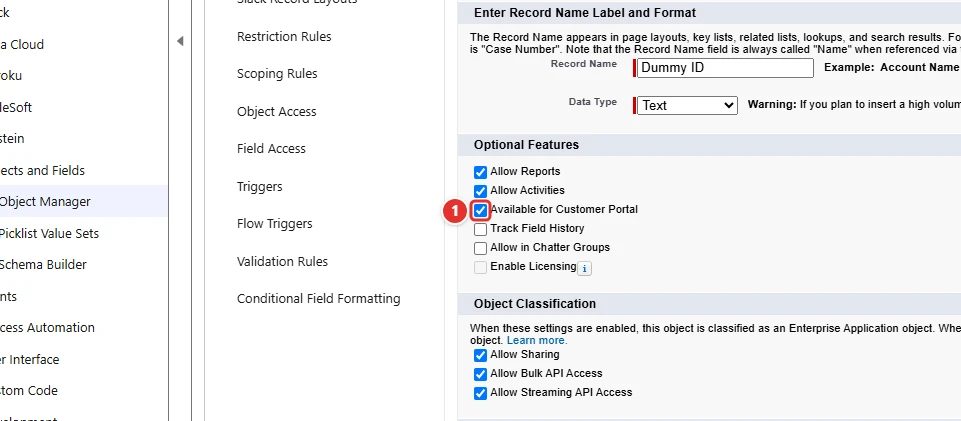

    *The Quote object of Salesforce CPQ (SBQQ__Quote__c)*

    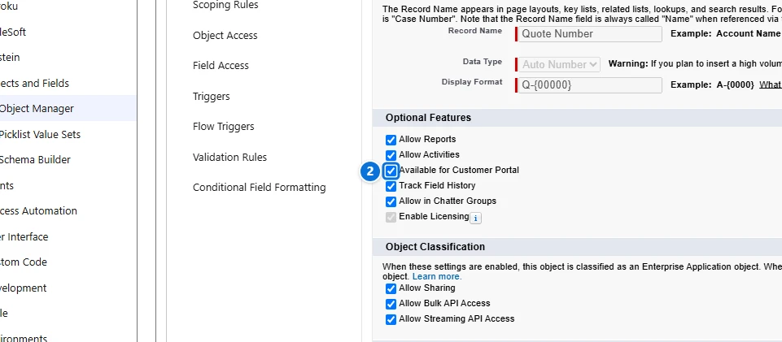

| Pill | Field | Before | After |
| ---- | ----- | ------ | ----- |
| <span class="bf-pill bf-pill-c1">1</span> | <code>availableCustomObjects[0].<wbr>available</code> | `false` | `true` |
| <span class="bf-pill bf-pill-c2">2</span> | <code>availableCustomObjects[1].<wbr>available</code> | `false` | `true` |
|  | <code>enabled</code><br>the Customer Portal must be enabled first (use case 1) | `true` | `true` |
|  | <code>availableCustomObjects[0].<wbr>name</code><br>the API name of the object, without its __c suffix | `Dummy` | `Dummy` |
|  | <code>availableCustomObjects[1].<wbr>name</code><br>the API name of the object, without its namespace and __c suffix | `Quote` | `Quote` |
|  | <code>availableCustomObjects[1].<wbr>namespacePrefix</code><br>the namespace of the managed package of the object, SBQQ for Salesforce CPQ | `SBQQ` | `SBQQ` |

## Examples

=== "Example 1"

    ```json
    {
      "$schema": "https://raw.githubusercontent.com/amtrack/sfdx-browserforce-plugin/main/src/plugins/schema.json",
      "settings": {
        "customerPortal": {
          "enabled": true
        }
      }
    }
    ```

=== "Example 2"

    ```json
    {
      "$schema": "https://raw.githubusercontent.com/amtrack/sfdx-browserforce-plugin/main/src/plugins/schema.json",
      "settings": {
        "customerPortal": {
          "portals": [
            {
              "name": "Customer Portal",
              "isSelfRegistrationActivated": true
            }
          ]
        }
      }
    }
    ```

=== "Example 3"

    ```json
    {
      "$schema": "https://raw.githubusercontent.com/amtrack/sfdx-browserforce-plugin/main/src/plugins/schema.json",
      "settings": {
        "customerPortal": {
          "availableCustomObjects": [
            {
              "name": "MyObject",
              "available": true
            }
          ]
        }
      }
    }
    ```

## Fields

In the field paths, `[]` stands for the items of a list and `*` for the entries of an object keyed by name.

| Field | Type | Description | Default |
| ----- | ---- | ----------- | ------- |
| <code>enabled</code> | boolean | Enable Customer Portal<br>Although the Metadata API has a OrgSettings.enableCustomerSuccessPortal field, enabling this via the browser can be handy because it automatically creates a Portal named 'Customer Portal', where the admin and emailSenderAddress are set to the current user. Warning: cannot be disabled once enabled<br>**Irreversible:** cannot be changed back once applied. |  |
| <code>portals[].<wbr>adminUser</code> | string |  |  |
| <code>portals[].<wbr>description</code> | string |  |  |
| <code>portals[].<wbr>isSelfRegistrationActivated</code> | boolean |  |  |
| <code>portals[].<wbr>name</code> | string | **Required.** |  |
| <code>portals[].<wbr>oldName</code> | string |  |  |
| <code>portals[].<wbr>selfRegUserDefaultLicense</code> | string |  |  |
| <code>portals[].<wbr>selfRegUserDefaultProfile</code> | string |  |  |
| <code>portals[].<wbr>selfRegUserDefaultRole</code> | string |  |  |
| <code>portals[].<wbr>portalProfileMemberships</code> | json | Profiles for which this portal should be activated or deactivated | `[]` |
| <code>availableCustomObjects[].<wbr>name</code> | string | **Required.** |  |
| <code>availableCustomObjects[].<wbr>namespacePrefix</code> | string |  |  |
| <code>availableCustomObjects[].<wbr>available</code> | boolean | **Required.** |  |

??? note "JSON Schema"

    ```json
    {
      "type": "object",
      "properties": {
        "enabled": {
          "type": "boolean",
          "title": "Enable Customer Portal",
          "x-irreversible": true,
          "description": "Although the Metadata API has a OrgSettings.enableCustomerSuccessPortal field, enabling this via the browser can be handy because it automatically creates a Portal named 'Customer Portal', where the admin and emailSenderAddress are set to the current user. Warning: cannot be disabled once enabled"
        },
        "portals": {
          "default": [],
          "title": "Portals",
          "type": "array",
          "items": {
            "type": "object",
            "properties": {
              "adminUser": {
                "type": "string"
              },
              "description": {
                "type": "string"
              },
              "isSelfRegistrationActivated": {
                "type": "boolean"
              },
              "name": {
                "type": "string"
              },
              "oldName": {
                "type": "string"
              },
              "selfRegUserDefaultLicense": {
                "type": "string"
              },
              "selfRegUserDefaultProfile": {
                "type": "string"
              },
              "selfRegUserDefaultRole": {
                "type": "string"
              },
              "portalProfileMemberships": {
                "default": [],
                "description": "Profiles for which this portal should be activated or deactivated",
                "type": "array",
                "items": {
                  "type": "object",
                  "properties": {
                    "name": {
                      "type": "string"
                    },
                    "active": {
                      "type": "boolean"
                    }
                  }
                }
              }
            },
            "required": [
              "name"
            ]
          }
        },
        "availableCustomObjects": {
          "default": [],
          "title": "Custom Objects available for Customer Portal",
          "type": "array",
          "items": {
            "type": "object",
            "properties": {
              "name": {
                "type": "string"
              },
              "namespacePrefix": {
                "type": "string"
              },
              "available": {
                "type": "boolean"
              }
            },
            "required": [
              "name",
              "available"
            ]
          }
        }
      },
      "title": "Customer Portal Settings",
      "description": "Salesforce Classic Setup: **Customize → Customer Portal → Customer Portal Settings** (`/_ui/core/portal/CustomerSuccessPortalSetup/e`)\n\nEnables the Customer Portal, configures its portals (self-registration, profiles) and the custom objects available in it.\n\n\n\n",
      "examples": [
        {
          "enabled": true
        },
        {
          "portals": [
            {
              "name": "Customer Portal",
              "isSelfRegistrationActivated": true
            }
          ]
        },
        {
          "availableCustomObjects": [
            {
              "name": "MyObject",
              "available": true
            }
          ]
        }
      ],
      "x-user-interface": "classic"
    }
    ```

[Source code of this setting](https://github.com/amtrack/sfdx-browserforce-plugin/tree/main/src/plugins/customer-portal)
