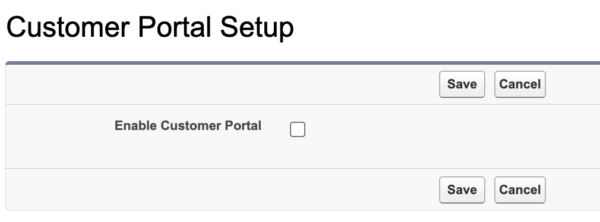
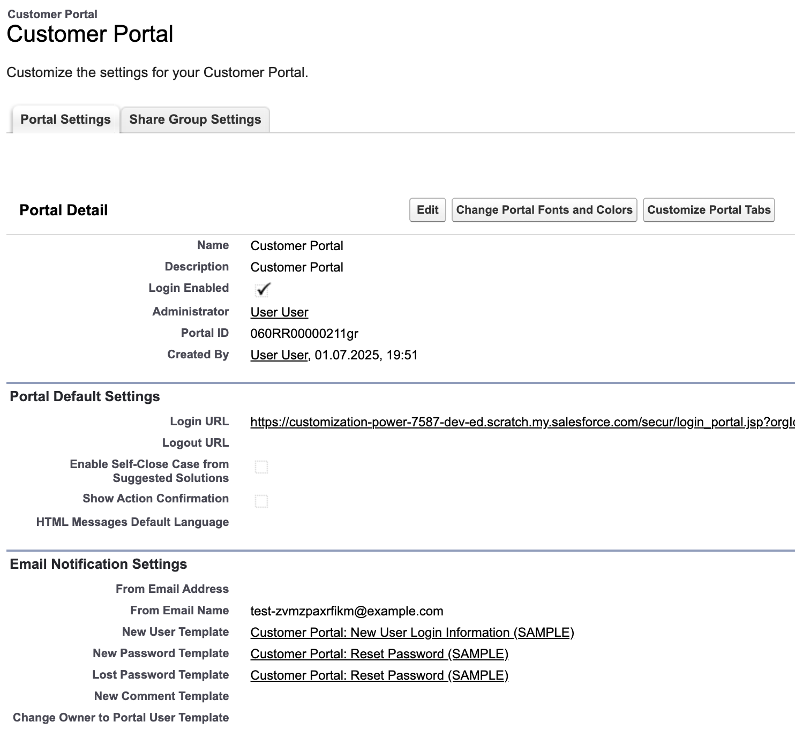

<!-- This file is generated by `npm run generate:docs` from the zod schemas in src/plugins. Do not edit it. -->

# Customer Portal Settings

Config key: `settings.customerPortal`

!!! warning "Salesforce Classic only"
    This feature only exists in Salesforce Classic.

!!! danger "Irreversible"
    Once applied, `enabled` cannot be changed back.

Salesforce Classic Setup: **Customize → Customer Portal → Customer Portal Settings** (`/_ui/core/portal/CustomerSuccessPortalSetup/e`)

Enables the Customer Portal, configures its portals (self-registration, profiles) and the custom objects available in it.





## Examples

=== "Example 1"

    ```json
    {
      "$schema": "https://raw.githubusercontent.com/amtrack/sfdx-browserforce-plugin/main/src/plugins/schema.json",
      "settings": {
        "customerPortal": {
          "enabled": true
        }
      }
    }
    ```

=== "Example 2"

    ```json
    {
      "$schema": "https://raw.githubusercontent.com/amtrack/sfdx-browserforce-plugin/main/src/plugins/schema.json",
      "settings": {
        "customerPortal": {
          "portals": [
            {
              "name": "Customer Portal",
              "isSelfRegistrationActivated": true
            }
          ]
        }
      }
    }
    ```

=== "Example 3"

    ```json
    {
      "$schema": "https://raw.githubusercontent.com/amtrack/sfdx-browserforce-plugin/main/src/plugins/schema.json",
      "settings": {
        "customerPortal": {
          "availableCustomObjects": [
            {
              "name": "MyObject",
              "available": true
            }
          ]
        }
      }
    }
    ```

## Fields

In the field paths, `[]` stands for the items of a list and `*` for the entries of an object keyed by name.

| Field | Type | Description | Values | Default |
| ----- | ---- | ----------- | ------ | ------- |
| `enabled` | boolean | Enable Customer Portal<br>Although the Metadata API has a OrgSettings.enableCustomerSuccessPortal field, enabling this via the browser can be handy because it automatically creates a Portal named 'Customer Portal', where the admin and emailSenderAddress are set to the current user. Warning: cannot be disabled once enabled<br>**Irreversible:** cannot be changed back once applied. |  |  |
| `portals[].adminUser` | string |  |  |  |
| `portals[].description` | string |  |  |  |
| `portals[].isSelfRegistrationActivated` | boolean |  |  |  |
| `portals[].name` | string | **Required.** |  |  |
| `portals[].oldName` | string |  |  |  |
| `portals[].selfRegUserDefaultLicense` | string |  |  |  |
| `portals[].selfRegUserDefaultProfile` | string |  |  |  |
| `portals[].selfRegUserDefaultRole` | string |  |  |  |
| `portals[].portalProfileMemberships` | json | Profiles for which this portal should be activated or deactivated |  | `[]` |
| `availableCustomObjects[].name` | string | **Required.** |  |  |
| `availableCustomObjects[].namespacePrefix` | string |  |  |  |
| `availableCustomObjects[].available` | boolean | **Required.** |  |  |

??? note "JSON Schema"

    ```json
    {
      "type": "object",
      "properties": {
        "enabled": {
          "type": "boolean",
          "title": "Enable Customer Portal",
          "x-irreversible": true,
          "description": "Although the Metadata API has a OrgSettings.enableCustomerSuccessPortal field, enabling this via the browser can be handy because it automatically creates a Portal named 'Customer Portal', where the admin and emailSenderAddress are set to the current user. Warning: cannot be disabled once enabled"
        },
        "portals": {
          "default": [],
          "title": "Portals",
          "type": "array",
          "items": {
            "type": "object",
            "properties": {
              "adminUser": {
                "type": "string"
              },
              "description": {
                "type": "string"
              },
              "isSelfRegistrationActivated": {
                "type": "boolean"
              },
              "name": {
                "type": "string"
              },
              "oldName": {
                "type": "string"
              },
              "selfRegUserDefaultLicense": {
                "type": "string"
              },
              "selfRegUserDefaultProfile": {
                "type": "string"
              },
              "selfRegUserDefaultRole": {
                "type": "string"
              },
              "portalProfileMemberships": {
                "default": [],
                "description": "Profiles for which this portal should be activated or deactivated",
                "type": "array",
                "items": {
                  "type": "object",
                  "properties": {
                    "name": {
                      "type": "string"
                    },
                    "active": {
                      "type": "boolean"
                    }
                  }
                }
              }
            },
            "required": [
              "name"
            ]
          }
        },
        "availableCustomObjects": {
          "default": [],
          "title": "Custom Objects available for Customer Portal",
          "type": "array",
          "items": {
            "type": "object",
            "properties": {
              "name": {
                "type": "string"
              },
              "namespacePrefix": {
                "type": "string"
              },
              "available": {
                "type": "boolean"
              }
            },
            "required": [
              "name",
              "available"
            ]
          }
        }
      },
      "title": "Customer Portal Settings",
      "description": "Salesforce Classic Setup: **Customize → Customer Portal → Customer Portal Settings** (`/_ui/core/portal/CustomerSuccessPortalSetup/e`)\n\nEnables the Customer Portal, configures its portals (self-registration, profiles) and the custom objects available in it.\n\n\n\n",
      "examples": [
        {
          "enabled": true
        },
        {
          "portals": [
            {
              "name": "Customer Portal",
              "isSelfRegistrationActivated": true
            }
          ]
        },
        {
          "availableCustomObjects": [
            {
              "name": "MyObject",
              "available": true
            }
          ]
        }
      ],
      "x-user-interface": "classic"
    }
    ```

[Source code of this setting](https://github.com/amtrack/sfdx-browserforce-plugin/tree/main/src/plugins/customer-portal)
