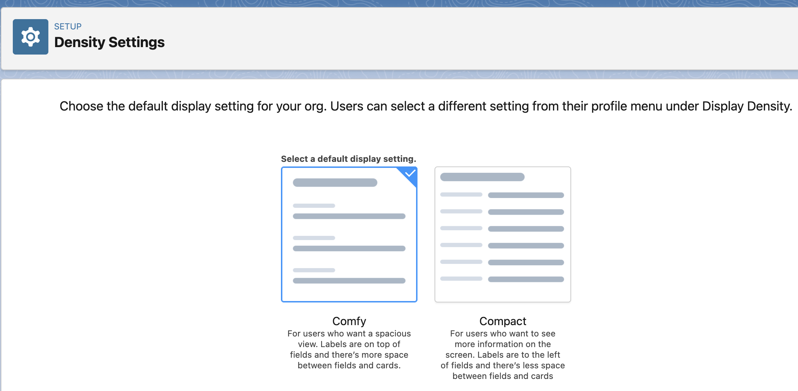
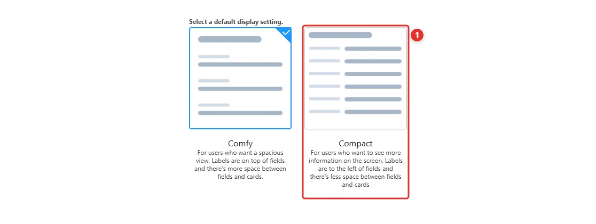
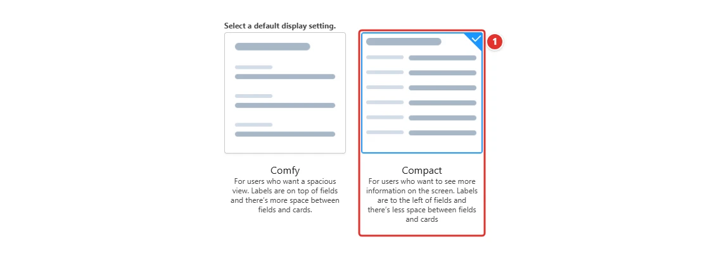

<!-- This file is generated by `npm run generate:docs` from the zod schemas in src/plugins. Do not edit it. -->

# Density Settings

Config key: `settings.densitySettings`

Setup: **User Interface → Density Settings** (`/lightning/setup/DensitySetup/home`)

Chooses the default display density of the org: "Comfy" or "Compact".



## Use case

### Contact center agents see more records on their laptops

The agents of Pinewood Insurance answer claims on 13-inch laptops. With the default **Comfy** density, a case list view shows a dozen rows and the related lists of an account need several scrolls.

Choosing **Compact <span class="bf-pill bf-pill-c1">1</span>** as the default density of the org puts labels next to their values and tightens every list, so the agents see about a third more records without zooming out. Agents who prefer the airier layout can still switch back in their own settings: this config only changes the default of the org, which the Metadata API cannot set.

=== "Config"

    ```json
    {
      "$schema": "https://raw.githubusercontent.com/amtrack/sfdx-browserforce-plugin/main/src/plugins/schema.json",
      "settings": {
        "densitySettings": {
          "density": "Compact"
        }
      }
    }
    ```

=== "Before"

    

=== "After"

    

| Pill | Field | Before | After |
| ---- | ----- | ------ | ----- |
| <span class="bf-pill bf-pill-c1">1</span> | <code>density</code> | `Comfy` | `Compact` |

## Examples

=== "Example 1"

    ```json
    {
      "$schema": "https://raw.githubusercontent.com/amtrack/sfdx-browserforce-plugin/main/src/plugins/schema.json",
      "settings": {
        "densitySettings": {
          "density": "Compact"
        }
      }
    }
    ```

=== "Example 2"

    ```json
    {
      "$schema": "https://raw.githubusercontent.com/amtrack/sfdx-browserforce-plugin/main/src/plugins/schema.json",
      "settings": {
        "densitySettings": {
          "density": "Comfy"
        }
      }
    }
    ```

## Fields

| Field | Type | Description | Values |
| ----- | ---- | ----------- | ------ |
| <code>density</code> | string | Density<br>Choose the default display setting for your org | `Comfy`<br>`Compact` |

??? note "JSON Schema"

    ```json
    {
      "type": "object",
      "properties": {
        "density": {
          "type": "string",
          "enum": [
            "Comfy",
            "Compact"
          ],
          "title": "Density",
          "description": "Choose the default display setting for your org"
        }
      },
      "title": "Density Settings",
      "description": "Setup: **User Interface → Density Settings** (`/lightning/setup/DensitySetup/home`)\n\nChooses the default display density of the org: \"Comfy\" or \"Compact\".\n\n",
      "examples": [
        {
          "density": "Compact"
        },
        {
          "density": "Comfy"
        }
      ]
    }
    ```

[Source code of this setting](https://github.com/amtrack/sfdx-browserforce-plugin/tree/main/src/plugins/density-settings)
