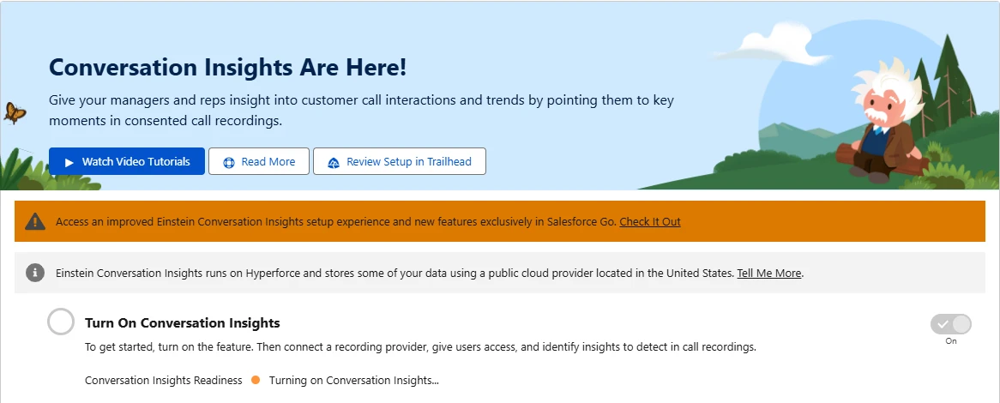
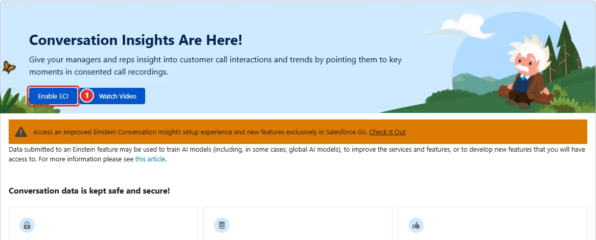
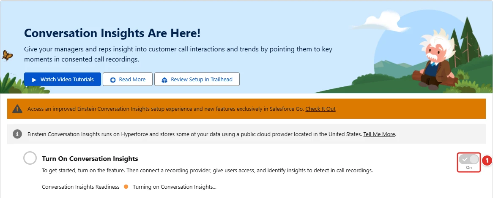

<!-- This file is generated by `npm run generate:docs` from the zod schemas in src/plugins. Do not edit it. -->

# Einstein Conversation Insights

Config key: `settings.einsteinConversationInsights`

!!! danger "Irreversible"
    Once applied, `enabled` cannot be changed back.

!!! info "Prerequisites"
    - Einstein Conversation Insights license (scratch org feature CallCoaching)

Setup: **Einstein Conversation Insights** (`/lightning/setup/CallCoachingSettings/home`)

Turns on Einstein Conversation Insights through the Metadata API (`ConversationalIntelligenceSettings.enableCallCoaching`), then waits until Salesforce has created the objects that store the conversations: a deployment returns as soon as the setting is saved, while turning the feature on can take more than 30 minutes. It cannot be turned off again.



## Use case

### Turn on Conversation Insights in every new org of a pipeline

Tailspin Toys records the sales calls of its reps, and every new scratch org of the sales team needs Einstein Conversation Insights before Call Summaries and the recording providers can be set up. A deployment of `ConversationalIntelligenceSettings` with `enableCallCoaching` returns as soon as the setting is saved, while Salesforce goes on turning the feature on in the background, sometimes for more than 30 minutes: a step that needs its objects right after the deployment fails.

With `enabled: true`, Browserforce turns on **Conversation Insights <span class="bf-pill bf-pill-c1">1</span>** through the Metadata API, then waits until Salesforce has created the objects that store the conversations. The page can show the readiness as in progress for a while longer: the `callSummaries` setting waits for it. Conversation Insights cannot be turned off again.

=== "Config"

    ```json
    {
      "$schema": "https://raw.githubusercontent.com/amtrack/sfdx-browserforce-plugin/main/src/plugins/schema.json",
      "settings": {
        "einsteinConversationInsights": {
          "enabled": true
        }
      }
    }
    ```

=== "Before"

    

=== "After"

    

| Pill | Field | Before | After |
| ---- | ----- | ------ | ----- |
| <span class="bf-pill bf-pill-c1">1</span> | <code>enabled</code> |  | `true` |

## Example

```json
{
  "$schema": "https://raw.githubusercontent.com/amtrack/sfdx-browserforce-plugin/main/src/plugins/schema.json",
  "settings": {
    "einsteinConversationInsights": {
      "enabled": true
    }
  }
}
```

## Fields

| Field | Type | Description |
| ----- | ---- | ----------- |
| <code>enabled</code> | boolean | Enable Einstein Conversation Insights<br>Turning on Einstein Conversation Insights in the scratch org definition can take more than 30 minutes to complete, and a Metadata deploy does not wait for it to complete.<br>It is turned on using ConversationalIntelligenceSettings Metadata (enableCallCoaching) after the org is created, waiting until it is completely turned on https://developer.salesforce.com/docs/atlas.en-us.api_meta.meta/api_meta/meta_conversationalintelligencesettings.htm<br>Warning: it cannot be turned off using Browserforce.<br>**Irreversible:** cannot be changed back once applied. |

??? note "JSON Schema"

    ```json
    {
      "type": "object",
      "properties": {
        "enabled": {
          "type": "boolean",
          "title": "Enable Einstein Conversation Insights",
          "x-irreversible": true,
          "description": "Turning on Einstein Conversation Insights in the scratch org definition can take more than 30 minutes to complete, and a Metadata deploy does not wait for it to complete.\nIt is turned on using ConversationalIntelligenceSettings Metadata (enableCallCoaching) after the org is created, waiting until it is completely turned on https://developer.salesforce.com/docs/atlas.en-us.api_meta.meta/api_meta/meta_conversationalintelligencesettings.htm\nWarning: it cannot be turned off using Browserforce."
        }
      },
      "title": "Einstein Conversation Insights",
      "description": "Setup: **Einstein Conversation Insights** (`/lightning/setup/CallCoachingSettings/home`)\n\nTurns on Einstein Conversation Insights through the Metadata API (`ConversationalIntelligenceSettings.enableCallCoaching`), then waits until Salesforce has created the objects that store the conversations: a deployment returns as soon as the setting is saved, while turning the feature on can take more than 30 minutes. It cannot be turned off again.\n\n",
      "examples": [
        {
          "enabled": true
        }
      ],
      "x-prerequisites": [
        "Einstein Conversation Insights license (scratch org feature CallCoaching)"
      ]
    }
    ```

[Source code of this setting](https://github.com/amtrack/sfdx-browserforce-plugin/tree/main/src/plugins/einstein-conversation-insights)
