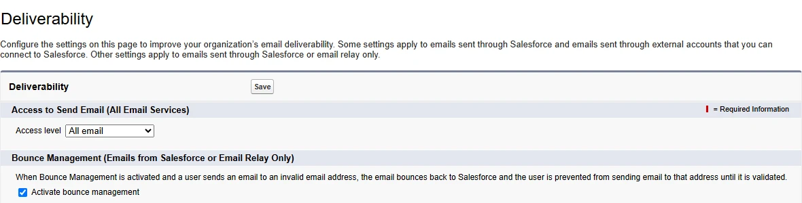
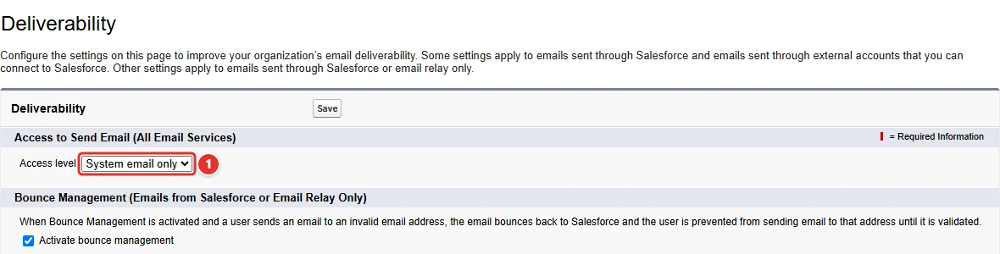
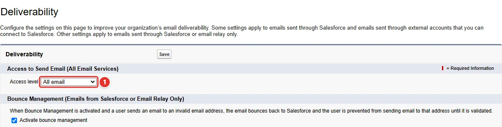

<!-- This file is generated by `npm run generate:docs` from the zod schemas in src/plugins. Do not edit it. -->

# Email Deliverability Settings

Config key: `settings.emailDeliverability`

Setup: **Email → Deliverability** (`/lightning/setup/OrgEmailSettings/home`)

Chooses the access level: "No access", "System email only" or "All email".



## Use case

### The QA team tests the email alerts of a new process

Wide World Importers adds approval and escalation emails to its case management process. Each release is tested in a fresh sandbox, and a new sandbox only sends system emails such as password resets: the email alerts of the process never reach the testers, who report them as bugs.

The Metadata API cannot set the **Access level <span class="bf-pill bf-pill-c1">1</span>** of email deliverability: `EmailAdministrationSettings` has no field for it. Applying this config right after the sandbox is created lets the flows and workflow rules send their emails to the test users. Use `System email only` in the opposite situation, for an org loaded with real customer data that must never email them.

=== "Config"

    ```json
    {
      "$schema": "https://raw.githubusercontent.com/amtrack/sfdx-browserforce-plugin/main/src/plugins/schema.json",
      "settings": {
        "emailDeliverability": {
          "accessLevel": "All email"
        }
      }
    }
    ```

=== "Before"

    

=== "After"

    

| Pill | Field | Before | After |
| ---- | ----- | ------ | ----- |
| <span class="bf-pill bf-pill-c1">1</span> | <code>accessLevel</code> | `System email only` | `All email` |

## Examples

=== "Example 1"

    ```json
    {
      "$schema": "https://raw.githubusercontent.com/amtrack/sfdx-browserforce-plugin/main/src/plugins/schema.json",
      "settings": {
        "emailDeliverability": {
          "accessLevel": "All email"
        }
      }
    }
    ```

=== "Example 2"

    ```json
    {
      "$schema": "https://raw.githubusercontent.com/amtrack/sfdx-browserforce-plugin/main/src/plugins/schema.json",
      "settings": {
        "emailDeliverability": {
          "accessLevel": "System email only"
        }
      }
    }
    ```

=== "Example 3"

    ```json
    {
      "$schema": "https://raw.githubusercontent.com/amtrack/sfdx-browserforce-plugin/main/src/plugins/schema.json",
      "settings": {
        "emailDeliverability": {
          "accessLevel": "No access"
        }
      }
    }
    ```

## Fields

| Field | Type | Description | Values |
| ----- | ---- | ----------- | ------ |
| <code>accessLevel</code> | string | Access Level<br>Choose the email Deliverability Access Level required | `No access`<br>`System email only`<br>`All email` |

??? note "JSON Schema"

    ```json
    {
      "type": "object",
      "properties": {
        "accessLevel": {
          "type": "string",
          "enum": [
            "No access",
            "System email only",
            "All email"
          ],
          "title": "Access Level",
          "description": "Choose the email Deliverability Access Level required"
        }
      },
      "title": "Email Deliverability Settings",
      "description": "Setup: **Email → Deliverability** (`/lightning/setup/OrgEmailSettings/home`)\n\nChooses the access level: \"No access\", \"System email only\" or \"All email\".\n\n",
      "examples": [
        {
          "accessLevel": "All email"
        },
        {
          "accessLevel": "System email only"
        },
        {
          "accessLevel": "No access"
        }
      ]
    }
    ```

[Source code of this setting](https://github.com/amtrack/sfdx-browserforce-plugin/tree/main/src/plugins/email-deliverability)
