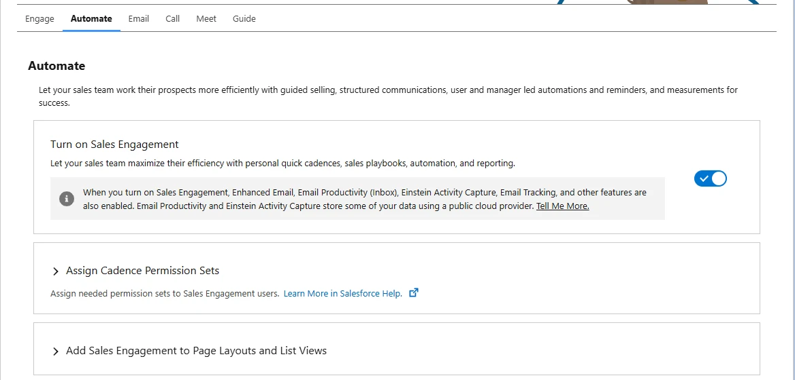
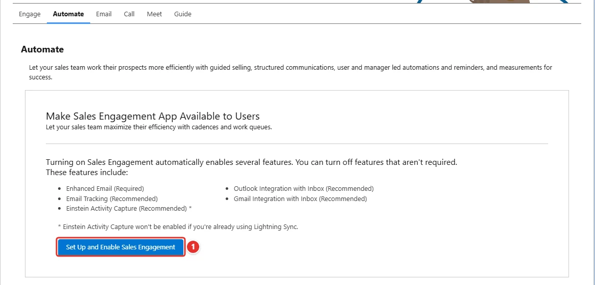
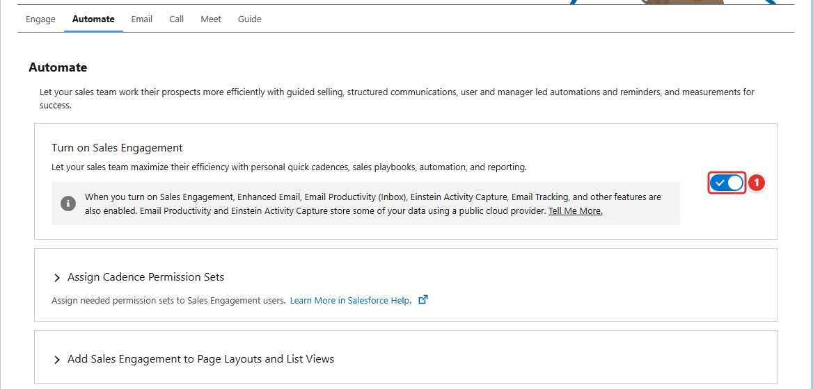

<!-- This file is generated by `npm run generate:docs` from the zod schemas in src/plugins. Do not edit it. -->

# HighVelocitySalesSettings

Config key: `settings.highVelocitySalesSettings`

!!! info "Prerequisites"
    - High Velocity Sales license (scratch org feature HighVelocitySales)

Setup: **Feature Settings → Sales → Sales Engagement → Sales Engagement Settings** (`/lightning/setup/SalesEngagement/home`)

Due to a bug, High Velocity Sales (Sales Engagement) needs to be set up and enabled initially using the user interface. Once set up, it can be configured with the [HighVelocitySalesSettings](https://developer.salesforce.com/docs/atlas.en-us.api_meta.meta/api_meta/meta_highvelocitysalessettings.htm) metadata.



## Use case

### A sales development team starts working with cadences

Contoso hires a team of sales development reps who call and email new leads following cadences: a sequence of steps with a work queue telling each rep who to contact next. Cadences and work queues come with Sales Engagement (formerly High Velocity Sales), and the team's developers already describe its options in `HighVelocitySalesSettings` metadata.

That metadata cannot turn the feature on for the first time: Salesforce requires a click on **Set Up and Enable Sales Engagement <span class="bf-pill bf-pill-c1">1</span>** in Setup, which then shows the toggle of the feature. This config clicks it in every new org, so the deployment of the cadences and of the settings that follow works without a manual step.

=== "Config"

    ```json
    {
      "$schema": "https://raw.githubusercontent.com/amtrack/sfdx-browserforce-plugin/main/src/plugins/schema.json",
      "settings": {
        "highVelocitySalesSettings": {
          "setUpAndEnable": true
        }
      }
    }
    ```

=== "Before"

    

=== "After"

    

| Pill | Field | Before | After |
| ---- | ----- | ------ | ----- |
| <span class="bf-pill bf-pill-c1">1</span> | <code>setUpAndEnable</code> | `false` | `true` |

## Example

```json
{
  "$schema": "https://raw.githubusercontent.com/amtrack/sfdx-browserforce-plugin/main/src/plugins/schema.json",
  "settings": {
    "highVelocitySalesSettings": {
      "setUpAndEnable": true
    }
  }
}
```

## Fields

| Field | Type | Description |
| ----- | ---- | ----------- |
| <code>setUpAndEnable</code> | boolean | Set Up and Enable High Velocity Sales |

??? note "JSON Schema"

    ```json
    {
      "type": "object",
      "properties": {
        "setUpAndEnable": {
          "type": "boolean",
          "title": "Set Up and Enable High Velocity Sales"
        }
      },
      "title": "HighVelocitySalesSettings",
      "description": "Setup: **Feature Settings → Sales → Sales Engagement → Sales Engagement Settings** (`/lightning/setup/SalesEngagement/home`)\n\nDue to a bug, High Velocity Sales (Sales Engagement) needs to be set up and enabled initially using the user interface. Once set up, it can be configured with the [HighVelocitySalesSettings](https://developer.salesforce.com/docs/atlas.en-us.api_meta.meta/api_meta/meta_highvelocitysalessettings.htm) metadata.\n\n",
      "examples": [
        {
          "setUpAndEnable": true
        }
      ],
      "x-prerequisites": [
        "High Velocity Sales license (scratch org feature HighVelocitySales)"
      ]
    }
    ```

[Source code of this setting](https://github.com/amtrack/sfdx-browserforce-plugin/tree/main/src/plugins/high-velocity-sales-settings)
