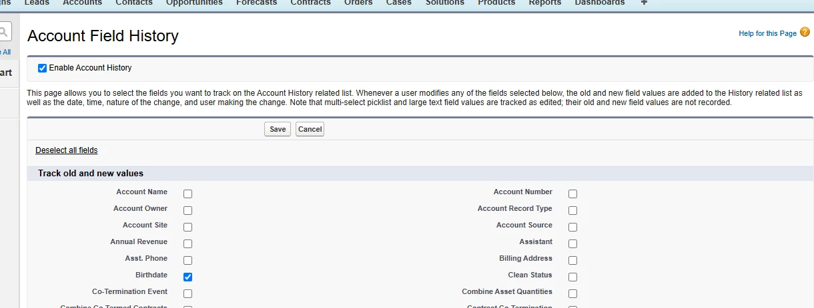
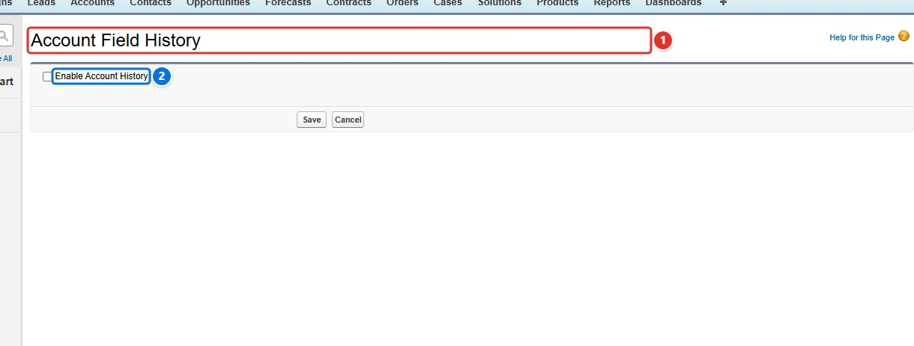
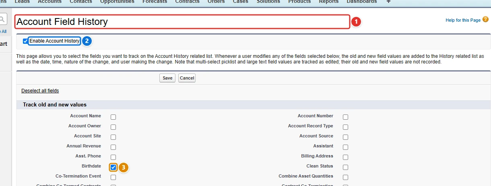

<!-- This file is generated by `npm run generate:docs` from the zod schemas in src/plugins. Do not edit it. -->

# History Tracking

Config key: `settings.historyTracking`

!!! info "Prerequisites"
    - Person Accounts enabled, to track Person Account fields

Enables or disables history tracking on objects and on their fields (**Object Manager → Fields & Relationships → Set History Tracking**).

It closes a gap of the Metadata API, which cannot enable field history tracking on custom Person Account fields.



## Use case

### Track the history of Person Account fields

A wealth management firm keeps its private clients as Person Accounts, and its compliance officers must see who changed a client's birthdate or the custom fields of the person, and when. History tracking of a Person Account field is set on the Account, but the Metadata API only sets `trackHistory` on the Contact field, which does not reach its Person Account twin (`__pc`).

This config turns on the history of **Account <span class="bf-pill bf-pill-c1">1</span>** with **Enable Account History <span class="bf-pill bf-pill-c2">2</span>**, then tracks the fields of the person **<span class="bf-pill bf-pill-c3">3</span>**: the standard Birthdate (`PersonBirthdate`) and the custom field `Test__pc`. Fields are named by their API name as seen from the Account, with the `__pc` suffix for the custom fields of the person.

=== "Config"

    ```json
    {
      "$schema": "https://raw.githubusercontent.com/amtrack/sfdx-browserforce-plugin/main/src/plugins/schema.json",
      "settings": {
        "historyTracking": [
          {
            "objectApiName": "Account",
            "enableHistoryTracking": true,
            "fieldHistoryTracking": [
              {
                "fieldApiName": "PersonBirthdate",
                "enableHistoryTracking": true
              },
              {
                "fieldApiName": "Test__pc",
                "enableHistoryTracking": true
              }
            ]
          }
        ]
      }
    }
    ```

=== "Before"

    

=== "After"

    

| Pill | Field | Before | After |
| ---- | ----- | ------ | ----- |
| <span class="bf-pill bf-pill-c1">1</span> | <code>[0].<wbr>objectApiName</code> | `Account` | `Account` |
| <span class="bf-pill bf-pill-c2">2</span> | <code>[0].<wbr>enableHistoryTracking</code> | `false` | `true` |
| <span class="bf-pill bf-pill-c3">3</span> | <code>[0].<wbr>fieldHistoryTracking</code> |  | `[{"fieldApiName":"PersonBirthdate","enableHistoryTracking":true},{"fieldApiName":"Test__pc","enableHistoryTracking":true}]` |

## Example

```json
{
  "$schema": "https://raw.githubusercontent.com/amtrack/sfdx-browserforce-plugin/main/src/plugins/schema.json",
  "settings": {
    "historyTracking": [
      {
        "objectApiName": "Account",
        "enableHistoryTracking": true,
        "fieldHistoryTracking": [
          {
            "fieldApiName": "Industry",
            "enableHistoryTracking": true
          },
          {
            "fieldApiName": "Rating",
            "enableHistoryTracking": true
          }
        ]
      }
    ]
  }
}
```

## Fields

In the field paths, `[]` stands for the items of a list and `*` for the entries of an object keyed by name.

| Field | Type | Description | Default |
| ----- | ---- | ----------- | ------- |
| <code>[].<wbr>objectApiName</code> | string | Object API Name<br>The API name of the object to manage history tracking for.<br>**Required.** |  |
| <code>[].<wbr>enableHistoryTracking</code> | boolean | Enable History Tracking<br>If history tracking should be enabled. |  |
| <code>[].<wbr>fieldHistoryTracking</code> | json | Field History Tracking | `[]` |

??? note "JSON Schema"

    ```json
    {
      "default": [],
      "title": "History Tracking",
      "description": "Enables or disables history tracking on objects and on their fields (**Object Manager → Fields & Relationships → Set History Tracking**).\n\nIt closes a gap of the Metadata API, which cannot enable field history tracking on custom Person Account fields.\n\n",
      "examples": [
        [
          {
            "objectApiName": "Account",
            "enableHistoryTracking": true,
            "fieldHistoryTracking": [
              {
                "fieldApiName": "Industry",
                "enableHistoryTracking": true
              },
              {
                "fieldApiName": "Rating",
                "enableHistoryTracking": true
              }
            ]
          }
        ]
      ],
      "x-prerequisites": [
        "Person Accounts enabled, to track Person Account fields"
      ],
      "type": "array",
      "items": {
        "type": "object",
        "properties": {
          "objectApiName": {
            "type": "string",
            "title": "Object API Name",
            "description": "The API name of the object to manage history tracking for."
          },
          "enableHistoryTracking": {
            "type": "boolean",
            "title": "Enable History Tracking",
            "description": "If history tracking should be enabled."
          },
          "fieldHistoryTracking": {
            "default": [],
            "title": "Field History Tracking",
            "type": "array",
            "items": {
              "type": "object",
              "properties": {
                "fieldApiName": {
                  "type": "string",
                  "title": "Field API Name",
                  "description": "The API name of the field to manage history tracking for."
                },
                "enableHistoryTracking": {
                  "type": "boolean",
                  "title": "Enable History Tracking",
                  "description": "If history tracking should be enabled."
                }
              },
              "required": [
                "fieldApiName",
                "enableHistoryTracking"
              ]
            }
          }
        },
        "required": [
          "objectApiName"
        ]
      }
    }
    ```

[Source code of this setting](https://github.com/amtrack/sfdx-browserforce-plugin/tree/main/src/plugins/history-tracking)
