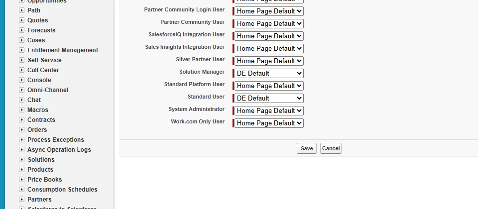
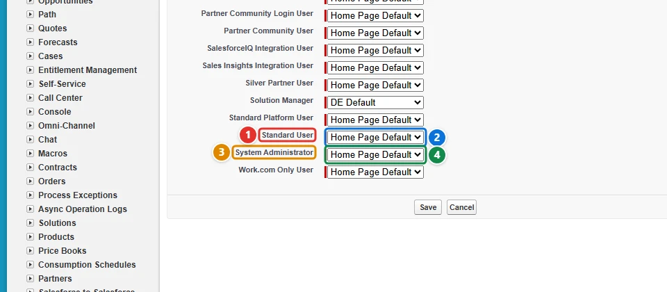
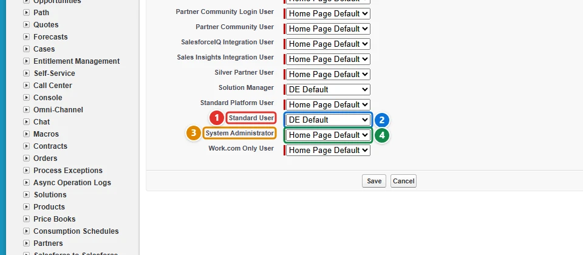

<!-- This file is generated by `npm run generate:docs` from the zod schemas in src/plugins. Do not edit it. -->

# Home Page Layouts

Config key: `settings.homePageLayouts`

!!! warning "Salesforce Classic only"
    This feature only exists in Salesforce Classic.

Salesforce Classic Setup: **Customize → Home → Home Page Layouts** (`/setup/ui/assignhomelayoutedit.jsp`)

Assigns Home Page Layouts to profiles.



## Use case

### Give sales users their own home page

The sales reps of Acme still work in Salesforce Classic, and their home tab should show the dashboard snapshot and the custom links of the **DE Default** home page layout. The Metadata API deploys the `HomePageLayout` itself, but the `Profile` type has no field for its home page layout: which profile sees which layout is only set on the Home Page Layout Assignment page of Setup.

This config gives the **Standard User <span class="bf-pill bf-pill-c1">1</span>** profile the **DE Default <span class="bf-pill bf-pill-c2">2</span>** layout, and keeps the **System Administrator <span class="bf-pill bf-pill-c3">3</span>** profile on the standard home page: an empty `layout` **<span class="bf-pill bf-pill-c4">4</span>** stands for **Home Page Default**. Profiles are named as Setup shows them, and the profiles the config does not list keep their layout.

=== "Config"

    ```json
    {
      "$schema": "https://raw.githubusercontent.com/amtrack/sfdx-browserforce-plugin/main/src/plugins/schema.json",
      "settings": {
        "homePageLayouts": {
          "homePageLayoutAssignments": [
            {
              "profile": "Standard User",
              "layout": "DE Default"
            },
            {
              "profile": "System Administrator",
              "layout": ""
            }
          ]
        }
      }
    }
    ```

=== "Before"

    

=== "After"

    

| Pill | Field | Before | After |
| ---- | ----- | ------ | ----- |
| <span class="bf-pill bf-pill-c1">1</span> | <code>homePageLayoutAssignments[0].<wbr>profile</code> | `Standard User` | `Standard User` |
| <span class="bf-pill bf-pill-c2">2</span> | <code>homePageLayoutAssignments[0].<wbr>layout</code> | `` | `DE Default` |
| <span class="bf-pill bf-pill-c3">3</span> | <code>homePageLayoutAssignments[1].<wbr>profile</code> | `System Administrator` | `System Administrator` |
| <span class="bf-pill bf-pill-c4">4</span> | <code>homePageLayoutAssignments[1].<wbr>layout</code> | `` | `` |

## Example

```json
{
  "$schema": "https://raw.githubusercontent.com/amtrack/sfdx-browserforce-plugin/main/src/plugins/schema.json",
  "settings": {
    "homePageLayouts": {
      "homePageLayoutAssignments": [
        {
          "profile": "StandardUser",
          "layout": "MyHomePageLayout"
        },
        {
          "profile": "SystemAdministrator",
          "layout": ""
        }
      ]
    }
  }
}
```

## Fields

In the field paths, `[]` stands for the items of a list and `*` for the entries of an object keyed by name.

| Field | Type | Description |
| ----- | ---- | ----------- |
| <code>homePageLayoutAssignments[].<wbr>profile</code> | string | Developer Name of Profile<br>**Required.** |
| <code>homePageLayoutAssignments[].<wbr>layout</code> | string | Developer Name of the HomePageLayout or empty string for default layout<br>**Required.** |

??? note "JSON Schema"

    ```json
    {
      "type": "object",
      "properties": {
        "homePageLayoutAssignments": {
          "default": [],
          "title": "Home Page Layout Assignment",
          "type": "array",
          "items": {
            "type": "object",
            "properties": {
              "profile": {
                "type": "string",
                "description": "Developer Name of Profile"
              },
              "layout": {
                "type": "string",
                "description": "Developer Name of the HomePageLayout or empty string for default layout"
              }
            },
            "required": [
              "profile",
              "layout"
            ]
          }
        }
      },
      "title": "Home Page Layouts",
      "description": "Salesforce Classic Setup: **Customize → Home → Home Page Layouts** (`/setup/ui/assignhomelayoutedit.jsp`)\n\nAssigns Home Page Layouts to profiles.\n\n",
      "examples": [
        {
          "homePageLayoutAssignments": [
            {
              "profile": "StandardUser",
              "layout": "MyHomePageLayout"
            },
            {
              "profile": "SystemAdministrator",
              "layout": ""
            }
          ]
        }
      ],
      "x-user-interface": "classic"
    }
    ```

[Source code of this setting](https://github.com/amtrack/sfdx-browserforce-plugin/tree/main/src/plugins/home-page-layouts)
