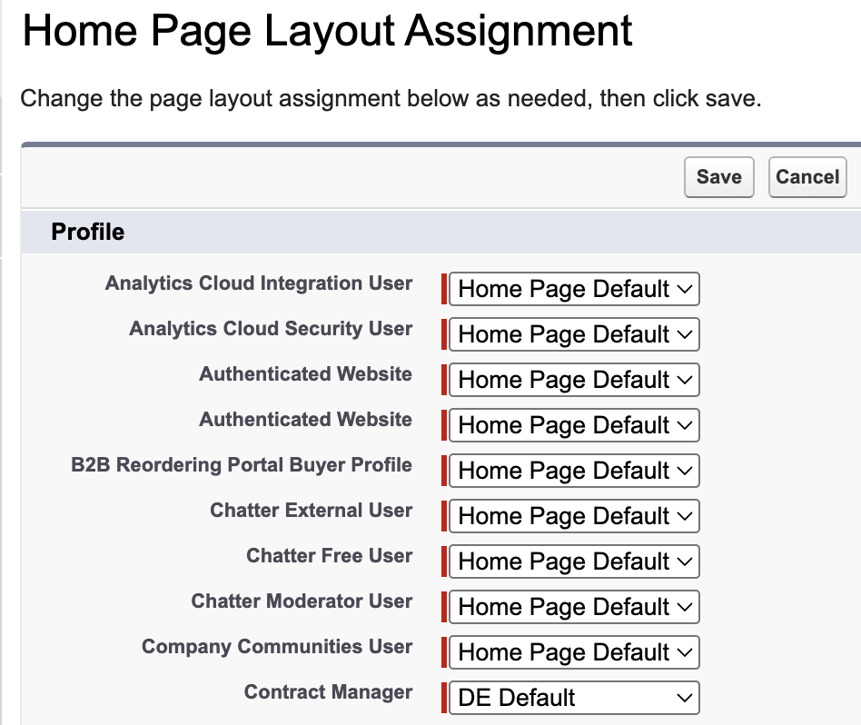

<!-- This file is generated by `npm run generate:docs` from the zod schemas in src/plugins. Do not edit it. -->

# Home Page Layouts

Config key: `settings.homePageLayouts`

!!! warning "Salesforce Classic only"
    This feature only exists in Salesforce Classic.

Salesforce Classic Setup: **Customize → Home → Home Page Layouts** (`/setup/ui/assignhomelayoutedit.jsp`)

Assigns Home Page Layouts to profiles.



## Example

```json
{
  "$schema": "https://raw.githubusercontent.com/amtrack/sfdx-browserforce-plugin/main/src/plugins/schema.json",
  "settings": {
    "homePageLayouts": {
      "homePageLayoutAssignments": [
        {
          "profile": "StandardUser",
          "layout": "MyHomePageLayout"
        },
        {
          "profile": "SystemAdministrator",
          "layout": ""
        }
      ]
    }
  }
}
```

## Fields

In the field paths, `[]` stands for the items of a list and `*` for the entries of an object keyed by name.

| Field | Type | Description |
| ----- | ---- | ----------- |
| <code>homePageLayoutAssignments[].<wbr>profile</code> | string | Developer Name of Profile<br>**Required.** |
| <code>homePageLayoutAssignments[].<wbr>layout</code> | string | Developer Name of the HomePageLayout or empty string for default layout<br>**Required.** |

??? note "JSON Schema"

    ```json
    {
      "type": "object",
      "properties": {
        "homePageLayoutAssignments": {
          "default": [],
          "title": "Home Page Layout Assignment",
          "type": "array",
          "items": {
            "type": "object",
            "properties": {
              "profile": {
                "type": "string",
                "description": "Developer Name of Profile"
              },
              "layout": {
                "type": "string",
                "description": "Developer Name of the HomePageLayout or empty string for default layout"
              }
            },
            "required": [
              "profile",
              "layout"
            ]
          }
        }
      },
      "title": "Home Page Layouts",
      "description": "Salesforce Classic Setup: **Customize → Home → Home Page Layouts** (`/setup/ui/assignhomelayoutedit.jsp`)\n\nAssigns Home Page Layouts to profiles.\n\n",
      "examples": [
        {
          "homePageLayoutAssignments": [
            {
              "profile": "StandardUser",
              "layout": "MyHomePageLayout"
            },
            {
              "profile": "SystemAdministrator",
              "layout": ""
            }
          ]
        }
      ],
      "x-user-interface": "classic"
    }
    ```

[Source code of this setting](https://github.com/amtrack/sfdx-browserforce-plugin/tree/main/src/plugins/home-page-layouts)
