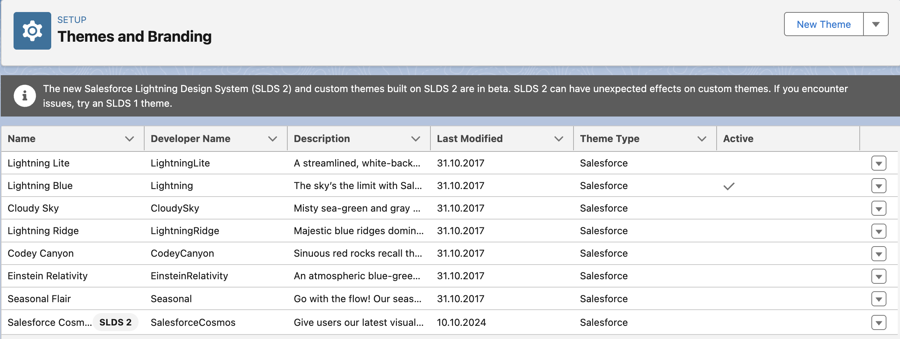

<!-- This file is generated by `npm run generate:docs` from the zod schemas in src/plugins. Do not edit it. -->

# LightningExperienceSettings

Config key: `settings.lightningExperienceSettings`

Setup: **User Interface → Themes and Branding** (`/lightning/setup/ThemingAndBranding/home`)

Activates a Lightning Experience theme. Although the Metadata API has an `activeThemeName` field in `LightningExperienceSettings`, it cannot activate the standard themes like `Lightning`, `LightningLite` or `SalesforceCosmos`.



## Example

```json
{
  "$schema": "https://raw.githubusercontent.com/amtrack/sfdx-browserforce-plugin/main/src/plugins/schema.json",
  "settings": {
    "lightningExperienceSettings": {
      "activeThemeName": "Lightning"
    }
  }
}
```

## Fields

| Field | Type | Description |
| ----- | ---- | ----------- |
| <code>activeThemeName</code> | string | The active Lightning Experience Theme<br>The API Name of the Lightning Experience Theme to be activated |

??? note "JSON Schema"

    ```json
    {
      "type": "object",
      "properties": {
        "activeThemeName": {
          "type": "string",
          "title": "The active Lightning Experience Theme",
          "description": "The API Name of the Lightning Experience Theme to be activated"
        }
      },
      "title": "LightningExperienceSettings",
      "description": "Setup: **User Interface → Themes and Branding** (`/lightning/setup/ThemingAndBranding/home`)\n\nActivates a Lightning Experience theme. Although the Metadata API has an `activeThemeName` field in `LightningExperienceSettings`, it cannot activate the standard themes like `Lightning`, `LightningLite` or `SalesforceCosmos`.\n\n",
      "examples": [
        {
          "activeThemeName": "Lightning"
        }
      ]
    }
    ```

[Source code of this setting](https://github.com/amtrack/sfdx-browserforce-plugin/tree/main/src/plugins/lightning-experience-settings)
