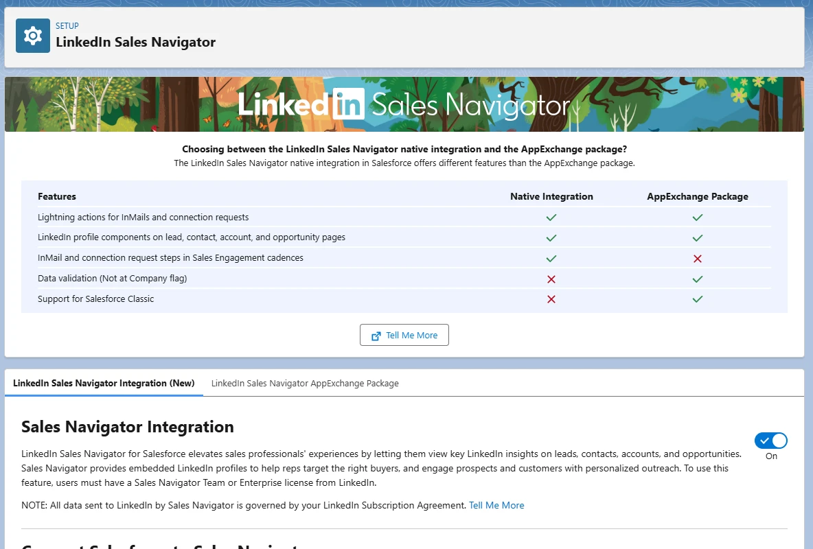
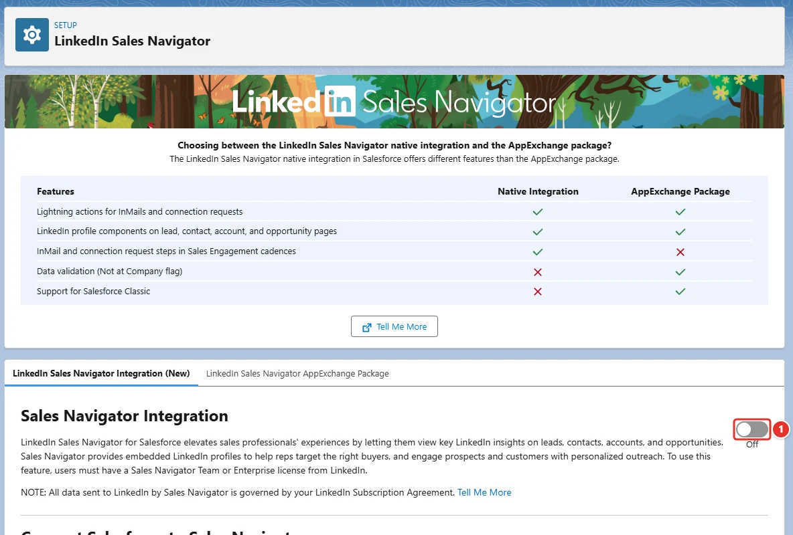
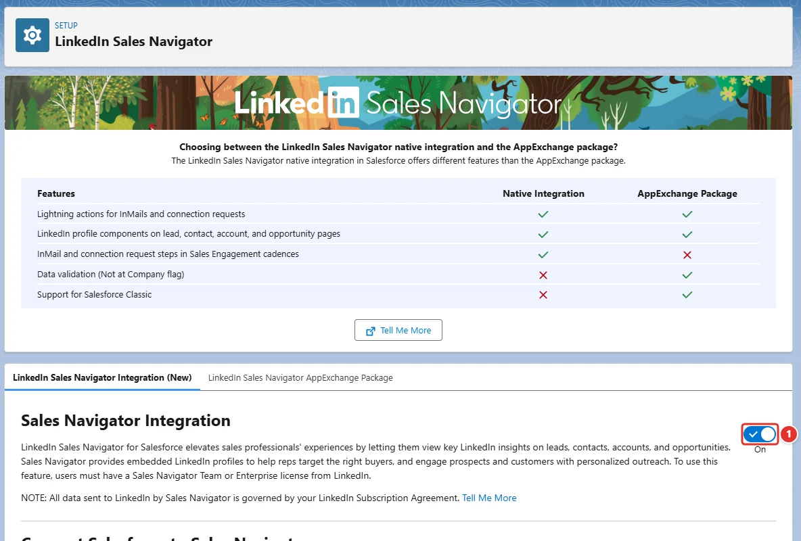

<!-- This file is generated by `npm run generate:docs` from the zod schemas in src/plugins. Do not edit it. -->

# LinkedIn Sales Navigator Settings

Config key: `settings.linkedInSalesNavigatorSettings`

Setup: **Feature Settings → Sales → LinkedIn Sales Navigator** (`/lightning/setup/LinkedInSalesNavigatorPage/home`)

Enables or disables the Sales Navigator integration.



## Use case

### Account executives research buyers without leaving Salesforce

The account executives of Fabrikam use LinkedIn Sales Navigator to find the decision makers of their prospects. They switch between the two tools all day, and the contacts they find never reach the CRM.

Turning on the **Sales Navigator integration <span class="bf-pill bf-pill-c1">1</span>** adds the Sales Navigator components to account, contact and lead pages, so reps see the buying committee and send InMails from the record. No Metadata API settings type holds this toggle, and turning it on also asks the admin to accept the terms of the integration: this config does both in every org of the team.

=== "Config"

    ```json
    {
      "$schema": "https://raw.githubusercontent.com/amtrack/sfdx-browserforce-plugin/main/src/plugins/schema.json",
      "settings": {
        "linkedInSalesNavigatorSettings": {
          "enabled": true
        }
      }
    }
    ```

=== "Before"

    

=== "After"

    

| Pill | Field | Before | After |
| ---- | ----- | ------ | ----- |
| <span class="bf-pill bf-pill-c1">1</span> | <code>enabled</code> | `false` | `true` |

## Examples

=== "Example 1"

    ```json
    {
      "$schema": "https://raw.githubusercontent.com/amtrack/sfdx-browserforce-plugin/main/src/plugins/schema.json",
      "settings": {
        "linkedInSalesNavigatorSettings": {
          "enabled": true
        }
      }
    }
    ```

=== "Example 2"

    ```json
    {
      "$schema": "https://raw.githubusercontent.com/amtrack/sfdx-browserforce-plugin/main/src/plugins/schema.json",
      "settings": {
        "linkedInSalesNavigatorSettings": {
          "enabled": false
        }
      }
    }
    ```

## Fields

| Field | Type | Description |
| ----- | ---- | ----------- |
| <code>enabled</code> | boolean | Enable LinkedIn Sales Navigator Integration |

??? note "JSON Schema"

    ```json
    {
      "type": "object",
      "properties": {
        "enabled": {
          "type": "boolean",
          "title": "Enable LinkedIn Sales Navigator Integration"
        }
      },
      "title": "LinkedIn Sales Navigator Settings",
      "description": "Setup: **Feature Settings → Sales → LinkedIn Sales Navigator** (`/lightning/setup/LinkedInSalesNavigatorPage/home`)\n\nEnables or disables the Sales Navigator integration.\n\n",
      "examples": [
        {
          "enabled": true
        },
        {
          "enabled": false
        }
      ]
    }
    ```

[Source code of this setting](https://github.com/amtrack/sfdx-browserforce-plugin/tree/main/src/plugins/linkedin-sales-navigator-settings)
