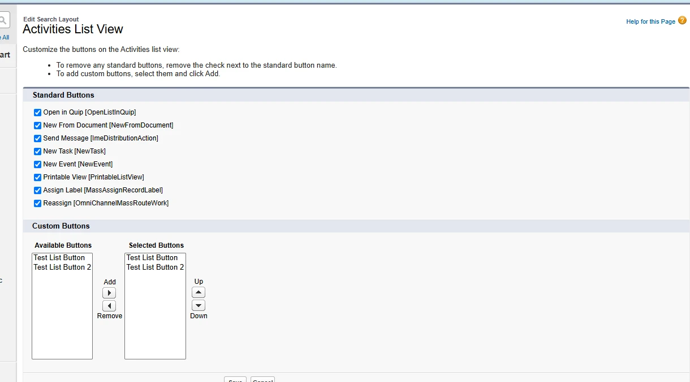
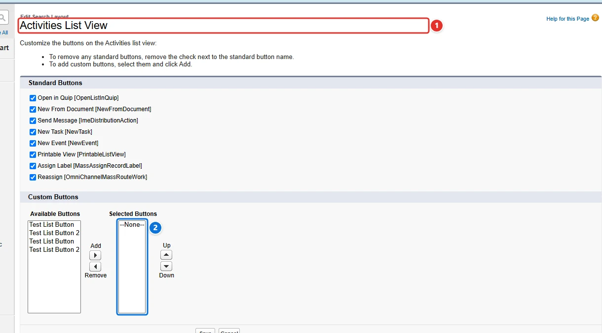
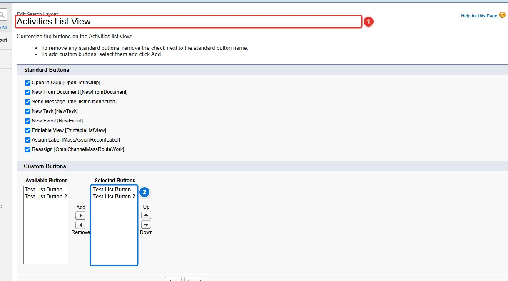

<!-- This file is generated by `npm run generate:docs` from the zod schemas in src/plugins. Do not edit it. -->

# List View Custom Buttons

Config key: `settings.listViewCustomButtons`

Object Manager: **(object) → Search Layouts for Salesforce Classic → List View**

Manages the custom buttons selected in the list view button layout of any object. Buttons are identified by the API name of their WebLink, with an optional namespace prefix (`AssignTask` or `th_dev__AssignTask`).



## Use case

### Show the custom buttons of the task list views

The support team of Acme works its tasks from list views, and its developers wrote two list buttons, **Test List Button** and **Test List Button 2**, that act on the selected tasks. The `listViewButtons` of the Metadata API (`searchLayouts` of an object) do not apply to tasks and events, so an admin had to add the buttons by hand, in each org.

This config selects both buttons on the list views of **Task <span class="bf-pill bf-pill-c1">1</span>**, whose layout is the **Activities List View**, shared with events. The buttons are named by their API name, with their namespace prefix when they come from a package (`th_dev__AssignTask`). With `removeOtherButtons`, the **Selected Buttons <span class="bf-pill bf-pill-c2">2</span>** end up exactly as listed.

=== "Config"

    ```json
    {
      "$schema": "https://raw.githubusercontent.com/amtrack/sfdx-browserforce-plugin/main/src/plugins/schema.json",
      "settings": {
        "listViewCustomButtons": [
          {
            "objectApiName": "Task",
            "buttons": [
              "TestListButton",
              "TestListButton2"
            ],
            "removeOtherButtons": true
          }
        ]
      }
    }
    ```

=== "Before"

    

=== "After"

    

| Pill | Field | Before | After |
| ---- | ----- | ------ | ----- |
| <span class="bf-pill bf-pill-c1">1</span> | <code>[0].<wbr>objectApiName</code> | `Task` | `Task` |
| <span class="bf-pill bf-pill-c2">2</span> | <code>[0].<wbr>buttons</code> | `[]` | `["TestListButton","TestListButton2"]` |
|  | <code>[0].<wbr>removeOtherButtons</code><br>removes from the Selected Buttons (2) the buttons the list does not name | `true` | `true` |

## Example

```json
{
  "$schema": "https://raw.githubusercontent.com/amtrack/sfdx-browserforce-plugin/main/src/plugins/schema.json",
  "settings": {
    "listViewCustomButtons": [
      {
        "objectApiName": "Task",
        "buttons": [
          "MyListButton",
          "MyOtherListButton"
        ],
        "removeOtherButtons": true
      }
    ]
  }
}
```

## Fields

In the field paths, `[]` stands for the items of a list and `*` for the entries of an object keyed by name.

| Field | Type | Description | Default |
| ----- | ---- | ----------- | ------- |
| <code>[].<wbr>objectApiName</code> | string | Object API Name<br>The API name of the object whose list view custom buttons to manage (e.g. Activity, Account, Contact).<br>**Required.** |  |
| <code>[].<wbr>buttons</code> | string[] | Buttons<br>WebLink API Names (DeveloperName) of the custom buttons to select. Use namespace__Name for namespaced buttons (e.g. 'th_dev__AssignTask') or just Name for unpackaged buttons (e.g. 'AssignTask').<br>**Required.** | `[]` |
| <code>[].<wbr>removeOtherButtons</code> | boolean | Remove Other Buttons<br>Whether to remove other buttons from the list view. If true, all buttons except the ones specified in the buttons array will be removed. | `false` |

??? note "JSON Schema"

    ```json
    {
      "default": [],
      "title": "List View Custom Buttons",
      "description": "Object Manager: **(object) → Search Layouts for Salesforce Classic → List View**\n\nManages the custom buttons selected in the list view button layout of any object. Buttons are identified by the API name of their WebLink, with an optional namespace prefix (`AssignTask` or `th_dev__AssignTask`).\n\n",
      "examples": [
        [
          {
            "objectApiName": "Task",
            "buttons": [
              "MyListButton",
              "MyOtherListButton"
            ],
            "removeOtherButtons": true
          }
        ]
      ],
      "type": "array",
      "items": {
        "type": "object",
        "properties": {
          "objectApiName": {
            "type": "string",
            "title": "Object API Name",
            "description": "The API name of the object whose list view custom buttons to manage (e.g. Activity, Account, Contact)."
          },
          "buttons": {
            "type": "array",
            "items": {
              "type": "string",
              "description": "WebLink API Name (DeveloperName) of the custom button, optionally prefixed with namespace (e.g. 'AssignTask' or 'th_dev__AssignTask')."
            },
            "title": "Buttons",
            "description": "WebLink API Names (DeveloperName) of the custom buttons to select. Use namespace__Name for namespaced buttons (e.g. 'th_dev__AssignTask') or just Name for unpackaged buttons (e.g. 'AssignTask').",
            "default": []
          },
          "removeOtherButtons": {
            "title": "Remove Other Buttons",
            "description": "Whether to remove other buttons from the list view. If true, all buttons except the ones specified in the buttons array will be removed.",
            "default": false,
            "type": "boolean"
          }
        },
        "required": [
          "objectApiName",
          "buttons"
        ]
      }
    }
    ```

[Source code of this setting](https://github.com/amtrack/sfdx-browserforce-plugin/tree/main/src/plugins/list-view-custom-buttons)
