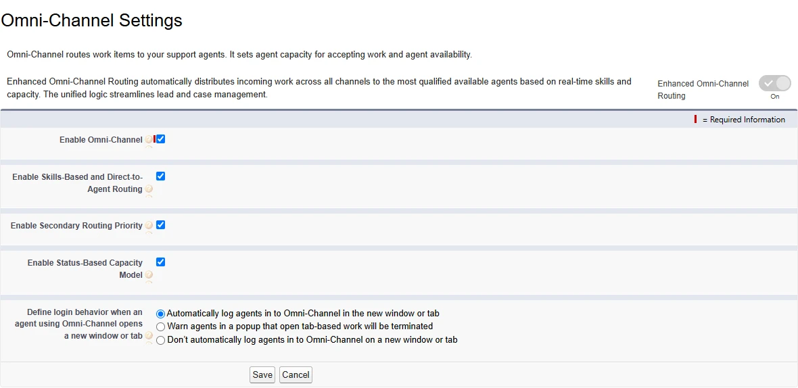
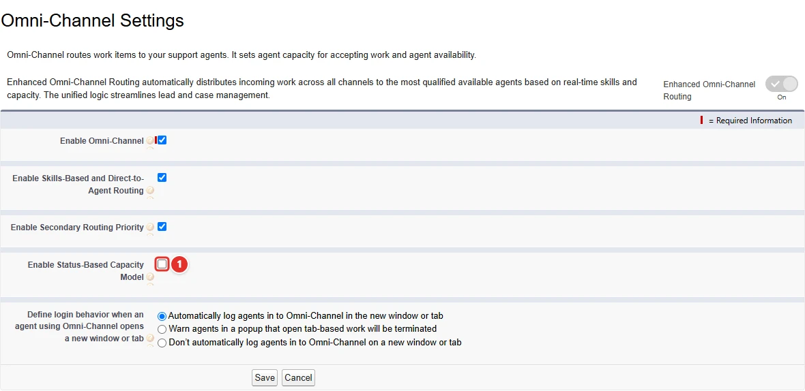
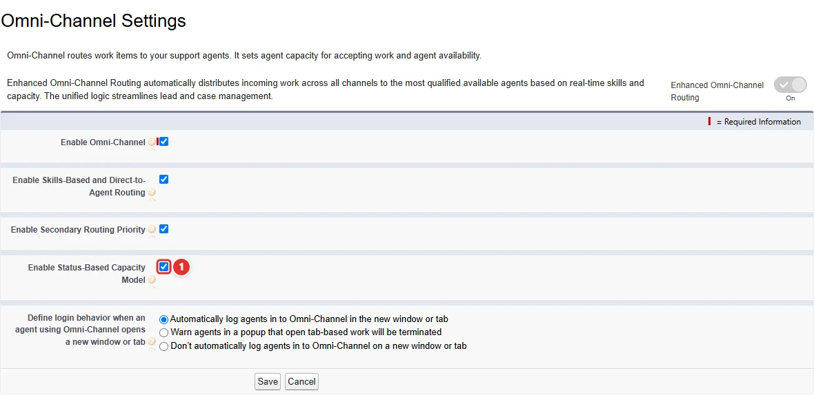

<!-- This file is generated by `npm run generate:docs` from the zod schemas in src/plugins. Do not edit it. -->

# Omni-Channel Settings

Config key: `settings.omniChannelSettings`

!!! info "Prerequisites"
    - Omni-Channel enabled

Setup: **Feature Settings → Service → Omni-Channel → Omni-Channel Settings** (`/lightning/setup/OmniChannelSettings/home`)

Enables the status-based capacity model.



## Use case

### A support center counts only the cases agents are working on

The support center of Litware routes cases to its agents with Omni-Channel. With the default tab-based capacity model, a case counts against an agent's capacity as long as its tab is open, so agents who park cases in "Waiting on customer" stop receiving new work while they have nothing to do.

The **status-based capacity model <span class="bf-pill bf-pill-c1">1</span>** counts a case only while its status says it is in progress, and frees the capacity as soon as the agent changes the status or the owner. It is a checkbox of the Omni-Channel Settings page with no Metadata API equivalent; turn it on with this config before configuring the capacity of the service channels with `serviceChannels`.

=== "Config"

    ```json
    {
      "$schema": "https://raw.githubusercontent.com/amtrack/sfdx-browserforce-plugin/main/src/plugins/schema.json",
      "settings": {
        "omniChannelSettings": {
          "enableStatusBasedCapacityModel": true
        }
      }
    }
    ```

=== "Before"

    

=== "After"

    

| Pill | Field | Before | After |
| ---- | ----- | ------ | ----- |
| <span class="bf-pill bf-pill-c1">1</span> | <code>enableStatusBasedCapacityModel</code> | `false` | `true` |

## Example

```json
{
  "$schema": "https://raw.githubusercontent.com/amtrack/sfdx-browserforce-plugin/main/src/plugins/schema.json",
  "settings": {
    "omniChannelSettings": {
      "enableStatusBasedCapacityModel": true
    }
  }
}
```

## Fields

| Field | Type | Description |
| ----- | ---- | ----------- |
| <code>enableStatusBasedCapacityModel</code> | boolean | Enable Status-Based Capacity Model<br>Route and track work based on changes to work status and ownership. |

??? note "JSON Schema"

    ```json
    {
      "type": "object",
      "properties": {
        "enableStatusBasedCapacityModel": {
          "type": "boolean",
          "title": "Enable Status-Based Capacity Model",
          "description": "Route and track work based on changes to work status and ownership."
        }
      },
      "title": "Omni-Channel Settings",
      "description": "Setup: **Feature Settings → Service → Omni-Channel → Omni-Channel Settings** (`/lightning/setup/OmniChannelSettings/home`)\n\nEnables the status-based capacity model.\n\n",
      "examples": [
        {
          "enableStatusBasedCapacityModel": true
        }
      ],
      "x-prerequisites": [
        "Omni-Channel enabled"
      ]
    }
    ```

[Source code of this setting](https://github.com/amtrack/sfdx-browserforce-plugin/tree/main/src/plugins/omni-channel-settings)
