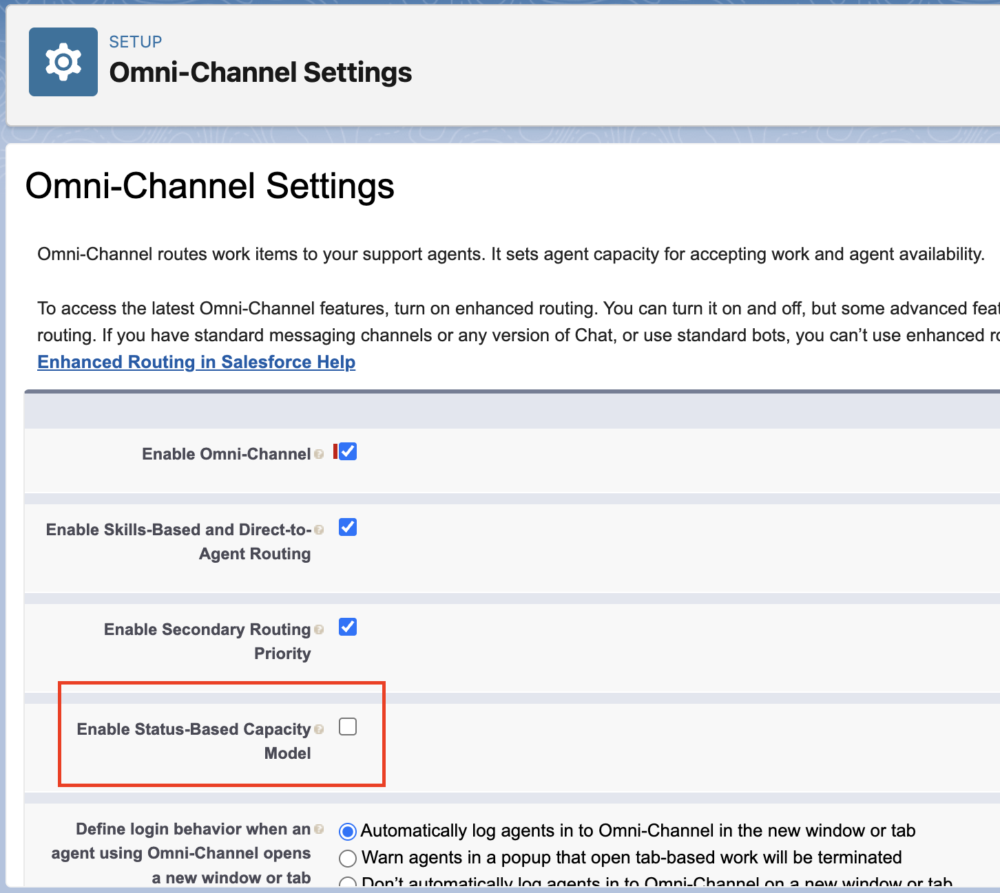

<!-- This file is generated by `npm run generate:docs` from the zod schemas in src/plugins. Do not edit it. -->

# Omni-Channel Settings

Config key: `settings.omniChannelSettings`

!!! info "Prerequisites"
    - Omni-Channel enabled

Setup: **Feature Settings → Service → Omni-Channel → Omni-Channel Settings** (`/lightning/setup/OmniChannelSettings/home`)

Enables the status-based capacity model.



## Example

```json
{
  "$schema": "https://raw.githubusercontent.com/amtrack/sfdx-browserforce-plugin/main/src/plugins/schema.json",
  "settings": {
    "omniChannelSettings": {
      "enableStatusBasedCapacityModel": true
    }
  }
}
```

## Fields

| Field | Type | Description |
| ----- | ---- | ----------- |
| <code>enableStatusBasedCapacityModel</code> | boolean | Enable Status-Based Capacity Model<br>Route and track work based on changes to work status and ownership. |

??? note "JSON Schema"

    ```json
    {
      "type": "object",
      "properties": {
        "enableStatusBasedCapacityModel": {
          "type": "boolean",
          "title": "Enable Status-Based Capacity Model",
          "description": "Route and track work based on changes to work status and ownership."
        }
      },
      "title": "Omni-Channel Settings",
      "description": "Setup: **Feature Settings → Service → Omni-Channel → Omni-Channel Settings** (`/lightning/setup/OmniChannelSettings/home`)\n\nEnables the status-based capacity model.\n\n",
      "examples": [
        {
          "enableStatusBasedCapacityModel": true
        }
      ],
      "x-prerequisites": [
        "Omni-Channel enabled"
      ]
    }
    ```

[Source code of this setting](https://github.com/amtrack/sfdx-browserforce-plugin/tree/main/src/plugins/omni-channel-settings)
