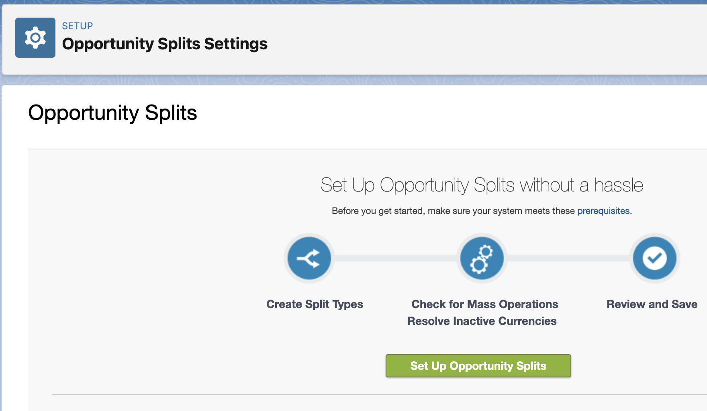

<!-- This file is generated by `npm run generate:docs` from the zod schemas in src/plugins. Do not edit it. -->

# OpportunitySplits Settings

Config key: `settings.opportunitySplits`

Setup: **Feature Settings → Sales → Opportunities → Opportunity Splits Settings** (`/lightning/setup/OpportunitySplitSetup/home`)

Enables and sets up Opportunity Splits. Opportunity Teams must be enabled first, for example by deploying the `Opportunity` settings with `<enableOpportunityTeam>true</enableOpportunityTeam>`.



## Examples

=== "Example 1"

    ```json
    {
      "$schema": "https://raw.githubusercontent.com/amtrack/sfdx-browserforce-plugin/main/src/plugins/schema.json",
      "settings": {
        "opportunitySplits": {
          "enabled": true
        }
      }
    }
    ```

=== "Example 2"

    ```json
    {
      "$schema": "https://raw.githubusercontent.com/amtrack/sfdx-browserforce-plugin/main/src/plugins/schema.json",
      "settings": {
        "opportunitySplits": {
          "enabled": false
        }
      }
    }
    ```

## Fields

| Field | Type | Description |
| ----- | ---- | ----------- |
| <code>enabled</code> | boolean | Enable Opportunity Splits<br>Prerequisite: Opportunity Teams must be enabled e.g. by deploying 'Settings:Opportunity' containing `<enableOpportunityTeam>true</enableOpportunityTeam>`. |

??? note "JSON Schema"

    ```json
    {
      "type": "object",
      "properties": {
        "enabled": {
          "type": "boolean",
          "title": "Enable Opportunity Splits",
          "description": "Prerequisite: Opportunity Teams must be enabled e.g. by deploying 'Settings:Opportunity' containing `<enableOpportunityTeam>true</enableOpportunityTeam>`."
        }
      },
      "title": "OpportunitySplits Settings",
      "description": "Setup: **Feature Settings → Sales → Opportunities → Opportunity Splits Settings** (`/lightning/setup/OpportunitySplitSetup/home`)\n\nEnables and sets up Opportunity Splits. Opportunity Teams must be enabled first, for example by deploying the `Opportunity` settings with `<enableOpportunityTeam>true</enableOpportunityTeam>`.\n\n",
      "examples": [
        {
          "enabled": true
        },
        {
          "enabled": false
        }
      ]
    }
    ```

[Source code of this setting](https://github.com/amtrack/sfdx-browserforce-plugin/tree/main/src/plugins/opportunity-splits)
