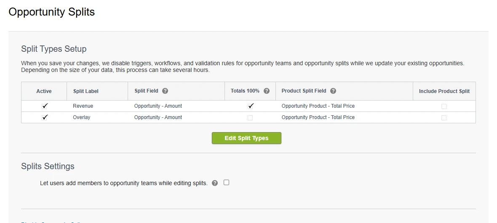
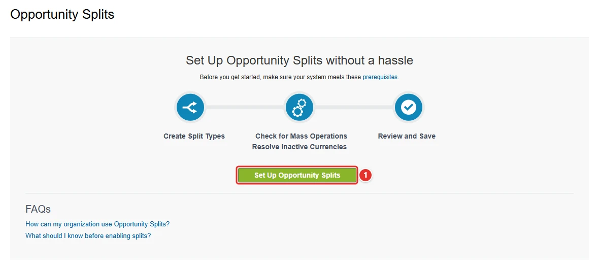
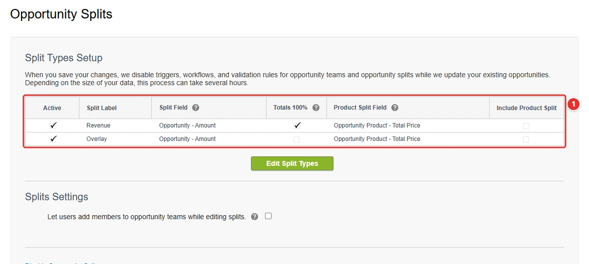

<!-- This file is generated by `npm run generate:docs` from the zod schemas in src/plugins. Do not edit it. -->

# OpportunitySplits Settings

Config key: `settings.opportunitySplits`

Setup: **Feature Settings → Sales → Opportunities → Opportunity Splits Settings** (`/lightning/setup/OpportunitySplitSetup/home`)

Enables and sets up Opportunity Splits. Opportunity Teams must be enabled first, for example by deploying the `Opportunity` settings with `<enableOpportunityTeam>true</enableOpportunityTeam>`.



## Use case

### Sales reps share the credit of the deals they close together

At Adventure Works, an account executive and a solution engineer often close a deal together, and the commission plan pays each of them a share of its revenue. Sales operations tracks those shares in a spreadsheet next to the CRM, and the quarterly commission run is always late.

Opportunity Splits stores the shares on the opportunity itself. The Metadata API cannot turn it on (`OpportunitySettings` only has `enableOpportunityTeam`), and Setup does it with a wizard: enable the feature, confirm the recalculation of the existing opportunities, then choose the page layouts that get the splits related list. This config runs the whole wizard, from **Set Up Opportunity Splits <span class="bf-pill bf-pill-c1">1</span>** to the default split types Revenue and Overlay, once Opportunity Teams are on (deploy the `Opportunity` settings with `enableOpportunityTeam` first, as the fixture of this plugin does).

=== "Config"

    ```json
    {
      "$schema": "https://raw.githubusercontent.com/amtrack/sfdx-browserforce-plugin/main/src/plugins/schema.json",
      "settings": {
        "opportunitySplits": {
          "enabled": true
        }
      }
    }
    ```

=== "Before"

    

=== "After"

    

| Pill | Field | Before | After |
| ---- | ----- | ------ | ----- |
| <span class="bf-pill bf-pill-c1">1</span> | <code>enabled</code> | `false` | `true` |

## Examples

=== "Example 1"

    ```json
    {
      "$schema": "https://raw.githubusercontent.com/amtrack/sfdx-browserforce-plugin/main/src/plugins/schema.json",
      "settings": {
        "opportunitySplits": {
          "enabled": true
        }
      }
    }
    ```

=== "Example 2"

    ```json
    {
      "$schema": "https://raw.githubusercontent.com/amtrack/sfdx-browserforce-plugin/main/src/plugins/schema.json",
      "settings": {
        "opportunitySplits": {
          "enabled": false
        }
      }
    }
    ```

## Fields

| Field | Type | Description |
| ----- | ---- | ----------- |
| <code>enabled</code> | boolean | Enable Opportunity Splits<br>Prerequisite: Opportunity Teams must be enabled e.g. by deploying 'Settings:Opportunity' containing `<enableOpportunityTeam>true</enableOpportunityTeam>`. |

??? note "JSON Schema"

    ```json
    {
      "type": "object",
      "properties": {
        "enabled": {
          "type": "boolean",
          "title": "Enable Opportunity Splits",
          "description": "Prerequisite: Opportunity Teams must be enabled e.g. by deploying 'Settings:Opportunity' containing `<enableOpportunityTeam>true</enableOpportunityTeam>`."
        }
      },
      "title": "OpportunitySplits Settings",
      "description": "Setup: **Feature Settings → Sales → Opportunities → Opportunity Splits Settings** (`/lightning/setup/OpportunitySplitSetup/home`)\n\nEnables and sets up Opportunity Splits. Opportunity Teams must be enabled first, for example by deploying the `Opportunity` settings with `<enableOpportunityTeam>true</enableOpportunityTeam>`.\n\n",
      "examples": [
        {
          "enabled": true
        },
        {
          "enabled": false
        }
      ]
    }
    ```

[Source code of this setting](https://github.com/amtrack/sfdx-browserforce-plugin/tree/main/src/plugins/opportunity-splits)
