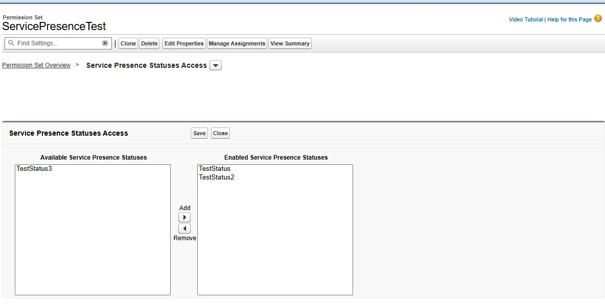
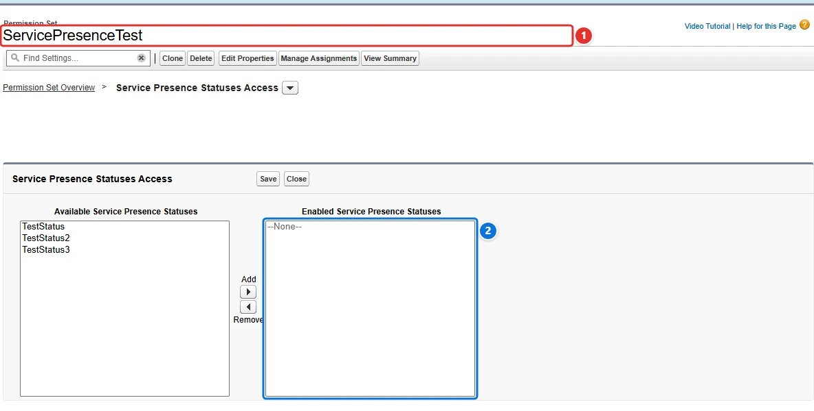
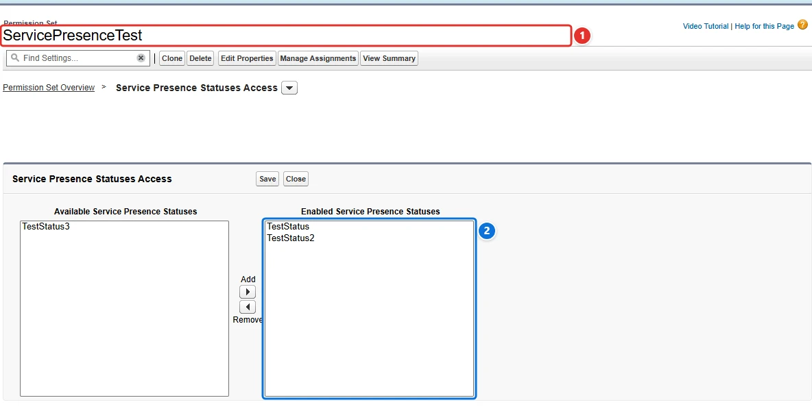

<!-- This file is generated by `npm run generate:docs` from the zod schemas in src/plugins. Do not edit it. -->

# Permission Sets

Config key: `settings.permissionSets`

!!! info "Prerequisites"
    - Omni-Channel enabled

Gives Permission Sets access to service presence statuses (Omni-Channel), by the API names of the statuses.



## Use case

### Support agents get the presence statuses of their team

Omni-Channel agents choose a presence status, such as "Available for cases" or "On a break", in the Omni-Channel widget, and they only see the statuses their profile or permission sets give access to. Litware gives them through the **permission set <span class="bf-pill bf-pill-c1">1</span>** of its support agents, and adds a status each time a new channel opens.

The access of a permission set to service presence statuses is not part of the `PermissionSet` metadata. This config moves the statuses `TestStatus` and `TestStatus2` (the API names of the statuses, here those of the test fixtures of this plugin) to the **enabled statuses <span class="bf-pill bf-pill-c2">2</span>** of the permission set, and removes the ones not listed.

=== "Config"

    ```json
    {
      "$schema": "https://raw.githubusercontent.com/amtrack/sfdx-browserforce-plugin/main/src/plugins/schema.json",
      "settings": {
        "permissionSets": [
          {
            "permissionSetName": "ServicePresenceTest",
            "servicePresenceStatuses": [
              "TestStatus",
              "TestStatus2"
            ]
          }
        ]
      }
    }
    ```

=== "Before"

    

=== "After"

    

| Pill | Field | Before | After |
| ---- | ----- | ------ | ----- |
| <span class="bf-pill bf-pill-c1">1</span> | <code>[0].<wbr>permissionSetName</code> | `ServicePresenceTest` | `ServicePresenceTest` |
| <span class="bf-pill bf-pill-c2">2</span> | <code>[0].<wbr>servicePresenceStatuses</code> | `[]` | `["TestStatus","TestStatus2"]` |

## Example

```json
{
  "$schema": "https://raw.githubusercontent.com/amtrack/sfdx-browserforce-plugin/main/src/plugins/schema.json",
  "settings": {
    "permissionSets": [
      {
        "permissionSetName": "Support_Agent",
        "servicePresenceStatuses": [
          "Available",
          "Busy"
        ]
      }
    ]
  }
}
```

## Fields

In the field paths, `[]` stands for the items of a list and `*` for the entries of an object keyed by name.

| Field | Type | Description | Default |
| ----- | ---- | ----------- | ------- |
| <code>[].<wbr>permissionSetName</code> | string | Permission Set<br>The name of the Permission Set to modify<br>**Required.** |  |
| <code>[].<wbr>servicePresenceStatuses</code> | string[] | Service Presence Statuses | `[]` |

??? note "JSON Schema"

    ```json
    {
      "default": [],
      "title": "Permission Sets",
      "description": "Gives Permission Sets access to service presence statuses (Omni-Channel), by the API names of the statuses.\n\n",
      "examples": [
        [
          {
            "permissionSetName": "Support_Agent",
            "servicePresenceStatuses": [
              "Available",
              "Busy"
            ]
          }
        ]
      ],
      "x-prerequisites": [
        "Omni-Channel enabled"
      ],
      "type": "array",
      "items": {
        "type": "object",
        "properties": {
          "permissionSetName": {
            "type": "string",
            "title": "Permission Set",
            "description": "The name of the Permission Set to modify"
          },
          "servicePresenceStatuses": {
            "default": [],
            "title": "Service Presence Statuses",
            "type": "array",
            "items": {
              "type": "string"
            }
          }
        },
        "required": [
          "permissionSetName"
        ]
      }
    }
    ```

[Source code of this setting](https://github.com/amtrack/sfdx-browserforce-plugin/tree/main/src/plugins/permission-sets)
