<!-- This file is generated by `npm run generate:docs` from the zod schemas in src/plugins. Do not edit it. -->

# Picklists

Config key: `settings.picklists`

Changes picklist values in ways the Metadata API cannot:

- replace a value by another one in the records using it, then deactivate or delete the old value;
- activate or deactivate values;
- manage (create, modify, delete) the field dependencies of custom fields. An existing field dependency of the dependent field is deleted first.

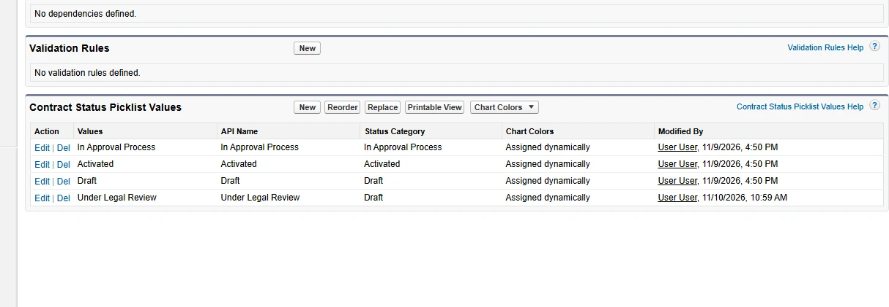

## Use cases

### 1. Add a contract status with its category

At Acme, every contract goes through the legal team before it is activated. The **Contract Status <span class="bf-pill bf-pill-c1">1</span>** picklist needs a step **Under Legal Review <span class="bf-pill bf-pill-c2">2</span>**, and each contract status belongs to a **Status Category <span class="bf-pill bf-pill-c3">3</span>**, `Draft`, `Activated` or `Expired`, which drives what users can do with the contract. The `StandardValue` type of the Metadata API has no field for the status category, so a deployment cannot create such a status.

Set `statusCategory` with `newValue` on a status picklist (contracts, orders): Browserforce creates the value on its Setup page and picks the category there. A second `apply` finds the value and does nothing.

=== "Config"

    ```json
    {
      "$schema": "https://raw.githubusercontent.com/amtrack/sfdx-browserforce-plugin/main/src/plugins/schema.json",
      "settings": {
        "picklists": {
          "picklistValues": [
            {
              "metadataType": "StandardValueSet",
              "metadataFullName": "ContractStatus",
              "newValue": "Under Legal Review",
              "statusCategory": "Draft"
            }
          ]
        }
      }
    }
    ```

=== "Before"

    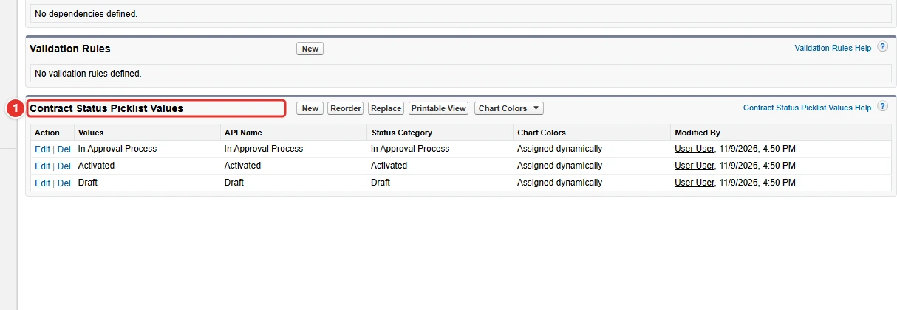

=== "After"

    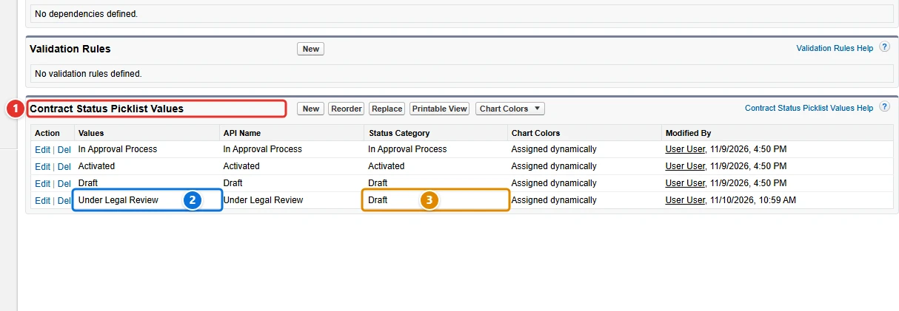

| Pill | Field | Before | After |
| ---- | ----- | ------ | ----- |
| <span class="bf-pill bf-pill-c1">1</span> | <code>picklistValues[0].<wbr>metadataFullName</code> | `ContractStatus` | `ContractStatus` |
| <span class="bf-pill bf-pill-c2">2</span> | <code>picklistValues[0].<wbr>newValue</code> |  | `Under Legal Review` |
| <span class="bf-pill bf-pill-c3">3</span> | <code>picklistValues[0].<wbr>statusCategory</code> |  | `Draft` |
|  | <code>picklistValues[0].<wbr>metadataType</code><br>tells Browserforce which Setup page holds the values | `StandardValueSet` | `StandardValueSet` |

### 2. Replace a value in the records, keeping the old one

The marketing team of Acme merged its call channels: the leads that came by phone, like Thandi Ndlovu's, now count under Other. The **Replace** button of a picklist page rewrites a value in every record that holds it; the Metadata API only deploys the list of values, and never touches the records.

This config replaces **Phone Inquiry <span class="bf-pill bf-pill-c1">1</span>** with **Other <span class="bf-pill bf-pill-c2">2</span>** in the Lead Source of every lead. Without `active` or `absent`, the old value stays in the picklist, active, for the processes that still read it. Replacing is not idempotent: every `apply` runs it again, which is harmless once no record holds the old value.

=== "Config"

    ```json
    {
      "$schema": "https://raw.githubusercontent.com/amtrack/sfdx-browserforce-plugin/main/src/plugins/schema.json",
      "settings": {
        "picklists": {
          "picklistValues": [
            {
              "metadataType": "StandardValueSet",
              "metadataFullName": "LeadSource",
              "value": "Phone Inquiry",
              "newValue": "Other"
            }
          ]
        }
      }
    }
    ```

=== "Before"

    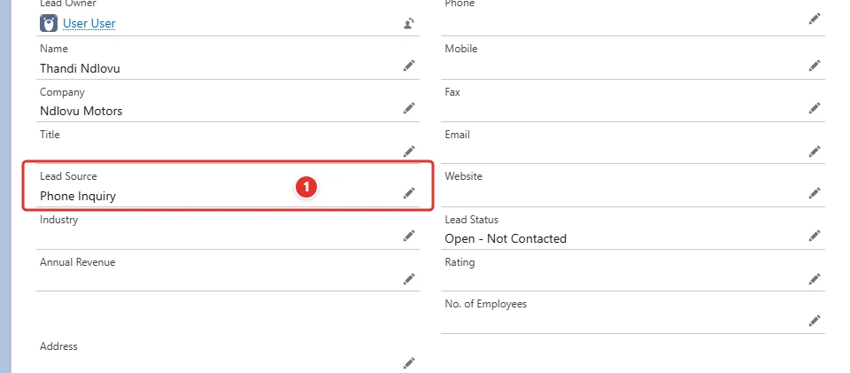

=== "After"

    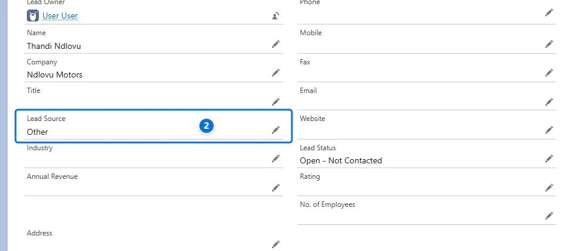

| Pill | Field | Before | After |
| ---- | ----- | ------ | ----- |
| <span class="bf-pill bf-pill-c1">1</span> | <code>picklistValues[0].<wbr>value</code> |  | `Phone Inquiry` |
| <span class="bf-pill bf-pill-c2">2</span> | <code>picklistValues[0].<wbr>newValue</code> |  | `Other` |
|  | <code>picklistValues[0].<wbr>metadataFullName</code><br>the Lead Source field, shown by the other pills |  | `LeadSource` |
|  | <code>picklistValues[0].<wbr>metadataType</code><br>tells Browserforce which Setup page holds the values |  | `StandardValueSet` |

### 3. Fill the blank values of the records

Acme imported a purchased list of prospects without filling their source, and its marketing reports now show a large "blank" slice. Records are data, not metadata: no deployment can fill an empty field, and only the **Replace** page of the picklist offers to replace the blanks.

With `replaceAllBlankValues`, the leads whose **Lead Source <span class="bf-pill bf-pill-c1">1</span>** is empty, like Bongani Dube's, get **Purchased List <span class="bf-pill bf-pill-c2">2</span>**. It is an alternative to `value`: one action replaces either a value or the blanks.

=== "Config"

    ```json
    {
      "$schema": "https://raw.githubusercontent.com/amtrack/sfdx-browserforce-plugin/main/src/plugins/schema.json",
      "settings": {
        "picklists": {
          "picklistValues": [
            {
              "metadataType": "StandardValueSet",
              "metadataFullName": "LeadSource",
              "replaceAllBlankValues": true,
              "newValue": "Purchased List"
            }
          ]
        }
      }
    }
    ```

=== "Before"

    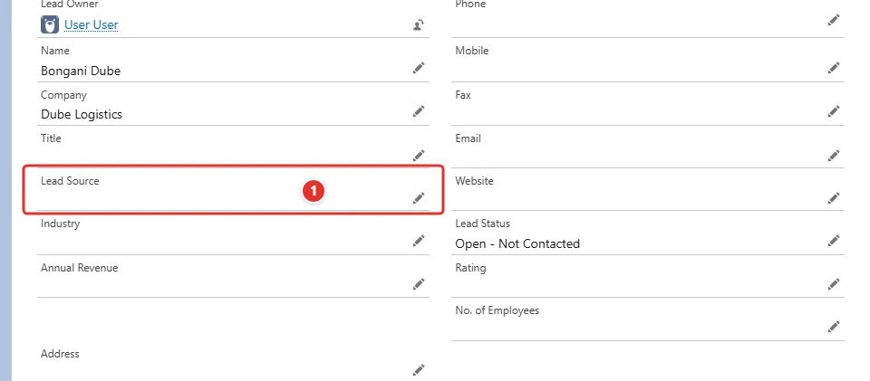

=== "After"

    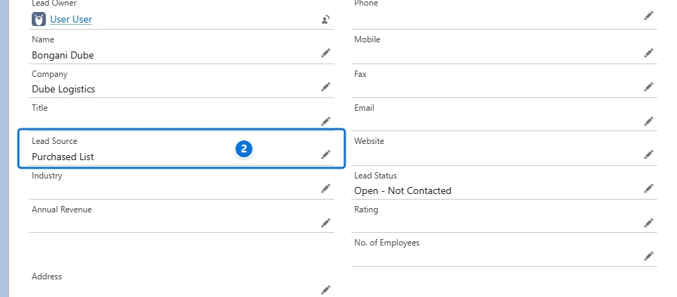

| Pill | Field | Before | After |
| ---- | ----- | ------ | ----- |
| <span class="bf-pill bf-pill-c1">1</span> | <code>picklistValues[0].<wbr>replaceAllBlankValues</code> |  | `true` |
| <span class="bf-pill bf-pill-c2">2</span> | <code>picklistValues[0].<wbr>newValue</code> |  | `Purchased List` |
|  | <code>picklistValues[0].<wbr>metadataFullName</code><br>the Lead Source field, shown by the other pills |  | `LeadSource` |
|  | <code>picklistValues[0].<wbr>metadataType</code><br>tells Browserforce which Setup page holds the values |  | `StandardValueSet` |

### 4. Replace a value in the records, then deactivate it

The AUX input of old cars is now part of the media system. The admins of the dealer want every Vehicle that says **AUX <span class="bf-pill bf-pill-c2">2</span>** to say **Media <span class="bf-pill bf-pill-c3">3</span>**, and AUX to leave the choices, while the records keep a valid value. A deployment can deactivate a value, but it leaves the records with the old one: only the **Replace** page of Setup moves them.

Two actions on the same value run in order: the first replaces it in the records, the second sets **active <span class="bf-pill bf-pill-c4">4</span>** to `false`. The list of a config is applied from top to bottom.

=== "Config"

    ```json
    {
      "$schema": "https://raw.githubusercontent.com/amtrack/sfdx-browserforce-plugin/main/src/plugins/schema.json",
      "settings": {
        "picklists": {
          "picklistValues": [
            {
              "metadataType": "CustomField",
              "metadataFullName": "Vehicle__c.Features__c",
              "value": "AUX",
              "newValue": "Media"
            },
            {
              "metadataType": "CustomField",
              "metadataFullName": "Vehicle__c.Features__c",
              "value": "AUX",
              "active": false
            }
          ]
        }
      }
    }
    ```

=== "Before"

    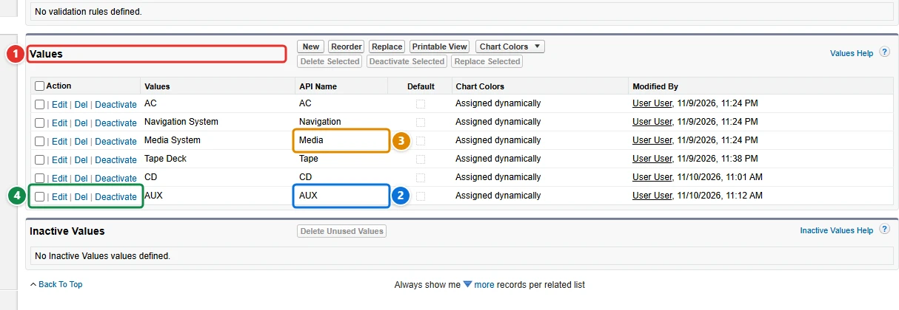

=== "After"

    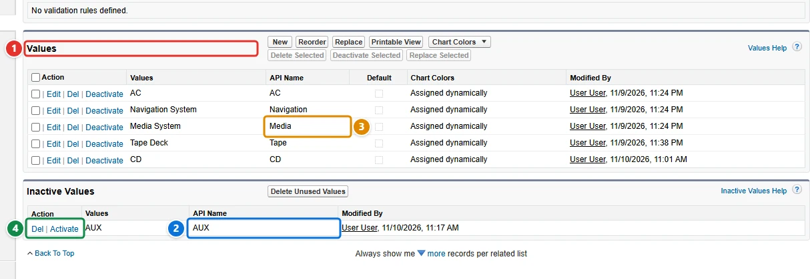

| Pill | Field | Before | After |
| ---- | ----- | ------ | ----- |
| <span class="bf-pill bf-pill-c1">1</span> | <code>picklistValues[0].<wbr>metadataFullName</code> | `Vehicle__c.Features__c` | `Vehicle__c.Features__c` |
| <span class="bf-pill bf-pill-c2">2</span> | <code>picklistValues[0].<wbr>value</code> | `AUX` | `AUX` |
| <span class="bf-pill bf-pill-c3">3</span> | <code>picklistValues[0].<wbr>newValue</code> |  | `Media` |
| <span class="bf-pill bf-pill-c4">4</span> | <code>picklistValues[1].<wbr>active</code> |  | `false` |
|  | <code>picklistValues[0].<wbr>metadataType</code><br>a custom field, found by its object and API name | `CustomField` | `CustomField` |
|  | <code>picklistValues[1].<wbr>metadataType</code><br>the same field as (1) |  | `CustomField` |
|  | <code>picklistValues[1].<wbr>metadataFullName</code><br>the same field as (1) |  | `Vehicle__c.Features__c` |
|  | <code>picklistValues[1].<wbr>value</code><br>the same value as (2) |  | `AUX` |

### 5. Replace a value in the records, then delete it

Compact discs are gone for good, and the dealer wants the value out of the **Features <span class="bf-pill bf-pill-c1">1</span>** field, not only hidden. The Metadata API cannot delete a picklist value: a value missing from a deployment is only deactivated, and its records keep it. Deleting a value in Setup asks what the records that hold it become.

With `absent: true` and a `newValue`, Browserforce deletes **CD <span class="bf-pill bf-pill-c2">2</span>** and gives its records **Media <span class="bf-pill bf-pill-c3">3</span>**. Without `newValue`, their value is cleared.

=== "Config"

    ```json
    {
      "$schema": "https://raw.githubusercontent.com/amtrack/sfdx-browserforce-plugin/main/src/plugins/schema.json",
      "settings": {
        "picklists": {
          "picklistValues": [
            {
              "metadataType": "CustomField",
              "metadataFullName": "Vehicle__c.Features__c",
              "value": "CD",
              "newValue": "Media",
              "absent": true
            }
          ]
        }
      }
    }
    ```

=== "Before"

    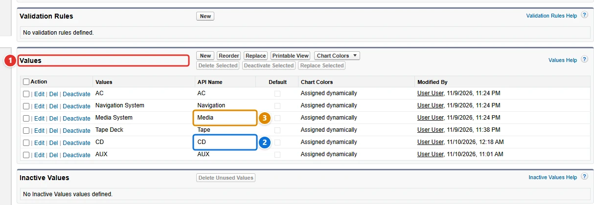

=== "After"

    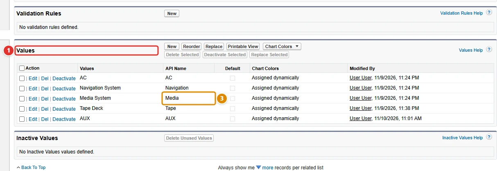

| Pill | Field | Before | After |
| ---- | ----- | ------ | ----- |
| <span class="bf-pill bf-pill-c1">1</span> | <code>picklistValues[0].<wbr>metadataFullName</code> | `Vehicle__c.Features__c` | `Vehicle__c.Features__c` |
| <span class="bf-pill bf-pill-c2">2</span> | <code>picklistValues[0].<wbr>value</code> |  | `CD` |
| <span class="bf-pill bf-pill-c3">3</span> | <code>picklistValues[0].<wbr>newValue</code> | `CD` | `Media` |
|  | <code>picklistValues[0].<wbr>metadataType</code><br>a custom field, found by its object and API name | `CustomField` | `CustomField` |
|  | <code>picklistValues[0].<wbr>absent</code><br>the value (2) is gone from the list |  | `true` |

### 6. Remove a field dependency

A field dependency also gets in the way: an import of old Vehicle records fails on every gear that does not match its transmission. The dealer removes the dependency during the migration. The Metadata API can create or change a field dependency, but deploying the field without its controlling field does not remove it.

Set the controlling field of **Gears <span class="bf-pill bf-pill-c3">3</span>** on **Vehicle <span class="bf-pill bf-pill-c1">1</span>** to `null`: Browserforce deletes the dependency, which leaves the field dependencies of **Transmission <span class="bf-pill bf-pill-c2">2</span>**, and every value of Gears is available again. A second `apply` finds no dependency and does nothing.

=== "Config"

    ```json
    {
      "$schema": "https://raw.githubusercontent.com/amtrack/sfdx-browserforce-plugin/main/src/plugins/schema.json",
      "settings": {
        "picklists": {
          "fieldDependencies": [
            {
              "object": "Vehicle__c",
              "dependentField": "Gears__c",
              "controllingField": null
            }
          ]
        }
      }
    }
    ```

=== "Before"

    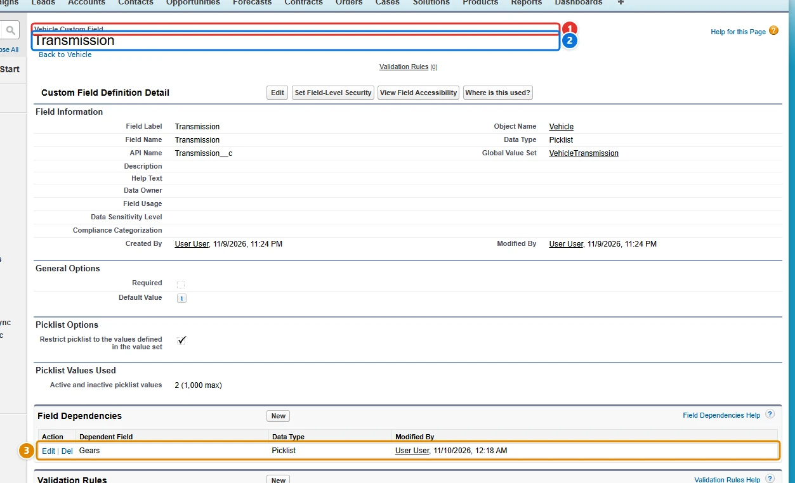

=== "After"

    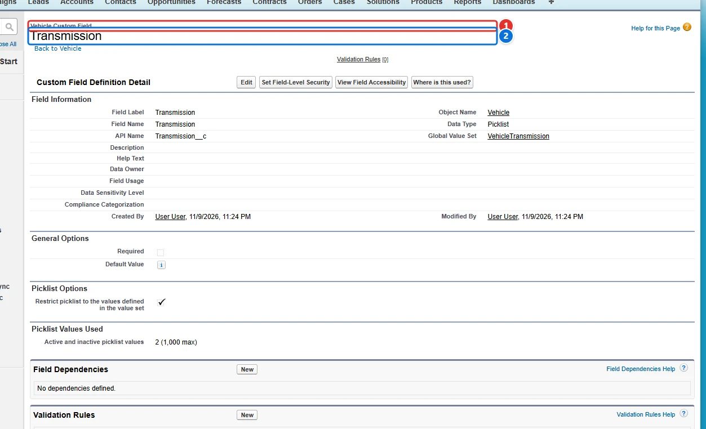

| Pill | Field | Before | After |
| ---- | ----- | ------ | ----- |
| <span class="bf-pill bf-pill-c1">1</span> | <code>fieldDependencies[0].<wbr>object</code> | `Vehicle__c` | `Vehicle__c` |
| <span class="bf-pill bf-pill-c2">2</span> | <code>fieldDependencies[0].<wbr>controllingField</code> | `Transmission__c` | `null` |
| <span class="bf-pill bf-pill-c3">3</span> | <code>fieldDependencies[0].<wbr>dependentField</code> | `Gears__c` | `Gears__c` |

## Examples

=== "Example 1"

    ```json
    {
      "$schema": "https://raw.githubusercontent.com/amtrack/sfdx-browserforce-plugin/main/src/plugins/schema.json",
      "settings": {
        "picklists": {
          "picklistValues": [
            {
              "metadataType": "StandardValueSet",
              "metadataFullName": "LeadSource",
              "value": "Phone Inquiry",
              "newValue": "Other"
            }
          ]
        }
      }
    }
    ```

=== "Example 2"

    ```json
    {
      "$schema": "https://raw.githubusercontent.com/amtrack/sfdx-browserforce-plugin/main/src/plugins/schema.json",
      "settings": {
        "picklists": {
          "picklistValues": [
            {
              "metadataType": "StandardValueSet",
              "metadataFullName": "LeadSource",
              "value": "Purchased List",
              "newValue": "Other",
              "absent": true
            }
          ]
        }
      }
    }
    ```

=== "Example 3"

    ```json
    {
      "$schema": "https://raw.githubusercontent.com/amtrack/sfdx-browserforce-plugin/main/src/plugins/schema.json",
      "settings": {
        "picklists": {
          "picklistValues": [
            {
              "metadataType": "CustomField",
              "metadataFullName": "Account.MyPicklist__c",
              "value": "MyOldValue",
              "active": false
            }
          ]
        }
      }
    }
    ```

## Fields

In the field paths, `[]` stands for the items of a list and `*` for the entries of an object keyed by name.

| Field | Type | Description | Values |
| ----- | ---- | ----------- | ------ |
| <code>picklistValues[].<wbr>metadataType</code> | string | the metadata type<br>**Required.** | `CustomField`<br>`GlobalValueSet`<br>`StandardValueSet` |
| <code>picklistValues[].<wbr>metadataFullName</code> | string | the API name of the CustomField/GlobalValueSet/StandardValueSet<br>**Required.** |  |
| <code>picklistValues[].<wbr>value</code> | string | the API name of the value |  |
| <code>picklistValues[].<wbr>newValue</code> | string | the API name of the new value, otherwise blank |  |
| <code>picklistValues[].<wbr>statusCategory</code> | string | the Status Category of a new picklist value |  |
| <code>picklistValues[].<wbr>replaceAllBlankValues</code> | boolean | replace all blank values (mutually exclusive to replacing an old value) |  |
| <code>picklistValues[].<wbr>active</code> | boolean | ensure the picklist value is active/inactive |  |
| <code>picklistValues[].<wbr>absent</code> | boolean | ensure the picklist value is absent/deleted |  |
| <code>fieldDependencies[].<wbr>object</code> | string | the API name of the CustomObject |  |
| <code>fieldDependencies[].<wbr>dependentField</code> | string | the API name of the CustomField that has its values filtered |  |
| <code>fieldDependencies[].<wbr>controllingField</code> | json | the API name of the CustomField that drives filtering<br>If this value is null or not set, the Field Dependency will be deleted. |  |

??? note "JSON Schema"

    ```json
    {
      "type": "object",
      "properties": {
        "picklistValues": {
          "default": [],
          "title": "Picklist Values",
          "description": "Replace (and delete) picklist values",
          "type": "array",
          "items": {
            "type": "object",
            "properties": {
              "metadataType": {
                "type": "string",
                "enum": [
                  "CustomField",
                  "GlobalValueSet",
                  "StandardValueSet"
                ],
                "description": "the metadata type"
              },
              "metadataFullName": {
                "type": "string",
                "description": "the API name of the CustomField/GlobalValueSet/StandardValueSet"
              },
              "value": {
                "type": "string",
                "description": "the API name of the value"
              },
              "newValue": {
                "type": "string",
                "description": "the API name of the new value, otherwise blank"
              },
              "statusCategory": {
                "type": "string",
                "description": "the Status Category of a new picklist value"
              },
              "replaceAllBlankValues": {
                "type": "boolean",
                "description": "replace all blank values (mutually exclusive to replacing an old value)"
              },
              "active": {
                "type": "boolean",
                "description": "ensure the picklist value is active/inactive"
              },
              "absent": {
                "type": "boolean",
                "description": "ensure the picklist value is absent/deleted"
              }
            },
            "required": [
              "metadataType",
              "metadataFullName"
            ]
          }
        },
        "fieldDependencies": {
          "default": [],
          "description": "Manage (create/modify/delete) Field Dependencies on CustomFields.\nIf a Field Dependency already exists for the dependent field, it will be deleted.",
          "title": "Field Dependencies",
          "type": "array",
          "items": {
            "type": "object",
            "properties": {
              "object": {
                "type": "string",
                "title": "the API name of the CustomObject",
                "examples": [
                  "Account",
                  "Vehicle__c",
                  "ACME__Vehicle__c"
                ]
              },
              "dependentField": {
                "type": "string",
                "title": "the API name of the CustomField that has its values filtered",
                "examples": [
                  "Gears__c",
                  "ACME__Gears__c"
                ]
              },
              "controllingField": {
                "title": "the API name of the CustomField that drives filtering",
                "description": "If this value is null or not set, the Field Dependency will be deleted.",
                "examples": [
                  "Transmission__c",
                  "ACME__Transmission__c",
                  null
                ],
                "type": [
                  "string",
                  "null"
                ]
              }
            }
          }
        }
      },
      "title": "Picklists",
      "description": "Changes picklist values in ways the Metadata API cannot:\n\n- replace a value by another one in the records using it, then deactivate or delete the old value;\n- activate or deactivate values;\n- manage (create, modify, delete) the field dependencies of custom fields. An existing field dependency of the dependent field is deleted first.\n\n",
      "examples": [
        {
          "picklistValues": [
            {
              "metadataType": "StandardValueSet",
              "metadataFullName": "LeadSource",
              "value": "Phone Inquiry",
              "newValue": "Other"
            }
          ]
        },
        {
          "picklistValues": [
            {
              "metadataType": "StandardValueSet",
              "metadataFullName": "LeadSource",
              "value": "Purchased List",
              "newValue": "Other",
              "absent": true
            }
          ]
        },
        {
          "picklistValues": [
            {
              "metadataType": "CustomField",
              "metadataFullName": "Account.MyPicklist__c",
              "value": "MyOldValue",
              "active": false
            }
          ]
        }
      ]
    }
    ```

[Source code of this setting](https://github.com/amtrack/sfdx-browserforce-plugin/tree/main/src/plugins/picklists)
