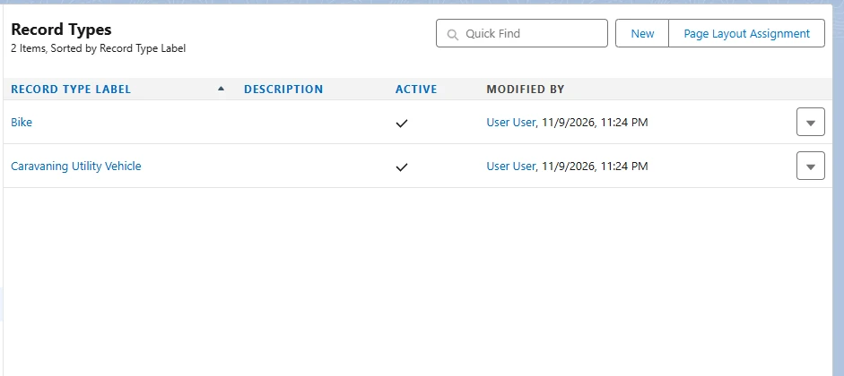
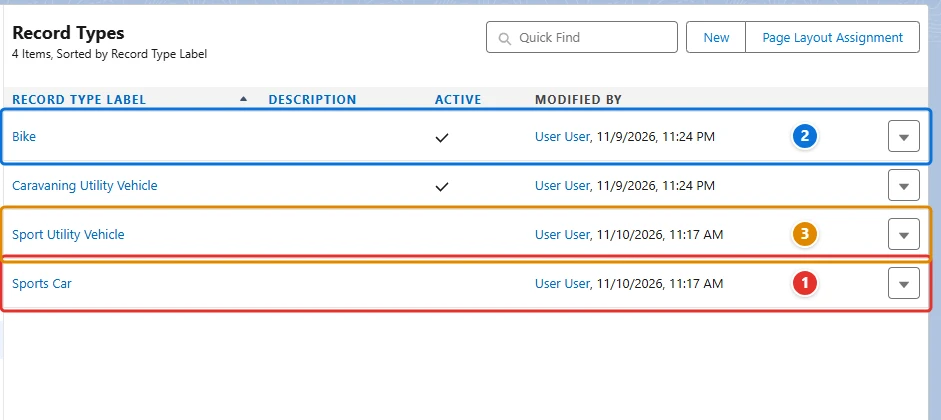
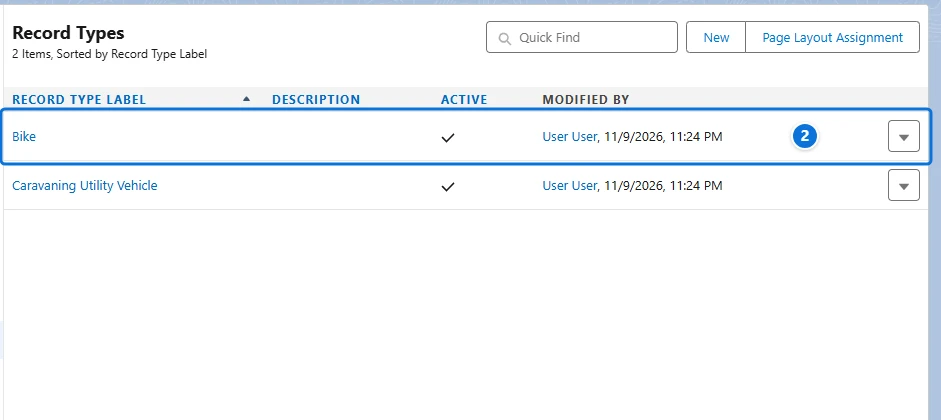

<!-- This file is generated by `npm run generate:docs` from the zod schemas in src/plugins. Do not edit it. -->

# RecordTypes

Config key: `settings.recordTypes`

Deletes inactive record types, optionally replacing them by another record type where they are used.



## Use case

### Delete retired record types

A rental company used to track sports cars and SUVs as Vehicle record types. Both were deactivated long ago, but they still clutter the record type lists, the reports and every profile. The Metadata API refuses to delete a record type ("Cannot delete record type through API"), and Setup only deletes an inactive one, asking which record type its records get instead.

This config deletes **Sports Car <span class="bf-pill bf-pill-c1">1</span>**, whose records become **Bike <span class="bf-pill bf-pill-c2">2</span>** records, and **Sport Utility Vehicle <span class="bf-pill bf-pill-c3">3</span>**, whose records lose their record type. Browserforce refuses to delete an active record type: deactivate it first with the Metadata API. Once deleted, a record type only comes back by deploying it again.

=== "Config"

    ```json
    {
      "$schema": "https://raw.githubusercontent.com/amtrack/sfdx-browserforce-plugin/main/src/plugins/schema.json",
      "settings": {
        "recordTypes": {
          "deletions": [
            {
              "fullName": "Vehicle__c.SportsCar",
              "replacement": "Vehicle__c.Bicycle"
            },
            {
              "fullName": "Vehicle__c.SUV"
            }
          ]
        }
      }
    }
    ```

=== "Before"

    

=== "After"

    

| Pill | Field | Before | After |
| ---- | ----- | ------ | ----- |
| <span class="bf-pill bf-pill-c1">1</span> | <code>deletions[0].<wbr>fullName</code> |  | `Vehicle__c.SportsCar` |
| <span class="bf-pill bf-pill-c2">2</span> | <code>deletions[0].<wbr>replacement</code> |  | `Vehicle__c.Bicycle` |
| <span class="bf-pill bf-pill-c3">3</span> | <code>deletions[1].<wbr>fullName</code> |  | `Vehicle__c.SUV` |

## Example

```json
{
  "$schema": "https://raw.githubusercontent.com/amtrack/sfdx-browserforce-plugin/main/src/plugins/schema.json",
  "settings": {
    "recordTypes": {
      "deletions": [
        {
          "fullName": "Account.MyOldRecordType",
          "replacement": "Account.MyRecordType"
        }
      ]
    }
  }
}
```

## Fields

In the field paths, `[]` stands for the items of a list and `*` for the entries of an object keyed by name.

| Field | Type | Description |
| ----- | ---- | ----------- |
| <code>deletions[].<wbr>fullName</code> | string | the API name of the RecordType<br>**Required.** |
| <code>deletions[].<wbr>replacement</code> | string | optional API name of the replacement RecordType |

??? note "JSON Schema"

    ```json
    {
      "type": "object",
      "properties": {
        "deletions": {
          "default": [],
          "title": "Record Type Deletions",
          "description": "Delete inactive record types",
          "type": "array",
          "items": {
            "type": "object",
            "properties": {
              "fullName": {
                "type": "string",
                "description": "the API name of the RecordType"
              },
              "replacement": {
                "type": "string",
                "description": "optional API name of the replacement RecordType"
              }
            },
            "required": [
              "fullName"
            ]
          }
        }
      },
      "title": "RecordTypes",
      "description": "Deletes inactive record types, optionally replacing them by another record type where they are used.\n\n",
      "examples": [
        {
          "deletions": [
            {
              "fullName": "Account.MyOldRecordType",
              "replacement": "Account.MyRecordType"
            }
          ]
        }
      ]
    }
    ```

[Source code of this setting](https://github.com/amtrack/sfdx-browserforce-plugin/tree/main/src/plugins/record-types)
