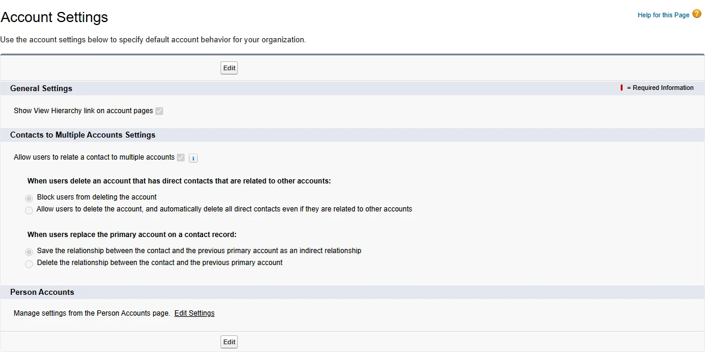
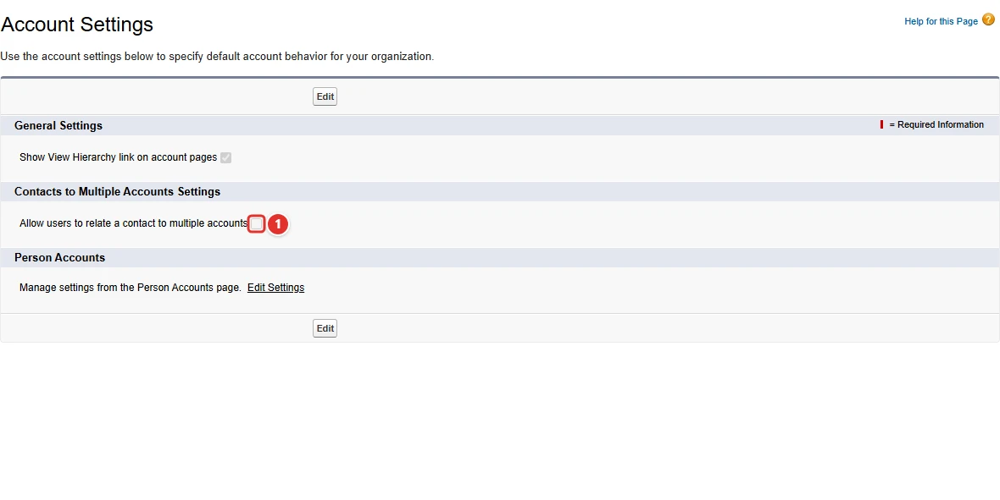
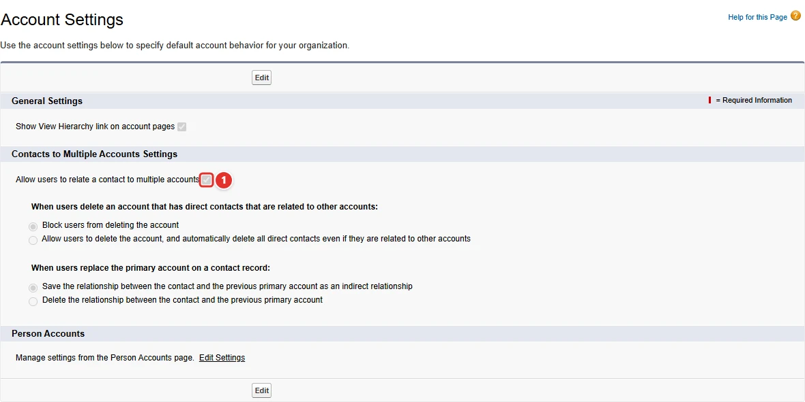

<!-- This file is generated by `npm run generate:docs` from the zod schemas in src/plugins. Do not edit it. -->

# RelateContactToMultipleAccounts Settings

Config key: `settings.relateContactToMultipleAccounts`

Setup: **Feature Settings → Sales → Account Settings** (`/lightning/setup/AccountSettings/home`)

Enabling it through the Metadata API (`AccountSettings.enableRelateContactToMultipleAccounts`) does not always make the `AccountContactRelation` object available. Enabling it in Setup always does.



## Use case

### Independent consultants work for several client accounts

Tailspin Consulting staffs freelance consultants on client projects. A consultant is a contact of their own company, but also works for two or three client accounts at a time, and the account managers want to see them on each of those accounts.

**Allow users to relate a contact to multiple accounts <span class="bf-pill bf-pill-c1">1</span>** creates the Account Contact Relationship object and the "Related Contacts" list for that. The `AccountSettings` metadata has a flag for it, but deploying it does not always make the object available, and the deployment of the fields and layouts that use it then fails. Enabling it in Setup with this config always works, before the metadata is deployed.

=== "Config"

    ```json
    {
      "$schema": "https://raw.githubusercontent.com/amtrack/sfdx-browserforce-plugin/main/src/plugins/schema.json",
      "settings": {
        "relateContactToMultipleAccounts": {
          "enabled": true
        }
      }
    }
    ```

=== "Before"

    

=== "After"

    

| Pill | Field | Before | After |
| ---- | ----- | ------ | ----- |
| <span class="bf-pill bf-pill-c1">1</span> | <code>enabled</code> | `false` | `true` |

## Example

```json
{
  "$schema": "https://raw.githubusercontent.com/amtrack/sfdx-browserforce-plugin/main/src/plugins/schema.json",
  "settings": {
    "relateContactToMultipleAccounts": {
      "enabled": true
    }
  }
}
```

## Fields

| Field | Type | Description |
| ----- | ---- | ----------- |
| <code>enabled</code> | boolean | Enable RelateContactToMultipleAccounts<br>This allows you to enable the 'Relate contact to multiple Accounts' in the Account settings. Doing this through the metadata API will not always make the AccountContactRelation object available. Enabling the feature using the setup does always work, therefore this plugin. |

??? note "JSON Schema"

    ```json
    {
      "type": "object",
      "properties": {
        "enabled": {
          "type": "boolean",
          "title": "Enable RelateContactToMultipleAccounts",
          "description": "This allows you to enable the 'Relate contact to multiple Accounts' in the Account settings. Doing this through the metadata API will not always make the AccountContactRelation object available. Enabling the feature using the setup does always work, therefore this plugin."
        }
      },
      "title": "RelateContactToMultipleAccounts Settings",
      "description": "Setup: **Feature Settings → Sales → Account Settings** (`/lightning/setup/AccountSettings/home`)\n\nEnabling it through the Metadata API (`AccountSettings.enableRelateContactToMultipleAccounts`) does not always make the `AccountContactRelation` object available. Enabling it in Setup always does.\n\n",
      "examples": [
        {
          "enabled": true
        }
      ]
    }
    ```

[Source code of this setting](https://github.com/amtrack/sfdx-browserforce-plugin/tree/main/src/plugins/relate-contact-to-multiple-accounts)
