<!-- This file is generated by `npm run generate:docs` from the zod schemas in src/plugins. Do not edit it. -->

# SalesforceCpqConfig Settings

Config key: `settings.salesforceCpqConfig`

!!! danger "Irreversible"
    Once applied, `subscriptionsAndRenewals.enableEvergreenSubscriptions` cannot be changed back.

!!! info "Prerequisites"
    - Salesforce CPQ managed package (SBQQ) installed

Setup: **Installed Packages → Salesforce CPQ → Configure**

Sets the settings of the Salesforce CPQ package.

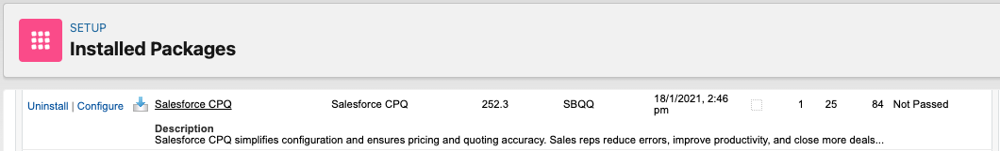

## Use cases

### 1. Generate the quote documents on the opportunity

Acme's sales reps send their quotes as PDF documents, and the sales managers want to find them on the opportunity, announced in its feed. Those choices are settings of the Salesforce CPQ package, stored in its protected custom settings: no Metadata API deployment can write them, only the settings page of the package can.

On the **Documents** tab, the generated documents go to the **Quotes <span class="bf-pill bf-pill-c1">1</span>** folder, open in a **full page preview <span class="bf-pill bf-pill-c3">3</span>**, are attached to the **Opportunity <span class="bf-pill bf-pill-c5">5</span>** and **posted to its feed <span class="bf-pill bf-pill-c6">6</span>**. On the **Quote** tab, the primary quote keeps the **opportunity products <span class="bf-pill bf-pill-c12">12</span>**, and a new quote stays valid **30 days <span class="bf-pill bf-pill-c13">13</span>**. Each pill marks a field of the config, changed or not, so the config can describe the whole tab.

=== "Config"

    ```json
    {
      "$schema": "https://raw.githubusercontent.com/amtrack/sfdx-browserforce-plugin/main/src/plugins/schema.json",
      "settings": {
        "salesforceCpqConfig": {
          "documents": {
            "documentFolder": "Quotes",
            "hideDocumentName": false,
            "fullPagePreview": true,
            "excludeHiddenLinesInGroupTotals": false,
            "attachmentTarget": "Opportunity",
            "postToFeed": true,
            "enableMultiLanguageTranslations": false
          },
          "quote": {
            "disableInitialQuoteSync": false,
            "disableQuoteContactDefaulting": false,
            "allowOptionDeletion": false,
            "disableQuoteAddressDefaulting": false,
            "primaryQuoteKeepsOpportunityProducts": true,
            "defaultQuoteValidityDays": 30
          }
        }
      }
    }
    ```

=== "Before"

    *Documents*

    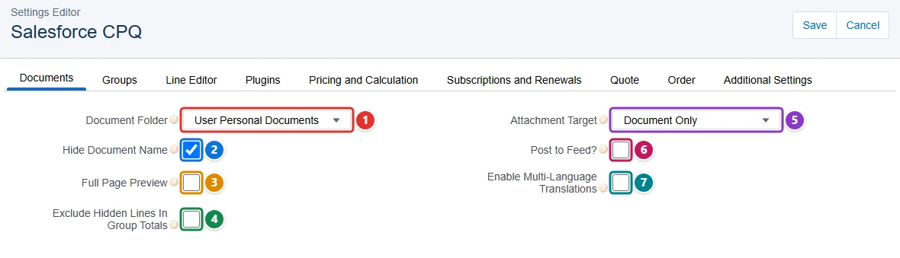

    *Quote*

    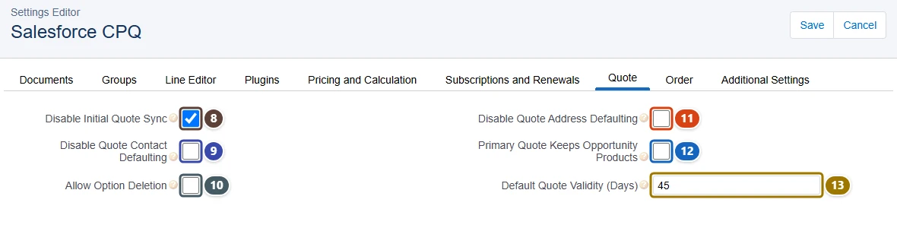

=== "After"

    *Documents*

    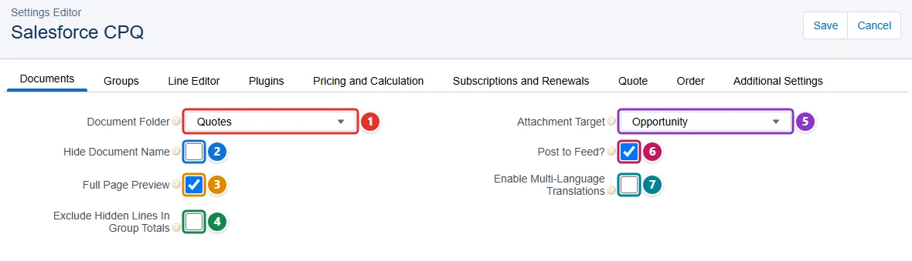

    *Quote*

    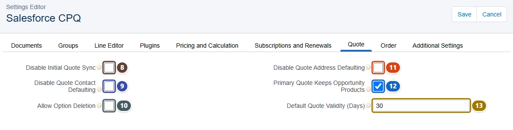

| Pill | Field | Before | After |
| ---- | ----- | ------ | ----- |
| <span class="bf-pill bf-pill-c1">1</span> | <code>documents.<wbr>documentFolder</code> | `User Personal Documents` | `Quotes` |
| <span class="bf-pill bf-pill-c2">2</span> | <code>documents.<wbr>hideDocumentName</code> |  | `false` |
| <span class="bf-pill bf-pill-c3">3</span> | <code>documents.<wbr>fullPagePreview</code> | `false` | `true` |
| <span class="bf-pill bf-pill-c4">4</span> | <code>documents.<wbr>excludeHiddenLinesInGroupTotals</code> |  | `false` |
| <span class="bf-pill bf-pill-c5">5</span> | <code>documents.<wbr>attachmentTarget</code> | `Document Only` | `Opportunity` |
| <span class="bf-pill bf-pill-c6">6</span> | <code>documents.<wbr>postToFeed</code> | `false` | `true` |
| <span class="bf-pill bf-pill-c7">7</span> | <code>documents.<wbr>enableMultiLanguageTranslations</code> |  | `false` |
| <span class="bf-pill bf-pill-c8">8</span> | <code>quote.<wbr>disableInitialQuoteSync</code> |  | `false` |
| <span class="bf-pill bf-pill-c9">9</span> | <code>quote.<wbr>disableQuoteContactDefaulting</code> |  | `false` |
| <span class="bf-pill bf-pill-c10">10</span> | <code>quote.<wbr>allowOptionDeletion</code> |  | `false` |
| <span class="bf-pill bf-pill-c11">11</span> | <code>quote.<wbr>disableQuoteAddressDefaulting</code> |  | `false` |
| <span class="bf-pill bf-pill-c12">12</span> | <code>quote.<wbr>primaryQuoteKeepsOpportunityProducts</code> | `false` | `true` |
| <span class="bf-pill bf-pill-c13">13</span> | <code>quote.<wbr>defaultQuoteValidityDays</code> |  | `30` |

### 2. Tune the quote line editor for large quotes

Acme sells data center equipment: a quote holds hundreds of lines, grouped in bundles, and the quote line editor of Salesforce CPQ became slow and hard to read. Its settings belong to the protected custom settings of the package, which no Metadata API deployment can write: they are only set on the settings page of the package.

This config turns on the **large quote experience <span class="bf-pill bf-pill-c17">17</span>**, shows the **product hierarchy <span class="bf-pill bf-pill-c2">2</span>** with **collapsed <span class="bf-pill bf-pill-c20">20</span>** bundles that users can **expand and collapse <span class="bf-pill bf-pill-c19">19</span>**, puts the actions on the **left <span class="bf-pill bf-pill-c9">9</span>**, allows deleting **several lines at once <span class="bf-pill bf-pill-c10">10</span>** and **resizing columns <span class="bf-pill bf-pill-c18">18</span>**, and shows the **Net Amount <span class="bf-pill bf-pill-c5">5</span>** as the total. The large quote threshold **<span class="bf-pill bf-pill-c7">7</span>** and the batch size **<span class="bf-pill bf-pill-c8">8</span>** are numbers. Every field of the tab carries a pill, changed or not.

=== "Config"

    ```json
    {
      "$schema": "https://raw.githubusercontent.com/amtrack/sfdx-browserforce-plugin/main/src/plugins/schema.json",
      "settings": {
        "salesforceCpqConfig": {
          "lineEditor": {
            "hideRenewedAssetsWhenEditing": false,
            "visualizeProductHierarchy": true,
            "preserveBundleStructure": true,
            "keepBundleTogether": true,
            "totalsField": "Net Amount",
            "lineSubtotalsTotalField": "Default",
            "largeQuoteThreshold": 300,
            "quoteBatchSize": 50,
            "actionsColumnPlacement": "Left",
            "enableMultiLineDelete": true,
            "productConfigurationInitializer": "",
            "enableAssetUpgrades": false,
            "groupSubtotalsField": "Default",
            "wrapButtons": false,
            "validateLargeQuotes": true,
            "enableCompactMode": true,
            "enableLargeQuoteExperience": true,
            "enableColumnResizing": true,
            "enableExpandCollapseBundles": true,
            "defaultBundleSetting": "Collapsed"
          }
        }
      }
    }
    ```

=== "Before"

    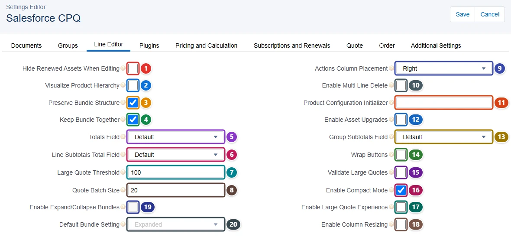

=== "After"

    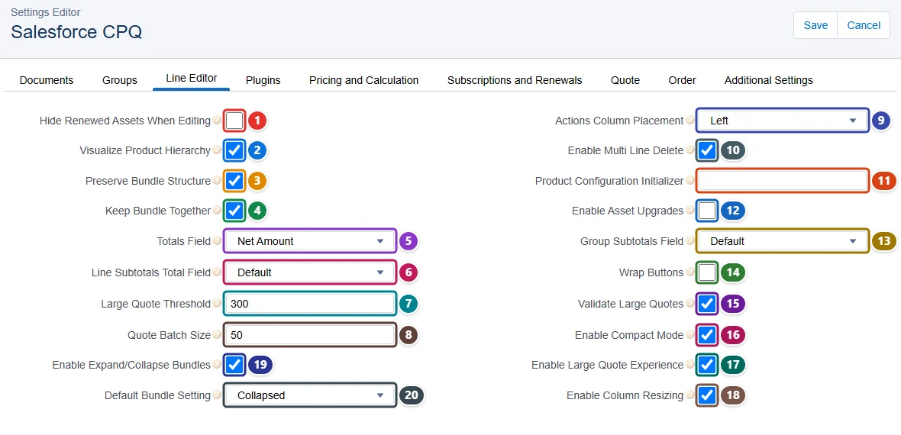

| Pill | Field | Before | After |
| ---- | ----- | ------ | ----- |
| <span class="bf-pill bf-pill-c1">1</span> | <code>lineEditor.<wbr>hideRenewedAssetsWhenEditing</code> |  | `false` |
| <span class="bf-pill bf-pill-c2">2</span> | <code>lineEditor.<wbr>visualizeProductHierarchy</code> | `false` | `true` |
| <span class="bf-pill bf-pill-c3">3</span> | <code>lineEditor.<wbr>preserveBundleStructure</code> |  | `true` |
| <span class="bf-pill bf-pill-c4">4</span> | <code>lineEditor.<wbr>keepBundleTogether</code> |  | `true` |
| <span class="bf-pill bf-pill-c5">5</span> | <code>lineEditor.<wbr>totalsField</code> | `Default` | `Net Amount` |
| <span class="bf-pill bf-pill-c6">6</span> | <code>lineEditor.<wbr>lineSubtotalsTotalField</code> |  | `Default` |
| <span class="bf-pill bf-pill-c7">7</span> | <code>lineEditor.<wbr>largeQuoteThreshold</code> | `100` | `300` |
| <span class="bf-pill bf-pill-c8">8</span> | <code>lineEditor.<wbr>quoteBatchSize</code> | `20` | `50` |
| <span class="bf-pill bf-pill-c9">9</span> | <code>lineEditor.<wbr>actionsColumnPlacement</code> | `Right` | `Left` |
| <span class="bf-pill bf-pill-c10">10</span> | <code>lineEditor.<wbr>enableMultiLineDelete</code> | `false` | `true` |
| <span class="bf-pill bf-pill-c11">11</span> | <code>lineEditor.<wbr>productConfigurationInitializer</code> |  | `` |
| <span class="bf-pill bf-pill-c12">12</span> | <code>lineEditor.<wbr>enableAssetUpgrades</code> |  | `false` |
| <span class="bf-pill bf-pill-c13">13</span> | <code>lineEditor.<wbr>groupSubtotalsField</code> |  | `Default` |
| <span class="bf-pill bf-pill-c14">14</span> | <code>lineEditor.<wbr>wrapButtons</code> |  | `false` |
| <span class="bf-pill bf-pill-c15">15</span> | <code>lineEditor.<wbr>validateLargeQuotes</code> | `false` | `true` |
| <span class="bf-pill bf-pill-c16">16</span> | <code>lineEditor.<wbr>enableCompactMode</code> |  | `true` |
| <span class="bf-pill bf-pill-c17">17</span> | <code>lineEditor.<wbr>enableLargeQuoteExperience</code> | `false` | `true` |
| <span class="bf-pill bf-pill-c18">18</span> | <code>lineEditor.<wbr>enableColumnResizing</code> | `false` | `true` |
| <span class="bf-pill bf-pill-c19">19</span> | <code>lineEditor.<wbr>enableExpandCollapseBundles</code> | `false` | `true` |
| <span class="bf-pill bf-pill-c20">20</span> | <code>lineEditor.<wbr>defaultBundleSetting</code> |  | `Collapsed` |

### 3. Calculate prices faster

The sales reps of Acme wait for the price calculation of every quote, and its "not calculated" warning confuses them while the background calculation runs. The pricing settings of Salesforce CPQ are protected custom settings of the package: no Metadata API deployment can write them, only its settings page can.

On the **Pricing and Calculation** tab, this config turns on the **quick calculate <span class="bf-pill bf-pill-c3">3</span>** button and hides the **uncalculated quote warning <span class="bf-pill bf-pill-c12">12</span>**, keeping the calculation with the **integration user <span class="bf-pill bf-pill-c13">13</span>**. On the **Plugins** tab, the plugin fields **<span class="bf-pill bf-pill-c14">14</span>** to **<span class="bf-pill bf-pill-c3">23</span>** take the names of Apex classes or JavaScript plugins; empty values keep the standard behavior. Every field of both tabs carries a pill.

=== "Config"

    ```json
    {
      "$schema": "https://raw.githubusercontent.com/amtrack/sfdx-browserforce-plugin/main/src/plugins/schema.json",
      "settings": {
        "salesforceCpqConfig": {
          "pricingAndCalculation": {
            "currencySymbol": "",
            "unitPriceScale": 2,
            "enableQuickCalculate": true,
            "allowNonConsecutiveCustomSegments": false,
            "enablePricingGuidance": false,
            "useLegacyCalculator": false,
            "useInactivePrices": false,
            "calculateImmediately": false,
            "disableBackgroundCalculationRefresh": false,
            "enableUsageBasedPricing": false,
            "quoteLineEditsForUsageBasedPricing": false,
            "hideUncalculatedQuoteWarning": true,
            "useIntegrationUserForCalculations": true
          },
          "plugins": {
            "legacyPageSecurityPlugin": "",
            "electronicSignaturePlugin": "",
            "billingPlugin": "",
            "productSearchPlugin": "",
            "recommendedProductsPlugin": "",
            "legacyQuoteCalculatorPlugin": "",
            "documentStorePlugin": "",
            "quoteCalculatorPlugin": "",
            "orderManagementPlugin": "",
            "qleCustomActionPlugin": ""
          }
        }
      }
    }
    ```

=== "Before"

    *Pricing and Calculation*

    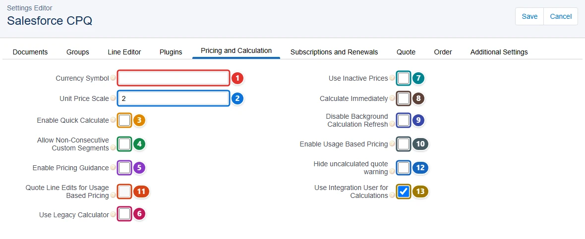

    *Plugins*

    

=== "After"

    *Pricing and Calculation*

    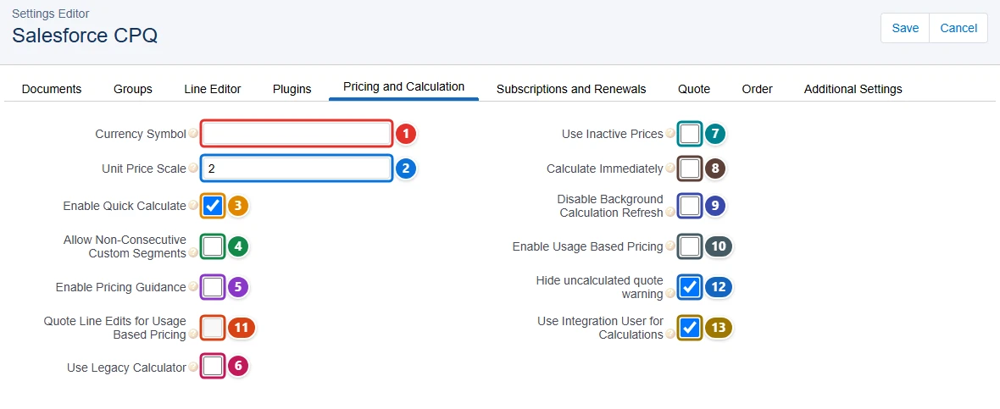

    *Plugins*

    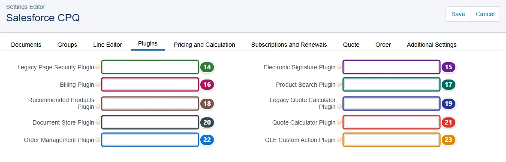

| Pill | Field | Before | After |
| ---- | ----- | ------ | ----- |
| <span class="bf-pill bf-pill-c1">1</span> | <code>pricingAndCalculation.<wbr>currencySymbol</code> |  | `` |
| <span class="bf-pill bf-pill-c2">2</span> | <code>pricingAndCalculation.<wbr>unitPriceScale</code> |  | `2` |
| <span class="bf-pill bf-pill-c3">3</span> | <code>pricingAndCalculation.<wbr>enableQuickCalculate</code> | `false` | `true` |
| <span class="bf-pill bf-pill-c4">4</span> | <code>pricingAndCalculation.<wbr>allowNonConsecutiveCustomSegments</code> |  | `false` |
| <span class="bf-pill bf-pill-c5">5</span> | <code>pricingAndCalculation.<wbr>enablePricingGuidance</code> |  | `false` |
| <span class="bf-pill bf-pill-c6">6</span> | <code>pricingAndCalculation.<wbr>useLegacyCalculator</code> |  | `false` |
| <span class="bf-pill bf-pill-c7">7</span> | <code>pricingAndCalculation.<wbr>useInactivePrices</code> |  | `false` |
| <span class="bf-pill bf-pill-c8">8</span> | <code>pricingAndCalculation.<wbr>calculateImmediately</code> |  | `false` |
| <span class="bf-pill bf-pill-c9">9</span> | <code>pricingAndCalculation.<wbr>disableBackgroundCalculationRefresh</code> |  | `false` |
| <span class="bf-pill bf-pill-c10">10</span> | <code>pricingAndCalculation.<wbr>enableUsageBasedPricing</code> |  | `false` |
| <span class="bf-pill bf-pill-c11">11</span> | <code>pricingAndCalculation.<wbr>quoteLineEditsForUsageBasedPricing</code> |  | `false` |
| <span class="bf-pill bf-pill-c12">12</span> | <code>pricingAndCalculation.<wbr>hideUncalculatedQuoteWarning</code> | `false` | `true` |
| <span class="bf-pill bf-pill-c13">13</span> | <code>pricingAndCalculation.<wbr>useIntegrationUserForCalculations</code> |  | `true` |
| <span class="bf-pill bf-pill-c14">14</span> | <code>plugins.<wbr>legacyPageSecurityPlugin</code> |  | `` |
| <span class="bf-pill bf-pill-c15">15</span> | <code>plugins.<wbr>electronicSignaturePlugin</code> |  | `` |
| <span class="bf-pill bf-pill-c16">16</span> | <code>plugins.<wbr>billingPlugin</code> |  | `` |
| <span class="bf-pill bf-pill-c17">17</span> | <code>plugins.<wbr>productSearchPlugin</code> |  | `` |
| <span class="bf-pill bf-pill-c18">18</span> | <code>plugins.<wbr>recommendedProductsPlugin</code> |  | `` |
| <span class="bf-pill bf-pill-c19">19</span> | <code>plugins.<wbr>legacyQuoteCalculatorPlugin</code> |  | `` |
| <span class="bf-pill bf-pill-c20">20</span> | <code>plugins.<wbr>documentStorePlugin</code> |  | `` |
| <span class="bf-pill bf-pill-c1">21</span> | <code>plugins.<wbr>quoteCalculatorPlugin</code> |  | `` |
| <span class="bf-pill bf-pill-c2">22</span> | <code>plugins.<wbr>orderManagementPlugin</code> |  | `` |
| <span class="bf-pill bf-pill-c3">23</span> | <code>plugins.<wbr>qleCustomActionPlugin</code> |  | `` |

### 4. Run subscriptions, renewals and orders the way the business does

Acme sells software subscriptions that renew until the customer cancels, bills them to the day, and only ships orders from approved quotes. Those rules are settings of Salesforce CPQ, kept in protected custom settings of the package that no Metadata API deployment can write: they are set on the settings page of the package.

On **Subscriptions and Renewals**, this config prorates to the **day <span class="bf-pill bf-pill-c5">5</span>**, enables **evergreen subscriptions <span class="bf-pill bf-pill-c9">9</span>** and **amends contracts in the background <span class="bf-pill bf-pill-c12">12</span>**. On **Order**, an order needs an **approved quote <span class="bf-pill bf-pill-c16">16</span>**, starts on the **quote start date <span class="bf-pill bf-pill-c17">17</span>** and a quote can be split into **several orders <span class="bf-pill bf-pill-c18">18</span>**. Every field of both tabs carries a pill.

=== "Config"

    ```json
    {
      "$schema": "https://raw.githubusercontent.com/amtrack/sfdx-browserforce-plugin/main/src/plugins/schema.json",
      "settings": {
        "salesforceCpqConfig": {
          "subscriptionsAndRenewals": {
            "renewalModel": "Contract Based",
            "disableAddSubscriptions": false,
            "allowRenewalQuotesWithoutAssets": false,
            "subscriptionTermUnit": "Month",
            "subscriptionProratePrecision": "Day",
            "includeNetNewProductsInMaintenance": false,
            "contractInForeground": false,
            "reEvaluateBundleLogicOnRenewals": false,
            "enableEvergreenSubscriptions": true,
            "poTRenewalsContractingFromOrders": true,
            "legacyAmendRenewService": false,
            "amendContractsInBackground": true,
            "disableProductBundleSubTypeChecks": false,
            "bypassPreserveBundleStructure": false,
            "useCurrentSubscriptionOnAssets": false
          },
          "order": {
            "requireApprovedQuote": true,
            "defaultOrderStartDate": "Quote Start Date",
            "allowMultipleOrders": true,
            "createOrdersWithoutOpportunities": false
          }
        }
      }
    }
    ```

=== "Before"

    *Subscriptions and Renewals*

    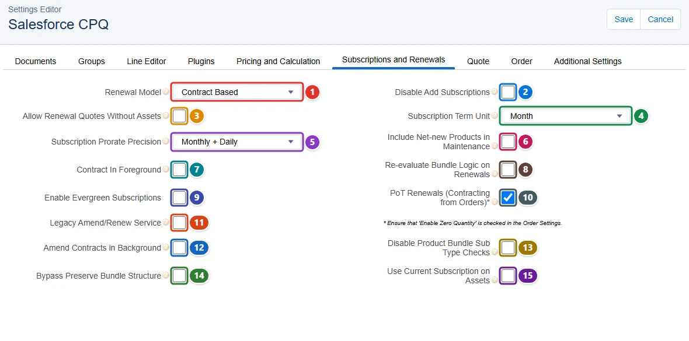

    *Order*

    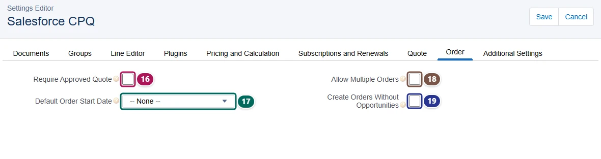

=== "After"

    *Subscriptions and Renewals*

    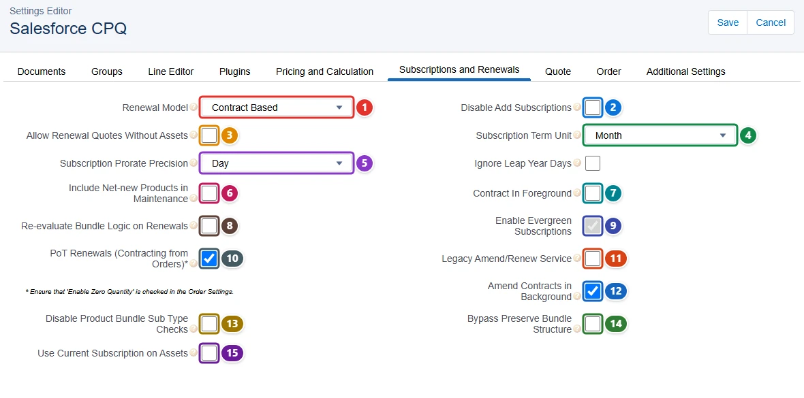

    *Order*

    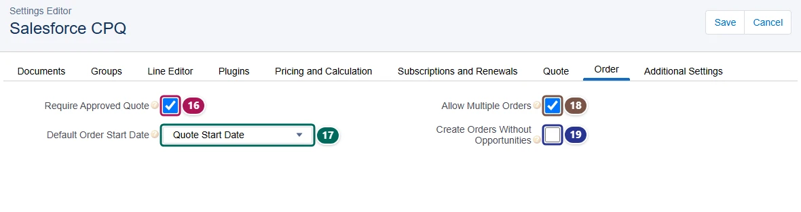

| Pill | Field | Before | After |
| ---- | ----- | ------ | ----- |
| <span class="bf-pill bf-pill-c1">1</span> | <code>subscriptionsAndRenewals.<wbr>renewalModel</code> |  | `Contract Based` |
| <span class="bf-pill bf-pill-c2">2</span> | <code>subscriptionsAndRenewals.<wbr>disableAddSubscriptions</code> |  | `false` |
| <span class="bf-pill bf-pill-c3">3</span> | <code>subscriptionsAndRenewals.<wbr>allowRenewalQuotesWithoutAssets</code> |  | `false` |
| <span class="bf-pill bf-pill-c4">4</span> | <code>subscriptionsAndRenewals.<wbr>subscriptionTermUnit</code> |  | `Month` |
| <span class="bf-pill bf-pill-c5">5</span> | <code>subscriptionsAndRenewals.<wbr>subscriptionProratePrecision</code> | `Monthly + Daily` | `Day` |
| <span class="bf-pill bf-pill-c6">6</span> | <code>subscriptionsAndRenewals.<wbr>includeNetNewProductsInMaintenance</code> |  | `false` |
| <span class="bf-pill bf-pill-c7">7</span> | <code>subscriptionsAndRenewals.<wbr>contractInForeground</code> |  | `false` |
| <span class="bf-pill bf-pill-c8">8</span> | <code>subscriptionsAndRenewals.<wbr>reEvaluateBundleLogicOnRenewals</code> |  | `false` |
| <span class="bf-pill bf-pill-c9">9</span> | <code>subscriptionsAndRenewals.<wbr>enableEvergreenSubscriptions</code> | `false` | `true` |
| <span class="bf-pill bf-pill-c10">10</span> | <code>subscriptionsAndRenewals.<wbr>poTRenewalsContractingFromOrders</code> |  | `true` |
| <span class="bf-pill bf-pill-c11">11</span> | <code>subscriptionsAndRenewals.<wbr>legacyAmendRenewService</code> |  | `false` |
| <span class="bf-pill bf-pill-c12">12</span> | <code>subscriptionsAndRenewals.<wbr>amendContractsInBackground</code> | `false` | `true` |
| <span class="bf-pill bf-pill-c13">13</span> | <code>subscriptionsAndRenewals.<wbr>disableProductBundleSubTypeChecks</code> |  | `false` |
| <span class="bf-pill bf-pill-c14">14</span> | <code>subscriptionsAndRenewals.<wbr>bypassPreserveBundleStructure</code> |  | `false` |
| <span class="bf-pill bf-pill-c15">15</span> | <code>subscriptionsAndRenewals.<wbr>useCurrentSubscriptionOnAssets</code> |  | `false` |
| <span class="bf-pill bf-pill-c16">16</span> | <code>order.<wbr>requireApprovedQuote</code> | `false` | `true` |
| <span class="bf-pill bf-pill-c17">17</span> | <code>order.<wbr>defaultOrderStartDate</code> | `-- None --` | `Quote Start Date` |
| <span class="bf-pill bf-pill-c18">18</span> | <code>order.<wbr>allowMultipleOrders</code> | `false` | `true` |
| <span class="bf-pill bf-pill-c19">19</span> | <code>order.<wbr>createOrdersWithoutOpportunities</code> |  | `false` |

### 5. Group quote lines by solution and tune the product selection

A car dealer quotes several vehicles in one deal, and wants the quote lines grouped by vehicle, each group named. Its sales reps also browse a long product catalog and need the search filters open and the results grouped by product family. These are settings of Salesforce CPQ, protected custom settings of the package that no Metadata API deployment can write: only the settings page of the package sets them.

On **Groups**, this config requires a **group name <span class="bf-pill bf-pill-c1">1</span>** for each group of quote lines. On **Additional Settings**, bundles open in the **Classic <span class="bf-pill bf-pill-c5">5</span>** view, the search filter is **open <span class="bf-pill bf-pill-c8">8</span>** and the results are grouped by **Product Family <span class="bf-pill bf-pill-c11">11</span>**. Every field of both tabs carries a pill.

=== "Config"

    ```json
    {
      "$schema": "https://raw.githubusercontent.com/amtrack/sfdx-browserforce-plugin/main/src/plugins/schema.json",
      "settings": {
        "salesforceCpqConfig": {
          "groups": {
            "requireGroupName": true
          },
          "additionalSettings": {
            "triggersDisabled": false,
            "quantityScale": 2,
            "sortProductsInMemory": false,
            "multipleBundlesView": "Classic",
            "externalConfiguratorUrl": "",
            "thirdPartyConfigurator": false,
            "openSearchFilterByDefault": true,
            "hideFeaturesWithHiddenOptions": false,
            "hideProductSearchBar": false,
            "productResultsGroupFieldName": "Product Family",
            "productDescriptionField": "Product Description",
            "theme": "-- None --",
            "useGlobalHeaderPermission": false,
            "serviceRegion": "Default",
            "enableProductOptionDrawer": false,
            "enableLargeConfigurations": false,
            "nestedBundlesForExternalConfigurator": false
          }
        }
      }
    }
    ```

=== "Before"

    *Groups*

    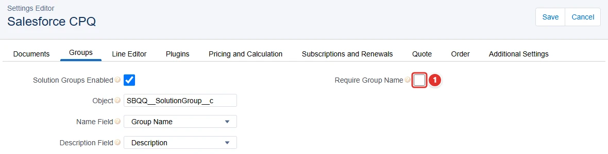

    *Additional Settings*

    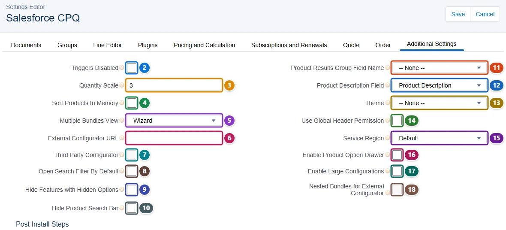

=== "After"

    *Groups*

    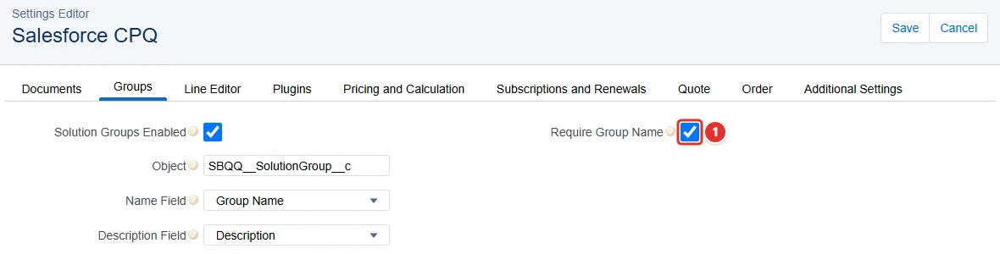

    *Additional Settings*

    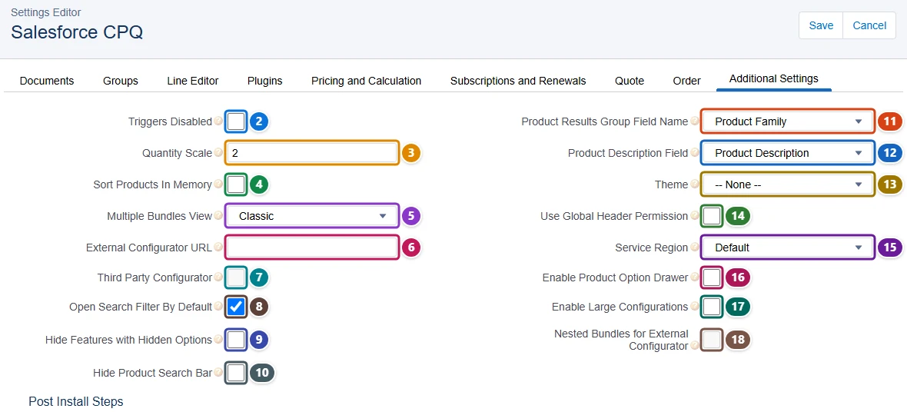

| Pill | Field | Before | After |
| ---- | ----- | ------ | ----- |
| <span class="bf-pill bf-pill-c1">1</span> | <code>groups.<wbr>requireGroupName</code> | `false` | `true` |
| <span class="bf-pill bf-pill-c2">2</span> | <code>additionalSettings.<wbr>triggersDisabled</code> |  | `false` |
| <span class="bf-pill bf-pill-c3">3</span> | <code>additionalSettings.<wbr>quantityScale</code> |  | `2` |
| <span class="bf-pill bf-pill-c4">4</span> | <code>additionalSettings.<wbr>sortProductsInMemory</code> |  | `false` |
| <span class="bf-pill bf-pill-c5">5</span> | <code>additionalSettings.<wbr>multipleBundlesView</code> | `Wizard` | `Classic` |
| <span class="bf-pill bf-pill-c6">6</span> | <code>additionalSettings.<wbr>externalConfiguratorUrl</code> |  | `` |
| <span class="bf-pill bf-pill-c7">7</span> | <code>additionalSettings.<wbr>thirdPartyConfigurator</code> |  | `false` |
| <span class="bf-pill bf-pill-c8">8</span> | <code>additionalSettings.<wbr>openSearchFilterByDefault</code> | `false` | `true` |
| <span class="bf-pill bf-pill-c9">9</span> | <code>additionalSettings.<wbr>hideFeaturesWithHiddenOptions</code> |  | `false` |
| <span class="bf-pill bf-pill-c10">10</span> | <code>additionalSettings.<wbr>hideProductSearchBar</code> |  | `false` |
| <span class="bf-pill bf-pill-c11">11</span> | <code>additionalSettings.<wbr>productResultsGroupFieldName</code> | `-- None --` | `Product Family` |
| <span class="bf-pill bf-pill-c12">12</span> | <code>additionalSettings.<wbr>productDescriptionField</code> |  | `Product Description` |
| <span class="bf-pill bf-pill-c13">13</span> | <code>additionalSettings.<wbr>theme</code> |  | `-- None --` |
| <span class="bf-pill bf-pill-c14">14</span> | <code>additionalSettings.<wbr>useGlobalHeaderPermission</code> |  | `false` |
| <span class="bf-pill bf-pill-c15">15</span> | <code>additionalSettings.<wbr>serviceRegion</code> |  | `Default` |
| <span class="bf-pill bf-pill-c16">16</span> | <code>additionalSettings.<wbr>enableProductOptionDrawer</code> |  | `false` |
| <span class="bf-pill bf-pill-c17">17</span> | <code>additionalSettings.<wbr>enableLargeConfigurations</code> |  | `false` |
| <span class="bf-pill bf-pill-c18">18</span> | <code>additionalSettings.<wbr>nestedBundlesForExternalConfigurator</code> |  | `false` |

### 6. Turn on solution groups and choose their fields

Contoso sells installation projects in which a quote holds several solutions: the hardware of a site, its cabling, its support contract. Sales reps want the quote line editor to group the lines of each solution.

Ticking **Solution Groups Enabled <span class="bf-pill bf-pill-c1">1</span>** makes Salesforce CPQ ask where the groups live: the **Object <span class="bf-pill bf-pill-c2">2</span>** that stores them, here the `SBQQ__SolutionGroup__c` object of the package, and which of its fields gives the **name <span class="bf-pill bf-pill-c3">3</span>** and the **description <span class="bf-pill bf-pill-c4">4</span>** of a group. CPQ refuses to save the first without the three others. These are protected custom settings of the managed package: no Metadata API deployment can write them.

=== "Config"

    ```json
    {
      "$schema": "https://raw.githubusercontent.com/amtrack/sfdx-browserforce-plugin/main/src/plugins/schema.json",
      "settings": {
        "salesforceCpqConfig": {
          "groups": {
            "solutionGroupsEnabled": true,
            "object": "SBQQ__SolutionGroup__c",
            "nameField": "Group Name",
            "descriptionField": "Description"
          }
        }
      }
    }
    ```

=== "Before"

    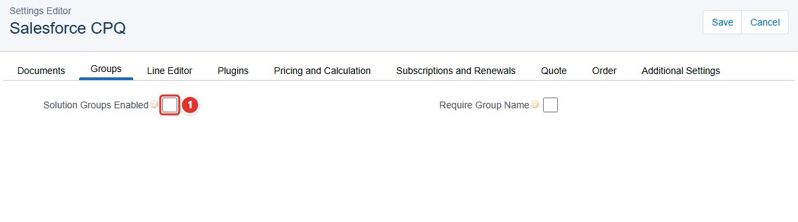

=== "After"

    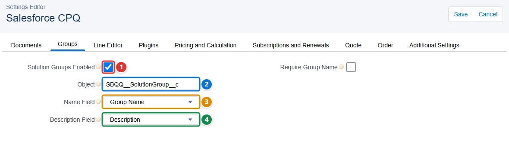

| Pill | Field | Before | After |
| ---- | ----- | ------ | ----- |
| <span class="bf-pill bf-pill-c1">1</span> | <code>groups.<wbr>solutionGroupsEnabled</code> | `false` | `true` |
| <span class="bf-pill bf-pill-c2">2</span> | <code>groups.<wbr>object</code> |  | `SBQQ__SolutionGroup__c` |
| <span class="bf-pill bf-pill-c3">3</span> | <code>groups.<wbr>nameField</code> |  | `Group Name` |
| <span class="bf-pill bf-pill-c4">4</span> | <code>groups.<wbr>descriptionField</code> |  | `Description` |

## Example

```json
{
  "$schema": "https://raw.githubusercontent.com/amtrack/sfdx-browserforce-plugin/main/src/plugins/schema.json",
  "settings": {
    "salesforceCpqConfig": {
      "documents": {
        "documentFolder": "UserPersonalDocuments",
        "postToFeed": false
      }
    }
  }
}
```

## Fields

| Field | Type | Description |
| ----- | ---- | ----------- |
| <code>documents.<wbr>documentFolder</code> | string | Document Folder |
| <code>documents.<wbr>hideDocumentName</code> | boolean | Hide Document Name |
| <code>documents.<wbr>fullPagePreview</code> | boolean | Full Page Preview |
| <code>documents.<wbr>excludeHiddenLinesInGroupTotals</code> | boolean | Exclude Hidden Lines In Group Totals |
| <code>documents.<wbr>attachmentTarget</code> | string | Attachment Target |
| <code>documents.<wbr>postToFeed</code> | boolean | Post to Feed? |
| <code>documents.<wbr>enableMultiLanguageTranslations</code> | boolean | Enable Multi-Language Translations |
| <code>groups.<wbr>solutionGroupsEnabled</code> | boolean | Solution Groups Enabled |
| <code>groups.<wbr>object</code> | string | Object |
| <code>groups.<wbr>nameField</code> | string | Name Field |
| <code>groups.<wbr>descriptionField</code> | string | Description Field |
| <code>groups.<wbr>requireGroupName</code> | boolean | Require Group Name |
| <code>lineEditor.<wbr>hideRenewedAssetsWhenEditing</code> | boolean | Hide Renewed Assets When Editing |
| <code>lineEditor.<wbr>visualizeProductHierarchy</code> | boolean | Visualize Product Hierarchy |
| <code>lineEditor.<wbr>preserveBundleStructure</code> | boolean | Preserve Bundle Structure |
| <code>lineEditor.<wbr>keepBundleTogether</code> | boolean | Keep Bundle Together |
| <code>lineEditor.<wbr>totalsField</code> | string | Totals Field |
| <code>lineEditor.<wbr>lineSubtotalsTotalField</code> | string | Line Subtotals Total Field |
| <code>lineEditor.<wbr>largeQuoteThreshold</code> | number | Large Quote Threshold |
| <code>lineEditor.<wbr>quoteBatchSize</code> | number | Quote Batch Size |
| <code>lineEditor.<wbr>enableExpandCollapseBundles</code> | boolean | Enable Expand/Collapse Bundles |
| <code>lineEditor.<wbr>defaultBundleSetting</code> | string | Default Bundle Setting |
| <code>lineEditor.<wbr>actionsColumnPlacement</code> | string | Actions Column Placement |
| <code>lineEditor.<wbr>enableMultiLineDelete</code> | boolean | Enable Multi Line Delete |
| <code>lineEditor.<wbr>productConfigurationInitializer</code> | string | Product Configuration Initializer |
| <code>lineEditor.<wbr>enableAssetUpgrades</code> | boolean | Enable Asset Upgrades |
| <code>lineEditor.<wbr>groupSubtotalsField</code> | string | Group Subtotals Field |
| <code>lineEditor.<wbr>wrapButtons</code> | boolean | Wrap Buttons |
| <code>lineEditor.<wbr>validateLargeQuotes</code> | boolean | Validate Large Quotes |
| <code>lineEditor.<wbr>enableCompactMode</code> | boolean | Enable Compact Mode |
| <code>lineEditor.<wbr>enableLargeQuoteExperience</code> | boolean | Enable Large Quote Experience |
| <code>lineEditor.<wbr>enableColumnResizing</code> | boolean | Enable Column Resizing |
| <code>plugins.<wbr>legacyPageSecurityPlugin</code> | string | Legacy Page Security Plugin |
| <code>plugins.<wbr>electronicSignaturePlugin</code> | string | Electronic Signature Plugin |
| <code>plugins.<wbr>billingPlugin</code> | string | Billing Plugin |
| <code>plugins.<wbr>productSearchPlugin</code> | string | Product Search Plugin |
| <code>plugins.<wbr>recommendedProductsPlugin</code> | string | Recommended Products Plugin |
| <code>plugins.<wbr>legacyQuoteCalculatorPlugin</code> | string | Legacy Quote Calculator Plugin |
| <code>plugins.<wbr>documentStorePlugin</code> | string | Document Store Plugin |
| <code>plugins.<wbr>quoteCalculatorPlugin</code> | string | Quote Calculator Plugin |
| <code>plugins.<wbr>orderManagementPlugin</code> | string | Order Management Plugin |
| <code>plugins.<wbr>qleCustomActionPlugin</code> | string | QLE Custom Action Plugin |
| <code>pricingAndCalculation.<wbr>currencySymbol</code> | string | Currency Symbol |
| <code>pricingAndCalculation.<wbr>useInactivePrices</code> | boolean | Use Inactive Prices |
| <code>pricingAndCalculation.<wbr>unitPriceScale</code> | number | Unit Price Scale |
| <code>pricingAndCalculation.<wbr>calculateImmediately</code> | boolean | Calculate Immediately |
| <code>pricingAndCalculation.<wbr>enableQuickCalculate</code> | boolean | Enable Quick Calculate |
| <code>pricingAndCalculation.<wbr>allowNonConsecutiveCustomSegments</code> | boolean | Allow Non-Consecutive Custom Segments |
| <code>pricingAndCalculation.<wbr>enablePricingGuidance</code> | boolean | Enable Pricing Guidance |
| <code>pricingAndCalculation.<wbr>quoteLineEditsForUsageBasedPricing</code> | boolean | Quote Line Edits for Usage Based Pricing |
| <code>pricingAndCalculation.<wbr>useLegacyCalculator</code> | boolean | Use Legacy Calculator |
| <code>pricingAndCalculation.<wbr>disableBackgroundCalculationRefresh</code> | boolean | Disable Background Calculation Refresh |
| <code>pricingAndCalculation.<wbr>enableUsageBasedPricing</code> | boolean | Enable Usage Based Pricing |
| <code>pricingAndCalculation.<wbr>hideUncalculatedQuoteWarning</code> | boolean | Hide Uncalculated Quote Warning |
| <code>pricingAndCalculation.<wbr>useIntegrationUserForCalculations</code> | boolean | Use Integration User for Calculations |
| <code>subscriptionsAndRenewals.<wbr>renewalModel</code> | string | Renewal Model |
| <code>subscriptionsAndRenewals.<wbr>disableAddSubscriptions</code> | boolean | Disable Add Subscriptions |
| <code>subscriptionsAndRenewals.<wbr>allowRenewalQuotesWithoutAssets</code> | boolean | Allow Renewal Quotes Without Assets |
| <code>subscriptionsAndRenewals.<wbr>subscriptionProratePrecision</code> | string | Subscription Prorate Precision |
| <code>subscriptionsAndRenewals.<wbr>includeNetNewProductsInMaintenance</code> | boolean | Include Net-new Products in Maintenance |
| <code>subscriptionsAndRenewals.<wbr>contractInForeground</code> | boolean | Contract In Foreground |
| <code>subscriptionsAndRenewals.<wbr>enableEvergreenSubscriptions</code> | boolean | Enable Evergreen Subscriptions<br>Once enabled, Salesforce CPQ disables the checkbox: evergreen subscriptions cannot be turned off.<br>**Irreversible:** cannot be changed back once applied. |
| <code>subscriptionsAndRenewals.<wbr>legacyAmendRenewService</code> | boolean | Legacy Amend/Renew Service |
| <code>subscriptionsAndRenewals.<wbr>amendContractsInBackground</code> | boolean | Amend Contracts in Background |
| <code>subscriptionsAndRenewals.<wbr>bypassPreserveBundleStructure</code> | boolean | Bypass Preserve Bundle Structure |
| <code>subscriptionsAndRenewals.<wbr>subscriptionTermUnit</code> | string | Subscription Term Unit |
| <code>subscriptionsAndRenewals.<wbr>reEvaluateBundleLogicOnRenewals</code> | boolean | Re-evaluate Bundle Logic on Renewals |
| <code>subscriptionsAndRenewals.<wbr>poTRenewalsContractingFromOrders</code> | boolean | PoT Renewals (Contracting from Orders) |
| <code>subscriptionsAndRenewals.<wbr>disableProductBundleSubTypeChecks</code> | boolean | Disable Product Bundle Sub Type Checks |
| <code>subscriptionsAndRenewals.<wbr>useCurrentSubscriptionOnAssets</code> | boolean | Use Current Subscription on Assets |
| <code>quote.<wbr>disableInitialQuoteSync</code> | boolean | Disable Initial Quote Sync |
| <code>quote.<wbr>disableQuoteContactDefaulting</code> | boolean | Disable Quote Contact Defaulting |
| <code>quote.<wbr>allowOptionDeletion</code> | boolean | Allow Option Deletion |
| <code>quote.<wbr>disableQuoteAddressDefaulting</code> | boolean | Disable Quote Address Defaulting |
| <code>quote.<wbr>primaryQuoteKeepsOpportunityProducts</code> | boolean | Primary Quote Keeps Opportunity Products |
| <code>quote.<wbr>defaultQuoteValidityDays</code> | number | Default Quote Validity (Days) |
| <code>order.<wbr>requireApprovedQuote</code> | boolean | Require Approved Quote |
| <code>order.<wbr>defaultOrderStartDate</code> | string | Default Order Start Date |
| <code>order.<wbr>allowMultipleOrders</code> | boolean | Allow Multiple Orders |
| <code>order.<wbr>createOrdersWithoutOpportunities</code> | boolean | Create Orders Without Opportunities |
| <code>additionalSettings.<wbr>triggersDisabled</code> | boolean | Triggers Disabled |
| <code>additionalSettings.<wbr>quantityScale</code> | number | Quantity Scale |
| <code>additionalSettings.<wbr>sortProductsInMemory</code> | boolean | Sort Products In Memory |
| <code>additionalSettings.<wbr>multipleBundlesView</code> | string | Multiple Bundles View |
| <code>additionalSettings.<wbr>externalConfiguratorUrl</code> | string | External Configurator URL |
| <code>additionalSettings.<wbr>thirdPartyConfigurator</code> | boolean | Third Party Configurator |
| <code>additionalSettings.<wbr>openSearchFilterByDefault</code> | boolean | Open Search Filter By Default |
| <code>additionalSettings.<wbr>hideFeaturesWithHiddenOptions</code> | boolean | Hide Features with Hidden Options |
| <code>additionalSettings.<wbr>hideProductSearchBar</code> | boolean | Hide Product Search Bar |
| <code>additionalSettings.<wbr>productResultsGroupFieldName</code> | string | Product Results Group Field Name |
| <code>additionalSettings.<wbr>productDescriptionField</code> | string | Product Description Field |
| <code>additionalSettings.<wbr>theme</code> | string | Theme |
| <code>additionalSettings.<wbr>useGlobalHeaderPermission</code> | boolean | Use Global Header Permission |
| <code>additionalSettings.<wbr>serviceRegion</code> | string | Service Region |
| <code>additionalSettings.<wbr>enableProductOptionDrawer</code> | boolean | Enable Product Option Drawer |
| <code>additionalSettings.<wbr>enableLargeConfigurations</code> | boolean | Enable Large Configurations |
| <code>additionalSettings.<wbr>nestedBundlesForExternalConfigurator</code> | boolean | Nested Bundles for External Configurator |

??? note "JSON Schema"

    ```json
    {
      "type": "object",
      "properties": {
        "documents": {
          "type": "object",
          "properties": {
            "documentFolder": {
              "type": "string",
              "title": "Document Folder"
            },
            "hideDocumentName": {
              "type": "boolean",
              "title": "Hide Document Name"
            },
            "fullPagePreview": {
              "type": "boolean",
              "title": "Full Page Preview"
            },
            "excludeHiddenLinesInGroupTotals": {
              "type": "boolean",
              "title": "Exclude Hidden Lines In Group Totals"
            },
            "attachmentTarget": {
              "type": "string",
              "title": "Attachment Target"
            },
            "postToFeed": {
              "type": "boolean",
              "title": "Post to Feed?"
            },
            "enableMultiLanguageTranslations": {
              "type": "boolean",
              "title": "Enable Multi-Language Translations"
            }
          },
          "title": "Documents"
        },
        "groups": {
          "type": "object",
          "properties": {
            "solutionGroupsEnabled": {
              "type": "boolean",
              "title": "Solution Groups Enabled"
            },
            "object": {
              "type": "string",
              "title": "Object"
            },
            "nameField": {
              "type": "string",
              "title": "Name Field"
            },
            "descriptionField": {
              "type": "string",
              "title": "Description Field"
            },
            "requireGroupName": {
              "type": "boolean",
              "title": "Require Group Name"
            }
          },
          "title": "Groups"
        },
        "lineEditor": {
          "type": "object",
          "properties": {
            "hideRenewedAssetsWhenEditing": {
              "type": "boolean",
              "title": "Hide Renewed Assets When Editing"
            },
            "visualizeProductHierarchy": {
              "type": "boolean",
              "title": "Visualize Product Hierarchy"
            },
            "preserveBundleStructure": {
              "type": "boolean",
              "title": "Preserve Bundle Structure"
            },
            "keepBundleTogether": {
              "type": "boolean",
              "title": "Keep Bundle Together"
            },
            "totalsField": {
              "type": "string",
              "title": "Totals Field"
            },
            "lineSubtotalsTotalField": {
              "type": "string",
              "title": "Line Subtotals Total Field"
            },
            "largeQuoteThreshold": {
              "type": "number",
              "title": "Large Quote Threshold"
            },
            "quoteBatchSize": {
              "type": "number",
              "title": "Quote Batch Size"
            },
            "enableExpandCollapseBundles": {
              "type": "boolean",
              "title": "Enable Expand/Collapse Bundles"
            },
            "defaultBundleSetting": {
              "type": "string",
              "title": "Default Bundle Setting"
            },
            "actionsColumnPlacement": {
              "type": "string",
              "title": "Actions Column Placement"
            },
            "enableMultiLineDelete": {
              "type": "boolean",
              "title": "Enable Multi Line Delete"
            },
            "productConfigurationInitializer": {
              "type": "string",
              "title": "Product Configuration Initializer"
            },
            "enableAssetUpgrades": {
              "type": "boolean",
              "title": "Enable Asset Upgrades"
            },
            "groupSubtotalsField": {
              "type": "string",
              "title": "Group Subtotals Field"
            },
            "wrapButtons": {
              "type": "boolean",
              "title": "Wrap Buttons"
            },
            "validateLargeQuotes": {
              "type": "boolean",
              "title": "Validate Large Quotes"
            },
            "enableCompactMode": {
              "type": "boolean",
              "title": "Enable Compact Mode"
            },
            "enableLargeQuoteExperience": {
              "type": "boolean",
              "title": "Enable Large Quote Experience"
            },
            "enableColumnResizing": {
              "type": "boolean",
              "title": "Enable Column Resizing"
            }
          },
          "title": "Line Editor"
        },
        "plugins": {
          "type": "object",
          "properties": {
            "legacyPageSecurityPlugin": {
              "type": "string",
              "title": "Legacy Page Security Plugin"
            },
            "electronicSignaturePlugin": {
              "type": "string",
              "title": "Electronic Signature Plugin"
            },
            "billingPlugin": {
              "type": "string",
              "title": "Billing Plugin"
            },
            "productSearchPlugin": {
              "type": "string",
              "title": "Product Search Plugin"
            },
            "recommendedProductsPlugin": {
              "type": "string",
              "title": "Recommended Products Plugin"
            },
            "legacyQuoteCalculatorPlugin": {
              "type": "string",
              "title": "Legacy Quote Calculator Plugin"
            },
            "documentStorePlugin": {
              "type": "string",
              "title": "Document Store Plugin"
            },
            "quoteCalculatorPlugin": {
              "type": "string",
              "title": "Quote Calculator Plugin"
            },
            "orderManagementPlugin": {
              "type": "string",
              "title": "Order Management Plugin"
            },
            "qleCustomActionPlugin": {
              "type": "string",
              "title": "QLE Custom Action Plugin"
            }
          },
          "title": "Plugins"
        },
        "pricingAndCalculation": {
          "type": "object",
          "properties": {
            "currencySymbol": {
              "type": "string",
              "title": "Currency Symbol"
            },
            "useInactivePrices": {
              "type": "boolean",
              "title": "Use Inactive Prices"
            },
            "unitPriceScale": {
              "type": "number",
              "title": "Unit Price Scale"
            },
            "calculateImmediately": {
              "type": "boolean",
              "title": "Calculate Immediately"
            },
            "enableQuickCalculate": {
              "type": "boolean",
              "title": "Enable Quick Calculate"
            },
            "allowNonConsecutiveCustomSegments": {
              "type": "boolean",
              "title": "Allow Non-Consecutive Custom Segments"
            },
            "enablePricingGuidance": {
              "type": "boolean",
              "title": "Enable Pricing Guidance"
            },
            "quoteLineEditsForUsageBasedPricing": {
              "type": "boolean",
              "title": "Quote Line Edits for Usage Based Pricing"
            },
            "useLegacyCalculator": {
              "type": "boolean",
              "title": "Use Legacy Calculator"
            },
            "disableBackgroundCalculationRefresh": {
              "type": "boolean",
              "title": "Disable Background Calculation Refresh"
            },
            "enableUsageBasedPricing": {
              "type": "boolean",
              "title": "Enable Usage Based Pricing"
            },
            "hideUncalculatedQuoteWarning": {
              "type": "boolean",
              "title": "Hide Uncalculated Quote Warning"
            },
            "useIntegrationUserForCalculations": {
              "type": "boolean",
              "title": "Use Integration User for Calculations"
            }
          },
          "title": "Pricing and Calculation"
        },
        "subscriptionsAndRenewals": {
          "type": "object",
          "properties": {
            "renewalModel": {
              "type": "string",
              "title": "Renewal Model"
            },
            "disableAddSubscriptions": {
              "type": "boolean",
              "title": "Disable Add Subscriptions"
            },
            "allowRenewalQuotesWithoutAssets": {
              "type": "boolean",
              "title": "Allow Renewal Quotes Without Assets"
            },
            "subscriptionProratePrecision": {
              "type": "string",
              "title": "Subscription Prorate Precision"
            },
            "includeNetNewProductsInMaintenance": {
              "type": "boolean",
              "title": "Include Net-new Products in Maintenance"
            },
            "contractInForeground": {
              "type": "boolean",
              "title": "Contract In Foreground"
            },
            "enableEvergreenSubscriptions": {
              "type": "boolean",
              "title": "Enable Evergreen Subscriptions",
              "x-irreversible": true,
              "description": "Once enabled, Salesforce CPQ disables the checkbox: evergreen subscriptions cannot be turned off."
            },
            "legacyAmendRenewService": {
              "type": "boolean",
              "title": "Legacy Amend/Renew Service"
            },
            "amendContractsInBackground": {
              "type": "boolean",
              "title": "Amend Contracts in Background"
            },
            "bypassPreserveBundleStructure": {
              "type": "boolean",
              "title": "Bypass Preserve Bundle Structure"
            },
            "subscriptionTermUnit": {
              "type": "string",
              "title": "Subscription Term Unit"
            },
            "reEvaluateBundleLogicOnRenewals": {
              "type": "boolean",
              "title": "Re-evaluate Bundle Logic on Renewals"
            },
            "poTRenewalsContractingFromOrders": {
              "type": "boolean",
              "title": "PoT Renewals (Contracting from Orders)"
            },
            "disableProductBundleSubTypeChecks": {
              "type": "boolean",
              "title": "Disable Product Bundle Sub Type Checks"
            },
            "useCurrentSubscriptionOnAssets": {
              "type": "boolean",
              "title": "Use Current Subscription on Assets"
            }
          },
          "title": "Subscriptions and Renewals"
        },
        "quote": {
          "type": "object",
          "properties": {
            "disableInitialQuoteSync": {
              "type": "boolean",
              "title": "Disable Initial Quote Sync"
            },
            "disableQuoteContactDefaulting": {
              "type": "boolean",
              "title": "Disable Quote Contact Defaulting"
            },
            "allowOptionDeletion": {
              "type": "boolean",
              "title": "Allow Option Deletion"
            },
            "disableQuoteAddressDefaulting": {
              "type": "boolean",
              "title": "Disable Quote Address Defaulting"
            },
            "primaryQuoteKeepsOpportunityProducts": {
              "type": "boolean",
              "title": "Primary Quote Keeps Opportunity Products"
            },
            "defaultQuoteValidityDays": {
              "type": "number",
              "title": "Default Quote Validity (Days)"
            }
          },
          "title": "Quote"
        },
        "order": {
          "type": "object",
          "properties": {
            "requireApprovedQuote": {
              "type": "boolean",
              "title": "Require Approved Quote"
            },
            "defaultOrderStartDate": {
              "type": "string",
              "title": "Default Order Start Date"
            },
            "allowMultipleOrders": {
              "type": "boolean",
              "title": "Allow Multiple Orders"
            },
            "createOrdersWithoutOpportunities": {
              "type": "boolean",
              "title": "Create Orders Without Opportunities"
            }
          },
          "title": "Order"
        },
        "additionalSettings": {
          "type": "object",
          "properties": {
            "triggersDisabled": {
              "type": "boolean",
              "title": "Triggers Disabled"
            },
            "quantityScale": {
              "type": "number",
              "title": "Quantity Scale"
            },
            "sortProductsInMemory": {
              "type": "boolean",
              "title": "Sort Products In Memory"
            },
            "multipleBundlesView": {
              "type": "string",
              "title": "Multiple Bundles View"
            },
            "externalConfiguratorUrl": {
              "type": "string",
              "title": "External Configurator URL"
            },
            "thirdPartyConfigurator": {
              "type": "boolean",
              "title": "Third Party Configurator"
            },
            "openSearchFilterByDefault": {
              "type": "boolean",
              "title": "Open Search Filter By Default"
            },
            "hideFeaturesWithHiddenOptions": {
              "type": "boolean",
              "title": "Hide Features with Hidden Options"
            },
            "hideProductSearchBar": {
              "type": "boolean",
              "title": "Hide Product Search Bar"
            },
            "productResultsGroupFieldName": {
              "type": "string",
              "title": "Product Results Group Field Name"
            },
            "productDescriptionField": {
              "type": "string",
              "title": "Product Description Field"
            },
            "theme": {
              "type": "string",
              "title": "Theme"
            },
            "useGlobalHeaderPermission": {
              "type": "boolean",
              "title": "Use Global Header Permission"
            },
            "serviceRegion": {
              "type": "string",
              "title": "Service Region"
            },
            "enableProductOptionDrawer": {
              "type": "boolean",
              "title": "Enable Product Option Drawer"
            },
            "enableLargeConfigurations": {
              "type": "boolean",
              "title": "Enable Large Configurations"
            },
            "nestedBundlesForExternalConfigurator": {
              "type": "boolean",
              "title": "Nested Bundles for External Configurator"
            }
          },
          "title": "Additional Settings"
        }
      },
      "title": "SalesforceCpqConfig Settings",
      "description": "Setup: **Installed Packages → Salesforce CPQ → Configure**\n\nSets the settings of the Salesforce CPQ package.\n\n",
      "examples": [
        {
          "documents": {
            "documentFolder": "UserPersonalDocuments",
            "postToFeed": false
          }
        }
      ],
      "x-prerequisites": [
        "Salesforce CPQ managed package (SBQQ) installed"
      ]
    }
    ```

[Source code of this setting](https://github.com/amtrack/sfdx-browserforce-plugin/tree/main/src/plugins/salesforce-cpq-config)
