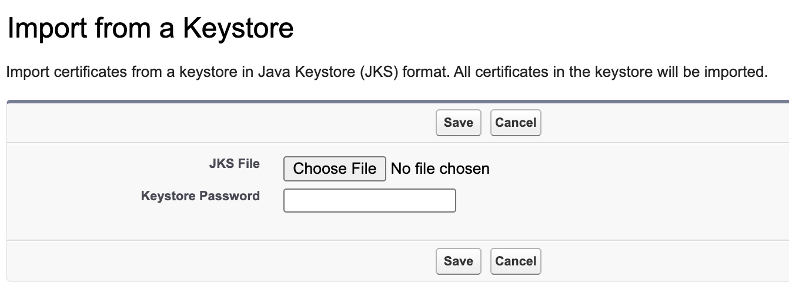
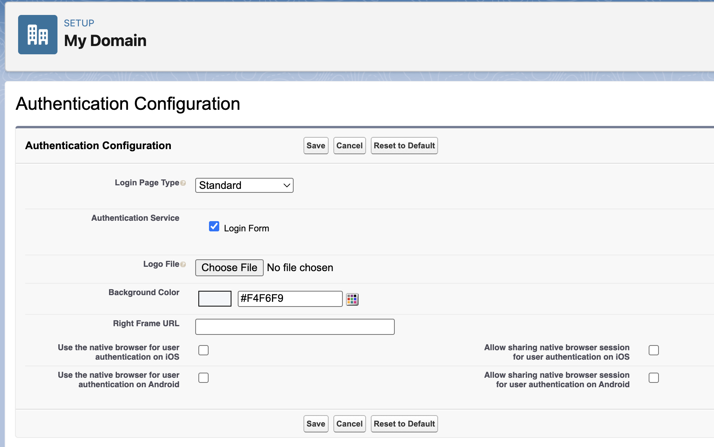

<!-- This file is generated by `npm run generate:docs` from the zod schemas in src/plugins. Do not edit it. -->

# Security Controls

Config key: `settings.security`

**Certificate and Key Management**: Setup **Security → Certificate and Key Management** (`/lightning/setup/CertificatesAndKeysManagement/home`). Imports certificates from a Java Keystore (JKS) and creates self-signed certificates.



**Authentication Configuration**: Setup **Company Settings → My Domain** (`/lightning/setup/OrgDomain/home`). Toggles the authentication services of the Authentication Configuration section.



## Examples

=== "Example 1"

    ```json
    {
      "$schema": "https://raw.githubusercontent.com/amtrack/sfdx-browserforce-plugin/main/src/plugins/schema.json",
      "settings": {
        "security": {
          "certificateAndKeyManagement": {
            "certificates": [
              {
                "name": "MySelfSignedCert",
                "label": "My Self Signed Cert",
                "keysize": 2048,
                "exportable": true
              }
            ]
          }
        }
      }
    }
    ```

=== "Example 2"

    ```json
    {
      "$schema": "https://raw.githubusercontent.com/amtrack/sfdx-browserforce-plugin/main/src/plugins/schema.json",
      "settings": {
        "security": {
          "certificateAndKeyManagement": {
            "importFromKeystore": [
              {
                "name": "MyCert",
                "filePath": "certs/keystore.jks",
                "password": "${KEYSTORE_PASSWORD}"
              }
            ]
          }
        }
      }
    }
    ```

## Fields

In the field paths, `[]` stands for the items of a list and `*` for the entries of an object keyed by name.

| Field | Type | Description | Values | Default |
| ----- | ---- | ----------- | ------ | ------- |
| `certificateAndKeyManagement.certificates[].name` | string | **Required.** |  |  |
| `certificateAndKeyManagement.certificates[].label` | string | **Required.** |  |  |
| `certificateAndKeyManagement.certificates[].exportable` | boolean |  |  |  |
| `certificateAndKeyManagement.certificates[].keysize` | integer |  |  |  |
| `certificateAndKeyManagement.importFromKeystore[].name` | string | Optional new name of the certificate. WARNING: Only use this to change the case of the certificate name as the imported name is lowercase by default.<br>**Required.** |  |  |
| `certificateAndKeyManagement.importFromKeystore[].filePath` | string | Relative path from current working directory<br>**Required.** |  |  |
| `certificateAndKeyManagement.importFromKeystore[].password` | string | **Secret:** masked in the output of `apply`. |  |  |
| `authenticationConfiguration.services[].label` | string | The visible name of the authentication service |  |  |
| `authenticationConfiguration.services[].authProviderApiName` | string | The DeveloperName of the AuthProvider (alternative to label for matching) |  |  |
| `authenticationConfiguration.services[].enabled` | boolean | True to enable, false to disable |  |  |

??? note "JSON Schema"

    ```json
    {
      "type": "object",
      "properties": {
        "certificateAndKeyManagement": {
          "type": "object",
          "properties": {
            "certificates": {
              "default": [],
              "title": "Self-Signed Certificates",
              "type": "array",
              "items": {
                "type": "object",
                "properties": {
                  "name": {
                    "type": "string"
                  },
                  "label": {
                    "type": "string"
                  },
                  "exportable": {
                    "type": "boolean"
                  },
                  "keysize": {
                    "type": "integer",
                    "minimum": -9007199254740991,
                    "maximum": 9007199254740991
                  }
                },
                "required": [
                  "name",
                  "label"
                ]
              }
            },
            "importFromKeystore": {
              "default": [],
              "title": "Import Certificate from Keystore",
              "type": "array",
              "items": {
                "type": "object",
                "properties": {
                  "name": {
                    "type": "string",
                    "description": "Optional new name of the certificate. WARNING: Only use this to change the case of the certificate name as the imported name is lowercase by default."
                  },
                  "filePath": {
                    "type": "string",
                    "description": "Relative path from current working directory"
                  },
                  "password": {
                    "type": "string",
                    "x-password": true
                  }
                },
                "required": [
                  "name",
                  "filePath"
                ]
              }
            }
          },
          "title": "Certificate and Key Management"
        },
        "authenticationConfiguration": {
          "type": "object",
          "properties": {
            "services": {
              "type": "array",
              "items": {
                "type": "object",
                "properties": {
                  "label": {
                    "type": "string",
                    "description": "The visible name of the authentication service"
                  },
                  "authProviderApiName": {
                    "type": "string",
                    "description": "The DeveloperName of the AuthProvider (alternative to label for matching)"
                  },
                  "enabled": {
                    "type": "boolean",
                    "description": "True to enable, false to disable"
                  }
                },
                "oneOf": [
                  {
                    "required": [
                      "label",
                      "enabled"
                    ]
                  },
                  {
                    "required": [
                      "authProviderApiName",
                      "enabled"
                    ]
                  },
                  {
                    "required": [
                      "label",
                      "authProviderApiName",
                      "enabled"
                    ]
                  }
                ]
              },
              "description": "List of Authentication Services to configure under My Domain, each with desired enabled state",
              "default": []
            }
          },
          "required": [
            "services"
          ],
          "title": "Authentication Configuration"
        }
      },
      "title": "Security Controls",
      "description": "**Certificate and Key Management**: Setup **Security → Certificate and Key Management** (`/lightning/setup/CertificatesAndKeysManagement/home`). Imports certificates from a Java Keystore (JKS) and creates self-signed certificates.\n\n\n\n**Authentication Configuration**: Setup **Company Settings → My Domain** (`/lightning/setup/OrgDomain/home`). Toggles the authentication services of the Authentication Configuration section.\n\n",
      "examples": [
        {
          "certificateAndKeyManagement": {
            "certificates": [
              {
                "name": "MySelfSignedCert",
                "label": "My Self Signed Cert",
                "keysize": 2048,
                "exportable": true
              }
            ]
          }
        },
        {
          "certificateAndKeyManagement": {
            "importFromKeystore": [
              {
                "name": "MyCert",
                "filePath": "certs/keystore.jks",
                "password": "${KEYSTORE_PASSWORD}"
              }
            ]
          }
        }
      ]
    }
    ```

[Source code of this setting](https://github.com/amtrack/sfdx-browserforce-plugin/tree/main/src/plugins/security)
