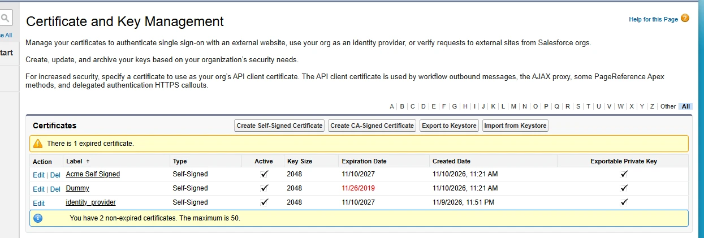
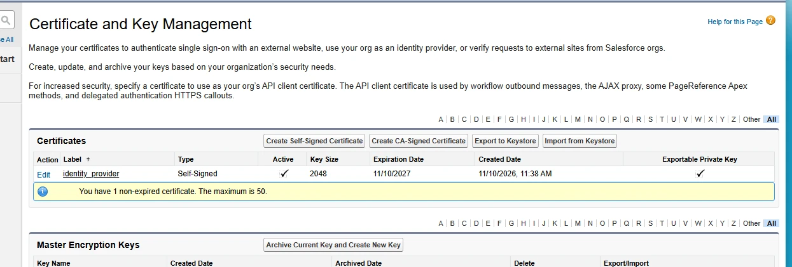
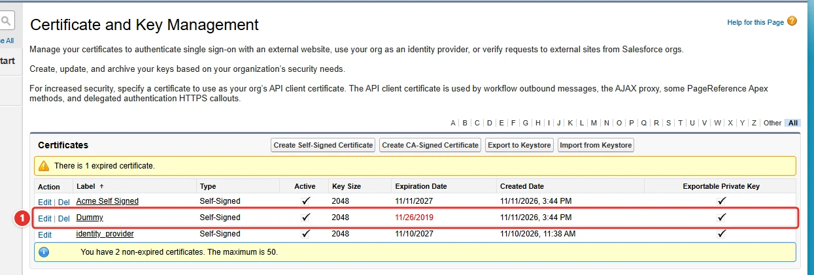
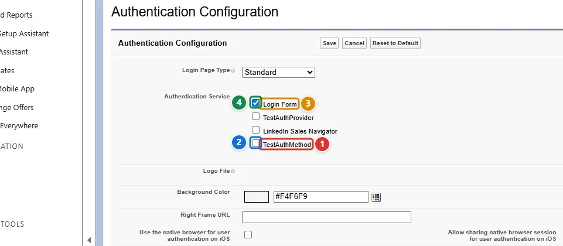
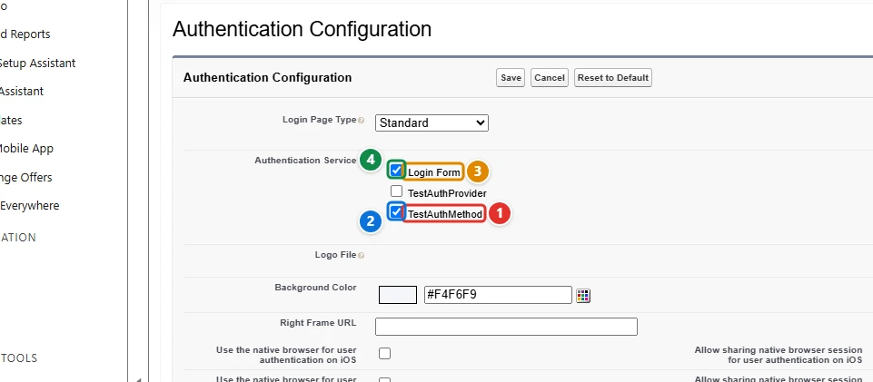

<!-- This file is generated by `npm run generate:docs` from the zod schemas in src/plugins. Do not edit it. -->

# Security Controls

Config key: `settings.security`

**Certificate and Key Management**: Setup **Security → Certificate and Key Management** (`/lightning/setup/CertificatesAndKeysManagement/home`). Imports certificates from a Java Keystore (JKS) and creates self-signed certificates.



**Authentication Configuration**: Setup **Company Settings → My Domain** (`/lightning/setup/OrgDomain/home`). Toggles the authentication services of the Authentication Configuration section.


## Use cases

### 1. Import a certificate and its private key from a keystore

Acme signs the SAML assertions of its identity provider with a certificate issued by its own certificate authority, and the same certificate and private key must exist in every org that acts as identity provider. Salesforce does not let any API import a private key: the only way in is the **Import from Keystore** button of Certificate and Key Management, which uploads a Java keystore (JKS).

This config uploads the keystore file at `filePath`, relative to the folder where `apply` runs, and the certificate appears as **Dummy <span class="bf-pill bf-pill-c1">1</span>**, the name Salesforce gives it from the keystore alias (in lowercase unless `name` changes its case). The same config can create self-signed certificates with `certificates`, although the Metadata API can do that too. The org must act as an identity provider first.

=== "Config"

    ```json
    {
      "$schema": "https://raw.githubusercontent.com/amtrack/sfdx-browserforce-plugin/main/src/plugins/schema.json",
      "settings": {
        "security": {
          "certificateAndKeyManagement": {
            "importFromKeystore": [
              {
                "name": "Dummy",
                "filePath": "./src/plugins/security/certificate-and-key-management/Dummy.jks",
                "password": ""
              }
            ],
            "certificates": [
              {
                "name": "AcmeSelfSigned",
                "label": "Acme Self Signed",
                "keysize": 2048,
                "exportable": true
              }
            ]
          }
        }
      }
    }
    ```

=== "Before"

    

=== "After"

    

| Pill | Field | Before | After |
| ---- | ----- | ------ | ----- |
| <span class="bf-pill bf-pill-c1">1</span> | <code>certificateAndKeyManagement.<wbr>importFromKeystore[0].<wbr>name</code> |  | `Dummy` |
|  | <code>certificateAndKeyManagement.<wbr>importFromKeystore[0].<wbr>filePath</code><br>the keystore file uploaded from the computer that runs Browserforce |  | `./src/plugins/security/certificate-and-key-management/Dummy.jks` |
|  | <code>certificateAndKeyManagement.<wbr>importFromKeystore[0].<wbr>password</code><br>the keystore password, empty for this test keystore; use an environment variable such as ${KEYSTORE_PASSWORD} |  | `` |
|  | <code>certificateAndKeyManagement.<wbr>certificates[0].<wbr>name</code><br>a self-signed certificate, which the Certificate type of the Metadata API can also create |  | `AcmeSelfSigned` |
|  | <code>certificateAndKeyManagement.<wbr>certificates[0].<wbr>label</code><br>a self-signed certificate, which the Certificate type of the Metadata API can also create |  | `Acme Self Signed` |
|  | <code>certificateAndKeyManagement.<wbr>certificates[0].<wbr>keysize</code><br>a self-signed certificate, which the Certificate type of the Metadata API can also create |  | `2048` |
|  | <code>certificateAndKeyManagement.<wbr>certificates[0].<wbr>exportable</code><br>a self-signed certificate, which the Certificate type of the Metadata API can also create |  | `true` |

### 2. Offer single sign-on on the login page of My Domain

Acme's employees log in to Salesforce through the company's identity provider, set up as an Auth. Provider, while a few administrators keep a password as a fallback. The buttons of the My Domain login page come from its **Authentication Configuration** section, which no Metadata API setting holds: after each deployment of the Auth. Provider, an admin had to tick it there.

This config ticks **<span class="bf-pill bf-pill-c2">2</span>** the Auth. Provider **TestAuthMethod <span class="bf-pill bf-pill-c1">1</span>**, named by its API name with `authProviderApiName`, and keeps the **Login Form <span class="bf-pill bf-pill-c3">3</span>** ticked **<span class="bf-pill bf-pill-c4">4</span>**, named by the label Setup shows with `label`. Services the config does not list stay as they are.

=== "Config"

    ```json
    {
      "$schema": "https://raw.githubusercontent.com/amtrack/sfdx-browserforce-plugin/main/src/plugins/schema.json",
      "settings": {
        "security": {
          "authenticationConfiguration": {
            "services": [
              {
                "authProviderApiName": "TestAuthMethod",
                "enabled": true
              },
              {
                "label": "Login Form",
                "enabled": true
              }
            ]
          }
        }
      }
    }
    ```

=== "Before"

    

=== "After"

    

| Pill | Field | Before | After |
| ---- | ----- | ------ | ----- |
| <span class="bf-pill bf-pill-c1">1</span> | <code>authenticationConfiguration.<wbr>services[0].<wbr>authProviderApiName</code> | `TestAuthMethod` | `TestAuthMethod` |
| <span class="bf-pill bf-pill-c2">2</span> | <code>authenticationConfiguration.<wbr>services[0].<wbr>enabled</code> | `false` | `true` |
| <span class="bf-pill bf-pill-c3">3</span> | <code>authenticationConfiguration.<wbr>services[1].<wbr>label</code> |  | `Login Form` |
| <span class="bf-pill bf-pill-c4">4</span> | <code>authenticationConfiguration.<wbr>services[1].<wbr>enabled</code> |  | `true` |

## Examples

=== "Example 1"

    ```json
    {
      "$schema": "https://raw.githubusercontent.com/amtrack/sfdx-browserforce-plugin/main/src/plugins/schema.json",
      "settings": {
        "security": {
          "certificateAndKeyManagement": {
            "certificates": [
              {
                "name": "MySelfSignedCert",
                "label": "My Self Signed Cert",
                "keysize": 2048,
                "exportable": true
              }
            ]
          }
        }
      }
    }
    ```

=== "Example 2"

    ```json
    {
      "$schema": "https://raw.githubusercontent.com/amtrack/sfdx-browserforce-plugin/main/src/plugins/schema.json",
      "settings": {
        "security": {
          "certificateAndKeyManagement": {
            "importFromKeystore": [
              {
                "name": "MyCert",
                "filePath": "certs/keystore.jks",
                "password": "${KEYSTORE_PASSWORD}"
              }
            ]
          }
        }
      }
    }
    ```

## Fields

In the field paths, `[]` stands for the items of a list and `*` for the entries of an object keyed by name.

| Field | Type | Description |
| ----- | ---- | ----------- |
| <code>certificateAndKeyManagement.<wbr>certificates[].<wbr>name</code> | string | **Required.** |
| <code>certificateAndKeyManagement.<wbr>certificates[].<wbr>label</code> | string | **Required.** |
| <code>certificateAndKeyManagement.<wbr>certificates[].<wbr>exportable</code> | boolean |  |
| <code>certificateAndKeyManagement.<wbr>certificates[].<wbr>keysize</code> | integer |  |
| <code>certificateAndKeyManagement.<wbr>importFromKeystore[].<wbr>name</code> | string | Optional new name of the certificate. WARNING: Only use this to change the case of the certificate name as the imported name is lowercase by default.<br>**Required.** |
| <code>certificateAndKeyManagement.<wbr>importFromKeystore[].<wbr>filePath</code> | string | Relative path from current working directory<br>**Required.** |
| <code>certificateAndKeyManagement.<wbr>importFromKeystore[].<wbr>password</code> | string | **Secret:** masked in the output of `apply`. |
| <code>authenticationConfiguration.<wbr>services[].<wbr>label</code> | string | The visible name of the authentication service |
| <code>authenticationConfiguration.<wbr>services[].<wbr>authProviderApiName</code> | string | The DeveloperName of the AuthProvider (alternative to label for matching) |
| <code>authenticationConfiguration.<wbr>services[].<wbr>enabled</code> | boolean | True to enable, false to disable |

??? note "JSON Schema"

    ```json
    {
      "type": "object",
      "properties": {
        "certificateAndKeyManagement": {
          "type": "object",
          "properties": {
            "certificates": {
              "default": [],
              "title": "Self-Signed Certificates",
              "type": "array",
              "items": {
                "type": "object",
                "properties": {
                  "name": {
                    "type": "string"
                  },
                  "label": {
                    "type": "string"
                  },
                  "exportable": {
                    "type": "boolean"
                  },
                  "keysize": {
                    "type": "integer",
                    "minimum": -9007199254740991,
                    "maximum": 9007199254740991
                  }
                },
                "required": [
                  "name",
                  "label"
                ]
              }
            },
            "importFromKeystore": {
              "default": [],
              "title": "Import Certificate from Keystore",
              "type": "array",
              "items": {
                "type": "object",
                "properties": {
                  "name": {
                    "type": "string",
                    "description": "Optional new name of the certificate. WARNING: Only use this to change the case of the certificate name as the imported name is lowercase by default."
                  },
                  "filePath": {
                    "type": "string",
                    "description": "Relative path from current working directory"
                  },
                  "password": {
                    "type": "string",
                    "x-password": true
                  }
                },
                "required": [
                  "name",
                  "filePath"
                ]
              }
            }
          },
          "title": "Certificate and Key Management"
        },
        "authenticationConfiguration": {
          "type": "object",
          "properties": {
            "services": {
              "type": "array",
              "items": {
                "type": "object",
                "properties": {
                  "label": {
                    "type": "string",
                    "description": "The visible name of the authentication service"
                  },
                  "authProviderApiName": {
                    "type": "string",
                    "description": "The DeveloperName of the AuthProvider (alternative to label for matching)"
                  },
                  "enabled": {
                    "type": "boolean",
                    "description": "True to enable, false to disable"
                  }
                },
                "oneOf": [
                  {
                    "required": [
                      "label",
                      "enabled"
                    ]
                  },
                  {
                    "required": [
                      "authProviderApiName",
                      "enabled"
                    ]
                  },
                  {
                    "required": [
                      "label",
                      "authProviderApiName",
                      "enabled"
                    ]
                  }
                ]
              },
              "description": "List of Authentication Services to configure under My Domain, each with desired enabled state",
              "default": []
            }
          },
          "required": [
            "services"
          ],
          "title": "Authentication Configuration"
        }
      },
      "title": "Security Controls",
      "description": "**Certificate and Key Management**: Setup **Security → Certificate and Key Management** (`/lightning/setup/CertificatesAndKeysManagement/home`). Imports certificates from a Java Keystore (JKS) and creates self-signed certificates.\n\n\n\n**Authentication Configuration**: Setup **Company Settings → My Domain** (`/lightning/setup/OrgDomain/home`). Toggles the authentication services of the Authentication Configuration section.\n\n",
      "examples": [
        {
          "certificateAndKeyManagement": {
            "certificates": [
              {
                "name": "MySelfSignedCert",
                "label": "My Self Signed Cert",
                "keysize": 2048,
                "exportable": true
              }
            ]
          }
        },
        {
          "certificateAndKeyManagement": {
            "importFromKeystore": [
              {
                "name": "MyCert",
                "filePath": "certs/keystore.jks",
                "password": "${KEYSTORE_PASSWORD}"
              }
            ]
          }
        }
      ]
    }
    ```

[Source code of this setting](https://github.com/amtrack/sfdx-browserforce-plugin/tree/main/src/plugins/security)
