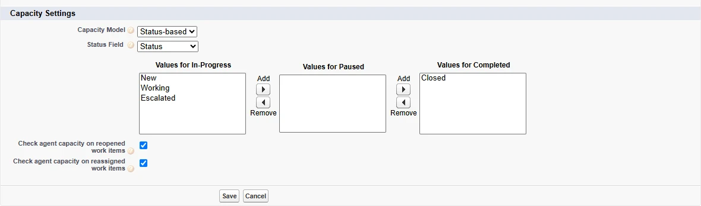
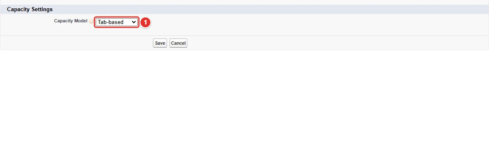
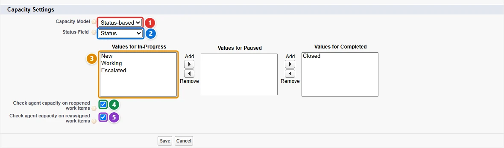

<!-- This file is generated by `npm run generate:docs` from the zod schemas in src/plugins. Do not edit it. -->

# Service Channels

Config key: `settings.serviceChannels`

!!! info "Prerequisites"
    - Omni-Channel enabled, with the status-based capacity model (omniChannelSettings)

Configures the capacity model of Service Channels (Omni-Channel): status-based capacity, the status field and its in-progress values.



## Use case

### Case capacity follows the status of the case

Litware turned on the status-based capacity model in `omniChannelSettings`. Its case channel still uses the tab-based **capacity model <span class="bf-pill bf-pill-c1">1</span>**, so the change has no effect yet: each case channel must say which field tells the status of the work and which of its values mean "in progress".

This config switches the channel to status-based capacity on the **Status field <span class="bf-pill bf-pill-c2">2</span>** of the case, counts `New`, `Working` and `Escalated` cases as **in progress <span class="bf-pill bf-pill-c3">3</span>**, and checks the agent's capacity again when a closed case is **reopened <span class="bf-pill bf-pill-c4">4</span>** or a case is **reassigned <span class="bf-pill bf-pill-c5">5</span>**. The `ServiceChannel` metadata of the API versions most projects deploy with has no capacity fields, so the deployment of the channel is followed by this config.

=== "Config"

    ```json
    {
      "$schema": "https://raw.githubusercontent.com/amtrack/sfdx-browserforce-plugin/main/src/plugins/schema.json",
      "settings": {
        "serviceChannels": [
          {
            "serviceChannelDeveloperName": "CaseTest",
            "capacity": {
              "capacityModel": "StatusBased",
              "statusField": "Case.Status",
              "valuesForInProgress": [
                "New",
                "Working",
                "Escalated"
              ],
              "checkAgentCapacityOnReopenedWorkItems": true,
              "checkAgentCapacityOnReassignedWorkItems": true
            }
          }
        ]
      }
    }
    ```

=== "Before"

    

=== "After"

    

| Pill | Field | Before | After |
| ---- | ----- | ------ | ----- |
| <span class="bf-pill bf-pill-c1">1</span> | <code>[0].<wbr>capacity.<wbr>capacityModel</code> | `TabBased` | `StatusBased` |
| <span class="bf-pill bf-pill-c2">2</span> | <code>[0].<wbr>capacity.<wbr>statusField</code> |  | `Case.Status` |
| <span class="bf-pill bf-pill-c3">3</span> | <code>[0].<wbr>capacity.<wbr>valuesForInProgress</code> |  | `["New","Working","Escalated"]` |
| <span class="bf-pill bf-pill-c4">4</span> | <code>[0].<wbr>capacity.<wbr>checkAgentCapacityOnReopenedWorkItems</code> |  | `true` |
| <span class="bf-pill bf-pill-c5">5</span> | <code>[0].<wbr>capacity.<wbr>checkAgentCapacityOnReassignedWorkItems</code> |  | `true` |
|  | <code>[0].<wbr>serviceChannelDeveloperName</code><br>the service channel whose edit page is opened | `CaseTest` | `CaseTest` |

## Example

```json
{
  "$schema": "https://raw.githubusercontent.com/amtrack/sfdx-browserforce-plugin/main/src/plugins/schema.json",
  "settings": {
    "serviceChannels": [
      {
        "serviceChannelDeveloperName": "Case",
        "capacity": {
          "capacityModel": "StatusBased",
          "statusField": "Case.Status",
          "valuesForInProgress": [
            "Working"
          ]
        }
      }
    ]
  }
}
```

## Fields

In the field paths, `[]` stands for the items of a list and `*` for the entries of an object keyed by name.

| Field | Type | Description | Values |
| ----- | ---- | ----------- | ------ |
| <code>[].<wbr>serviceChannelDeveloperName</code> | string | Service Channel<br>The developer name of the Service Channel to modify<br>**Required.** |  |
| <code>[].<wbr>capacity.<wbr>capacityModel</code> | string | Capacity Model<br>Choose the service channel Capacity Model | `TabBased`<br>`StatusBased` |
| <code>[].<wbr>capacity.<wbr>statusField</code> | string | Status Field<br>API Name of the field used to track status |  |
| <code>[].<wbr>capacity.<wbr>valuesForInProgress</code> | string[] | Values for In-Progress<br>Choose the field values for In-Progress work |  |
| <code>[].<wbr>capacity.<wbr>checkAgentCapacityOnReopenedWorkItems</code> | boolean | Check agent capacity on reopened work items |  |
| <code>[].<wbr>capacity.<wbr>checkAgentCapacityOnReassignedWorkItems</code> | boolean | Check agent capacity on reassigned work items |  |

??? note "JSON Schema"

    ```json
    {
      "default": [],
      "title": "Service Channels",
      "description": "Configures the capacity model of Service Channels (Omni-Channel): status-based capacity, the status field and its in-progress values.\n\n",
      "examples": [
        [
          {
            "serviceChannelDeveloperName": "Case",
            "capacity": {
              "capacityModel": "StatusBased",
              "statusField": "Case.Status",
              "valuesForInProgress": [
                "Working"
              ]
            }
          }
        ]
      ],
      "x-prerequisites": [
        "Omni-Channel enabled, with the status-based capacity model (omniChannelSettings)"
      ],
      "type": "array",
      "items": {
        "type": "object",
        "properties": {
          "serviceChannelDeveloperName": {
            "type": "string",
            "title": "Service Channel",
            "description": "The developer name of the Service Channel to modify"
          },
          "capacity": {
            "type": "object",
            "properties": {
              "capacityModel": {
                "type": "string",
                "enum": [
                  "TabBased",
                  "StatusBased"
                ],
                "title": "Capacity Model",
                "description": "Choose the service channel Capacity Model"
              },
              "statusField": {
                "type": "string",
                "title": "Status Field",
                "description": "API Name of the field used to track status"
              },
              "valuesForInProgress": {
                "type": "array",
                "items": {
                  "type": "string"
                },
                "title": "Values for In-Progress",
                "description": "Choose the field values for In-Progress work"
              },
              "checkAgentCapacityOnReopenedWorkItems": {
                "type": "boolean",
                "title": "Check agent capacity on reopened work items",
                "description": "Check agent capacity on reopened work items"
              },
              "checkAgentCapacityOnReassignedWorkItems": {
                "type": "boolean",
                "title": "Check agent capacity on reassigned work items",
                "description": "Check agent capacity on reassigned work items"
              }
            },
            "title": "Capacity Settings",
            "if": {
              "required": [
                "capacityModel"
              ],
              "properties": {
                "capacityModel": {
                  "const": "StatusBased"
                }
              }
            },
            "then": {
              "required": [
                "statusField",
                "valuesForInProgress"
              ]
            },
            "else": {
              "if": {
                "required": [
                  "capacityModel"
                ],
                "properties": {
                  "capacityModel": {
                    "const": "TabBased"
                  }
                }
              },
              "then": {
                "not": {
                  "anyOf": [
                    {
                      "required": [
                        "statusField"
                      ]
                    },
                    {
                      "required": [
                        "valuesForInProgress"
                      ]
                    }
                  ]
                }
              }
            }
          }
        },
        "required": [
          "serviceChannelDeveloperName"
        ]
      }
    }
    ```

[Source code of this setting](https://github.com/amtrack/sfdx-browserforce-plugin/tree/main/src/plugins/service-channels)
