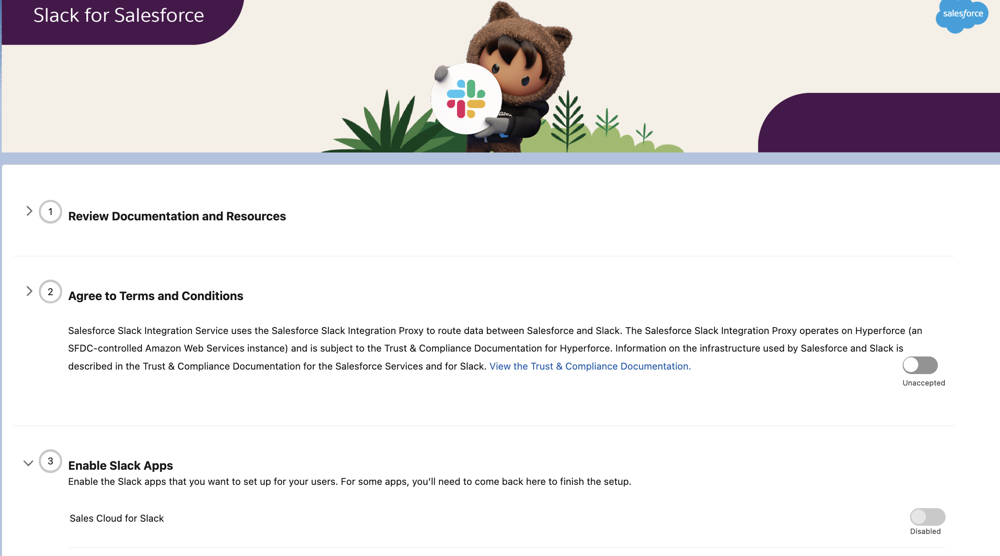
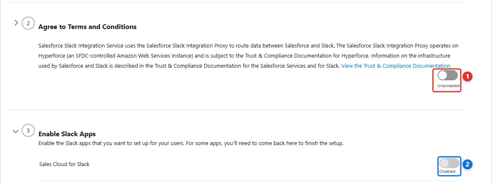
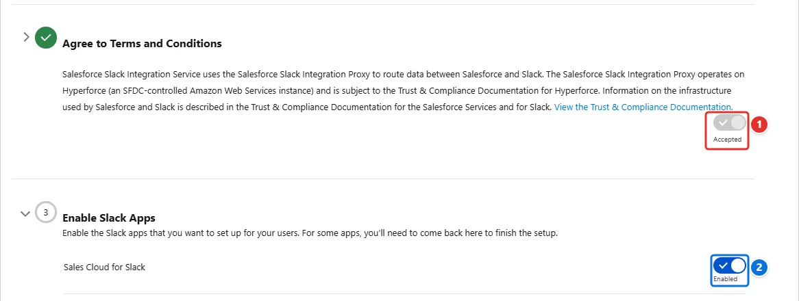

<!-- This file is generated by `npm run generate:docs` from the zod schemas in src/plugins. Do not edit it. -->

# Slack Apps Setup

Config key: `settings.slack`

!!! danger "Irreversible"
    Once applied, `agreeToTermsAndConditions` cannot be changed back.

Setup: **Slack → Slack Apps Setup** (`/lightning/setup/SlackSetupAssistant/home`)

Agrees to the terms and conditions and enables the Sales Cloud for Slack app.



## Use case

### The sales team works its deals from Slack

The account executives of Trey Research spend their day in Slack, and update their opportunities in Salesforce at the end of the week, if at all. Sales operations wants them to look up and update records, and get deal alerts, without leaving Slack, with the Sales Cloud for Slack app.

Before any Slack app can connect to the org, an admin must **accept the terms and conditions <span class="bf-pill bf-pill-c1">1</span>** of the Slack integration, then turn on **Sales Cloud for Slack <span class="bf-pill bf-pill-c2">2</span>**. No Metadata API type holds either toggle, and the terms can never be declined again once accepted: this config does both in each new org, so the Slack workspace of the sandbox can be connected right after it is created.

=== "Config"

    ```json
    {
      "$schema": "https://raw.githubusercontent.com/amtrack/sfdx-browserforce-plugin/main/src/plugins/schema.json",
      "settings": {
        "slack": {
          "agreeToTermsAndConditions": true,
          "enableSalesCloudForSlack": true
        }
      }
    }
    ```

=== "Before"

    

=== "After"

    

| Pill | Field | Before | After |
| ---- | ----- | ------ | ----- |
| <span class="bf-pill bf-pill-c1">1</span> | <code>agreeToTermsAndConditions</code> |  | `true` |
| <span class="bf-pill bf-pill-c2">2</span> | <code>enableSalesCloudForSlack</code> | `false` | `true` |

## Example

```json
{
  "$schema": "https://raw.githubusercontent.com/amtrack/sfdx-browserforce-plugin/main/src/plugins/schema.json",
  "settings": {
    "slack": {
      "agreeToTermsAndConditions": true,
      "enableSalesCloudForSlack": true
    }
  }
}
```

## Fields

| Field | Type | Description |
| ----- | ---- | ----------- |
| <code>agreeToTermsAndConditions</code> | boolean | Agree to Termns and Conditions<br>Once the terms have been accepted, this cannot be reverted.<br>**Irreversible:** cannot be changed back once applied. |
| <code>enableSalesCloudForSlack</code> | boolean | Enable the 'Sales Cloud for Slack' Slack App |

??? note "JSON Schema"

    ```json
    {
      "type": "object",
      "properties": {
        "agreeToTermsAndConditions": {
          "type": "boolean",
          "title": "Agree to Termns and Conditions",
          "x-irreversible": true,
          "description": "Once the terms have been accepted, this cannot be reverted."
        },
        "enableSalesCloudForSlack": {
          "type": "boolean",
          "title": "Enable the 'Sales Cloud for Slack' Slack App"
        }
      },
      "title": "Slack Apps Setup",
      "description": "Setup: **Slack → Slack Apps Setup** (`/lightning/setup/SlackSetupAssistant/home`)\n\nAgrees to the terms and conditions and enables the Sales Cloud for Slack app.\n\n",
      "examples": [
        {
          "agreeToTermsAndConditions": true,
          "enableSalesCloudForSlack": true
        }
      ]
    }
    ```

[Source code of this setting](https://github.com/amtrack/sfdx-browserforce-plugin/tree/main/src/plugins/slack)
