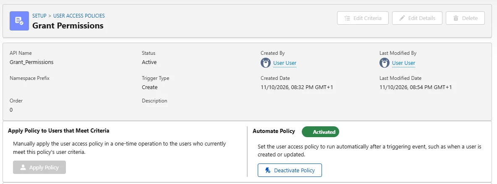
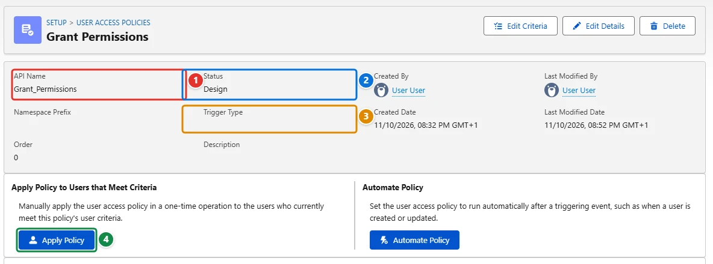
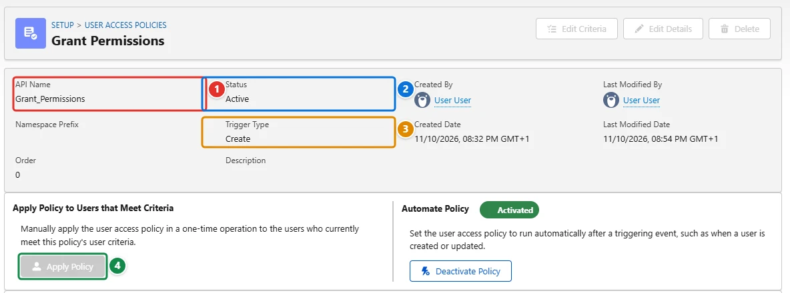

<!-- This file is generated by `npm run generate:docs` from the zod schemas in src/plugins. Do not edit it. -->

# User Access Policies

Config key: `settings.userAccessPolicies`

!!! danger "Irreversible"
    Once applied, `accessPolicies[].applyToAll` cannot be changed back.

!!! info "Prerequisites"
    - User Access Policies enabled (User Management Settings)

Setup: **Users → User Access Policies** (`/lightning/setup/UserAccessPolicies/home`)

Activates or deactivates User Access Policies, chooses when they run (on create, update, or both), and runs Apply To All.



## Use case

### New administrators get their permission sets automatically

Every time Fourth Coffee hires a Salesforce administrator, someone forgets one of the permission sets they need. The team describes the rule in a user access policy, `Grant_Permissions` **<span class="bf-pill bf-pill-c1">1</span>**: users with the System Administrator profile get the admin permission sets. The policy is deployed with the rest of the metadata, but the Metadata API cannot switch it on: a policy deployed with the status `Active` is saved as `Design`, and no metadata runs it for the existing users.

This config automates the policy **<span class="bf-pill bf-pill-c2">2</span>** so that it runs whenever a matching user is **created <span class="bf-pill bf-pill-c3">3</span>**, and runs **Apply Policy <span class="bf-pill bf-pill-c4">4</span>** once ("Apply To All") for the administrators who already exist. Apply To All cannot be undone and runs again at every apply, so keep it out of the config once the existing users have their access.

=== "Config"

    ```json
    {
      "$schema": "https://raw.githubusercontent.com/amtrack/sfdx-browserforce-plugin/main/src/plugins/schema.json",
      "settings": {
        "userAccessPolicies": {
          "accessPolicies": [
            {
              "apiName": "Grant_Permissions",
              "active": true,
              "on": "Create",
              "applyToAll": true
            }
          ]
        }
      }
    }
    ```

=== "Before"

    

=== "After"

    

| Pill | Field | Before | After |
| ---- | ----- | ------ | ----- |
| <span class="bf-pill bf-pill-c1">1</span> | <code>accessPolicies[0].<wbr>apiName</code> | `Grant_Permissions` | `Grant_Permissions` |
| <span class="bf-pill bf-pill-c2">2</span> | <code>accessPolicies[0].<wbr>active</code> | `false` | `true` |
| <span class="bf-pill bf-pill-c3">3</span> | <code>accessPolicies[0].<wbr>on</code> |  | `Create` |
| <span class="bf-pill bf-pill-c4">4</span> | <code>accessPolicies[0].<wbr>applyToAll</code> |  | `true` |

## Examples

=== "Example 1"

    ```json
    {
      "$schema": "https://raw.githubusercontent.com/amtrack/sfdx-browserforce-plugin/main/src/plugins/schema.json",
      "settings": {
        "userAccessPolicies": {
          "accessPolicies": [
            {
              "apiName": "Grant_Permissions",
              "active": true,
              "on": "Create"
            }
          ]
        }
      }
    }
    ```

=== "Example 2"

    ```json
    {
      "$schema": "https://raw.githubusercontent.com/amtrack/sfdx-browserforce-plugin/main/src/plugins/schema.json",
      "settings": {
        "userAccessPolicies": {
          "accessPolicies": [
            {
              "apiName": "Grant_Permissions",
              "active": true,
              "on": "Create",
              "applyToAll": true
            }
          ]
        }
      }
    }
    ```

=== "Example 3"

    ```json
    {
      "$schema": "https://raw.githubusercontent.com/amtrack/sfdx-browserforce-plugin/main/src/plugins/schema.json",
      "settings": {
        "userAccessPolicies": {
          "accessPolicies": [
            {
              "apiName": "Grant_Permissions",
              "applyToAll": true
            }
          ]
        }
      }
    }
    ```

## Fields

In the field paths, `[]` stands for the items of a list and `*` for the entries of an object keyed by name.

| Field | Type | Description | Values |
| ----- | ---- | ----------- | ------ |
| <code>accessPolicies[].<wbr>apiName</code> | string | The API name of the user access policy (e.g., 'Grant_Permissions')<br>**Required.** |  |
| <code>accessPolicies[].<wbr>active</code> | boolean | Whether the policy should be active (true) or inactive (false). Leave it out to keep the current status of the policy. |  |
| <code>accessPolicies[].<wbr>on</code> | string | Optional: specify when to apply the policy - 'Create', 'Update', or 'CreateAndUpdate'. Only used when active is true. | `Create`<br>`Update`<br>`CreateAndUpdate` |
| <code>accessPolicies[].<wbr>applyToAll</code> | boolean | Apply To All<br>Run Apply To All once the policy is set: assigns its access to every user matching its criteria. Runs Apply To All at each apply: Salesforce keeps no state that tells it already ran. A run cannot be undone.<br>**Irreversible:** cannot be changed back once applied. |  |

??? note "JSON Schema"

    ```json
    {
      "type": "object",
      "properties": {
        "accessPolicies": {
          "default": [],
          "title": "Access Policies",
          "description": "List of user access policies to activate, deactivate or apply to all users",
          "type": "array",
          "items": {
            "type": "object",
            "properties": {
              "apiName": {
                "type": "string",
                "description": "The API name of the user access policy (e.g., 'Grant_Permissions')"
              },
              "active": {
                "type": "boolean",
                "description": "Whether the policy should be active (true) or inactive (false). Leave it out to keep the current status of the policy."
              },
              "on": {
                "type": "string",
                "enum": [
                  "Create",
                  "Update",
                  "CreateAndUpdate"
                ],
                "description": "Optional: specify when to apply the policy - 'Create', 'Update', or 'CreateAndUpdate'. Only used when active is true."
              },
              "applyToAll": {
                "type": "boolean",
                "title": "Apply To All",
                "x-irreversible": true,
                "description": "Run Apply To All once the policy is set: assigns its access to every user matching its criteria. Runs Apply To All at each apply: Salesforce keeps no state that tells it already ran. A run cannot be undone."
              }
            },
            "required": [
              "apiName"
            ]
          }
        }
      },
      "title": "User Access Policies",
      "description": "Setup: **Users → User Access Policies** (`/lightning/setup/UserAccessPolicies/home`)\n\nActivates or deactivates User Access Policies, chooses when they run (on create, update, or both), and runs Apply To All.\n\n",
      "examples": [
        {
          "accessPolicies": [
            {
              "apiName": "Grant_Permissions",
              "active": true,
              "on": "Create"
            }
          ]
        },
        {
          "accessPolicies": [
            {
              "apiName": "Grant_Permissions",
              "active": true,
              "on": "Create",
              "applyToAll": true
            }
          ]
        },
        {
          "accessPolicies": [
            {
              "apiName": "Grant_Permissions",
              "applyToAll": true
            }
          ]
        }
      ],
      "x-prerequisites": [
        "User Access Policies enabled (User Management Settings)"
      ]
    }
    ```

[Source code of this setting](https://github.com/amtrack/sfdx-browserforce-plugin/tree/main/src/plugins/user-access-policies)
